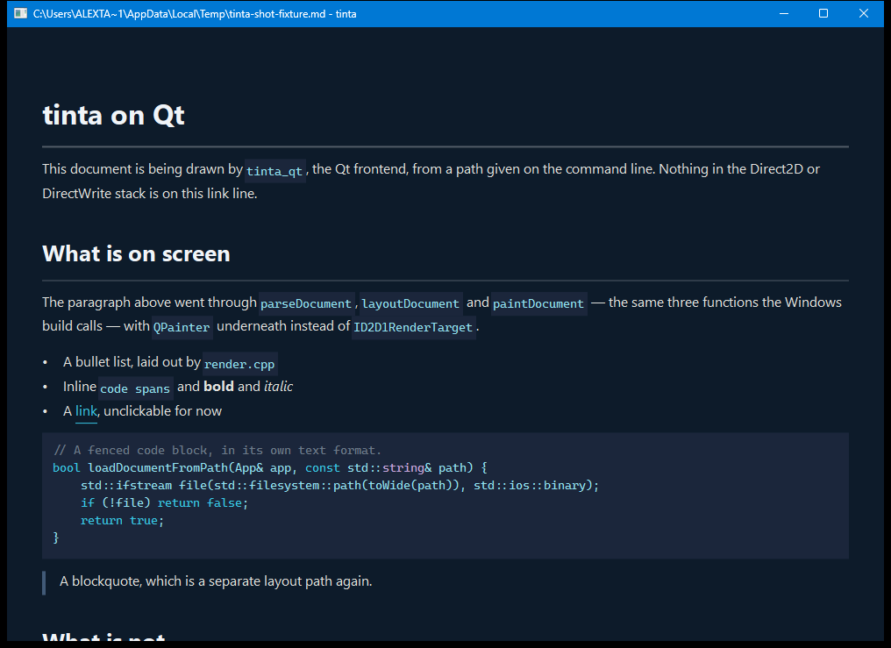
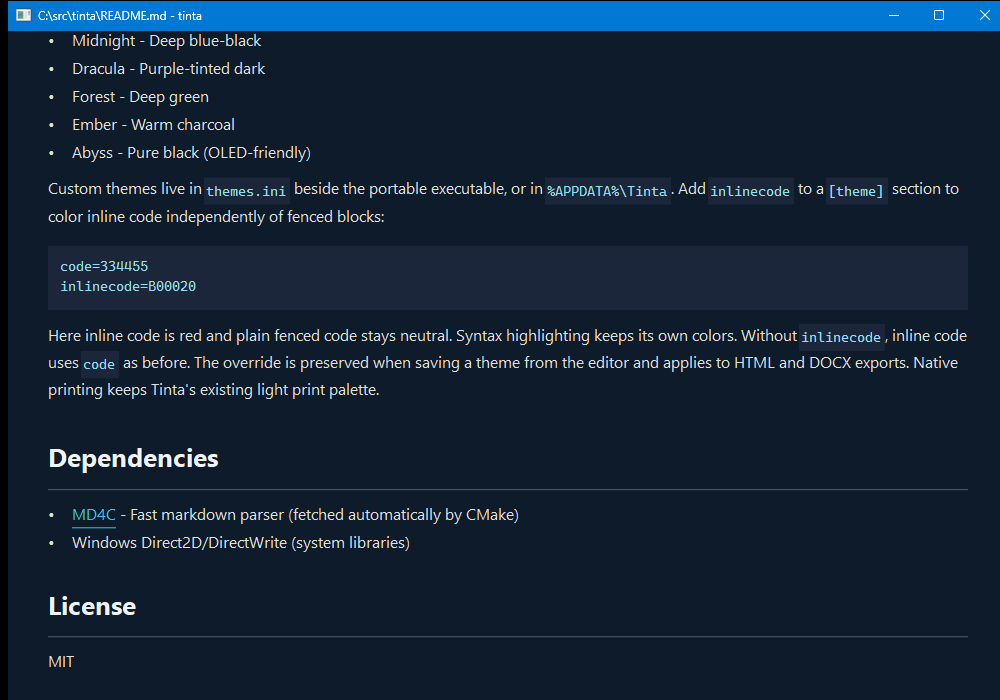

<div align="center">
  
  <h1>Qinta</h1>
  <p><em>Markdown, distilled — on every desktop.</em></p>
  <p>A multiplatform fork of <a href="https://github.com/oipoistar/tinta">Tinta</a>, moving the whole stack to Qt 6</p>

  
  <a href="LICENSE">
    
  </a>
</div>

<br>

**Qinta is a fork of [Tinta](https://github.com/oipoistar/tinta) that aims to run on Windows,
macOS and Linux from one codebase and one stack.**

Tinta is a fast, lightweight Markdown and Mermaid viewer for Windows — a single native
executable of about 2.3 MB that opens instantly, with no Electron, no web engine and no
installer. It gets that speed from the GPU-accelerated text stack built into Windows: Direct2D
for drawing, DirectWrite for text, Win32 for windowing. Which is also exactly why it runs only
on Windows.

Qinta keeps the viewer and replaces the stack underneath it. The rule the fork is built around
is that there is **one stack on all three platforms, and it is Qt 6** — not Direct2D on Windows
with something else elsewhere, because two stacks means every feature gets designed twice and
diverges quietly. [Cross-platform port](#cross-platform-port-windows--macos--linux) has the
goal, why Qt was chosen over Skia, how the port is structured, and a status table that counts
rather than estimates.

<p align="center">
  
  
</p>

<sub>Those two screenshots are upstream Tinta's, on Windows, via the Direct2D stack. Qinta's own
witnessed screenshots are further down and look plainer, because the Qt frontend is not finished.</sub>

### Two executables, and they are not equivalent

This one CMake project builds both. Which one you want depends on whether you want to *use* the
app or *work on the port*:

| Target | Stack | Platforms | State |
|---|---|---|---|
| `tinta` | Direct2D / DirectWrite / Win32 | Windows only | **The complete product.** Everything under [Features](#features) works. Transitional: scheduled for deletion once `qinta` reaches parity. |
| `qinta` | Qt 6 | Windows, macOS, Linux | Renders and scrolls a document. No input handling, no editor, no search yet. |

So `tinta` is what you run to read a file today, and `qinta` is where the code is going. Nothing
gets deleted before `qinta` can do the job: removing the Direct2D backend has already been
measured, and what gates it is feature parity rather than any entanglement — see
[The deprecated-backend flag](#the-deprecated-backend-flag).

## Install

**Qinta itself has no releases, no packages and no installer.** It is a work-in-progress fork
and the only way to get it is [Building](#building) it from source. Every install route in this
section installs **upstream Tinta** — the Windows Direct2D build — and is kept here because it
is still the way to get a working viewer today.

The recommended way is the [Microsoft Store](https://apps.microsoft.com/detail/9MZ5MZ3L9RKF): the build is signed by the Store, trusted by Windows out of the box (no security prompts, works with Smart App Control), and updates automatically. The same signed build installs from the command line:

```pwsh
winget install "Tinta Markdown Viewer" -s msstore
```

### Portable and other options

Prefer a single file? Grab [the latest release](https://github.com/oipoistar/tinta/releases/latest): a portable `tinta.exe`, no installation required. Because a freshly released exe is not yet code-signed, Windows may show a SmartScreen prompt on first run ("More info", then "Run anyway") until the new version builds up download reputation.

[Scoop](https://scoop.sh) users can install from the bucket:

```pwsh
scoop bucket add tinta https://github.com/oipoistar/scoop-bucket
scoop install tinta
```

## Why Tinta — and why fork it?

Most markdown apps ship an entire browser to render text. Tinta uses the GPU-accelerated text stack already built into Windows:

|  | Tinta | Typora | Obsidian | VS Code |
|---|---|---|---|---|
| Startup | **<100 ms** | ~1.5 s | ~3 s | ~2 s |
| Install size | **~2.3 MB** | ~90 MB | ~250 MB | ~350 MB |
| Runtime | **Native Direct2D** | Electron | Electron | Electron |

It's a viewer first: perfect as the double-click default for `.md` and `.mmd` files, for reading documentation and diagrams — with an edit mode when you need it.

Those figures are upstream Tinta's, measured by upstream, on Windows. **Qinta has not been
benchmarked against anything** — no startup time, no binary size claim beyond what the build
happens to produce. Publishing a comparison row for a frontend that cannot yet handle a keypress
would be inventing a number, so the table is left as Tinta's and marked as such.

The fork exists because that Windows-only stack is the whole reason for the speed *and* the whole
reason there is no macOS or Linux build. Reaching those platforms means either maintaining a
second stack — which is two of every feature, diverging quietly — or moving to one portable stack
everywhere. Qinta takes the second option. The cost is giving up the OS-native text stack; the
reasoning, and why Qt 6 rather than Skia, is in
[Stack choice: Qt 6](#stack-choice-qt-6).

## Features

- **Lightning-fast startup** - Direct2D rendering, no web engine overhead
- **10 beautiful themes** - 5 light and 5 dark themes to choose from
- **Hardware-accelerated** - Smooth text rendering via DirectWrite
- **Word wrap** - Optional soft wrap in the editor (Ctrl+W)
- **Native LaTeX math** - `$inline$` and `$$display$$` equations with matrices, cases, aligned equations, fractions, limits, accents and custom macros. Uses an installed math font; no bundled fonts or web engine. See the [supported math syntax](docs/math-support.md).
- **Focused editing** - Hide the preview pane while writing (Ctrl+E)
- **Native Mermaid diagrams** - 22 diagram families, from flowcharts with subgraphs through sequence, class, state, ER, gantt, and pie to C4, sankey, kanban, and radar - rendered without a web engine
- **Export as HTML, DOCX, or PDF** - Right-click and pick "Export as..." for a self-contained web page, a Word document that opens natively, or a vector PDF; diagrams and math come along in every format
- **Pandoc export** - With [pandoc](https://pandoc.org) installed (or pointed at in settings), the editor offers EPUB, OpenDocument, PowerPoint, RTF and LaTeX too; rich formats convert from Tinta's own HTML export so diagrams and math survive as vector graphics
- **Start page** - Bare launches land on a launcher with recent files, quick actions labeled with your actual key bindings, and built-in guides; closing the last tab returns there, and Ctrl+T opens it as a new tab
- **Review annotations** - Select text and press `A` to attach a note, stored as an invisible HTML comment in the file itself. Annotated passages get a tint and a marker rail beside the scrollbar; hover previews, click edits, and a copy-for-agent button turns the whole review into a paste-ready task list for any coding agent - as the agent fixes items and deletes the comments, the marks vanish live
- **File references** - Plain-text paths like `docs/plan.md` become real links: live targets open as tabs, missing ones render as faded ghosts. Mouse back/forward (or Alt+arrows) walks your jumps with exact scroll restore
- **Link peek** - Rest the pointer on a local `.md` or wiki link and the target appears fully rendered in a panel beside it, no tab opened
- **Image lightbox** - Click any inline image to view it full size: wheel zooms, drag pans, Esc closes
- **Copy tables as TSV** - Hover a table for a copy button that pastes into Excel or Sheets as a real grid
- **Copy diagrams as images** - Hover a diagram for an Image button that puts a crisp 2x PNG on the clipboard
- **Paste screenshots** - Ctrl+V a bitmap in edit mode and it saves as a PNG beside the document with the link inserted
- **Pin on top** - A pushpin in the title bar keeps the window above every other app
- **Rich tables** - Tables with bold, italic, code, and clickable links in cells
- **Tabs** - Win11 Notepad-style tabs in the title bar: files opened from Explorer join the window as tabs, Ctrl+Tab cycles, Ctrl+W or Ctrl+F4 closes (Ctrl+F4 also while editing, where Ctrl+W is word wrap), middle-click closes, Ctrl+T opens the file browser into a new tab, unsaved buffers show a dot, and dragging reorders tabs. Right-click a tab for close operations (close, close all but this, close all to the left/right) plus copy path and reveal in Explorer. Pulling a tab out of the strip floats it as a card: drop it on open space for a new window (which keeps the tab row), or onto another Tinta window to move it there — and dropping a single-file window onto a tab strip merges it back. Single-file windows stay tabless; turn the Explorer behavior off with the "Open files in tabs" setting
- **Folder browser** - Press B to browse and open Markdown or Mermaid files (Ctrl+click a file to open it in a new tab)
- **Table of contents** - Press Tab to see document headings, click to jump; the panel follows your reading position, and typing filters the headings
- **Unified editor** - Press `:` to edit: your raw Markdown on the left with the rendered page floating beside it as a sheet on the editor's desk. A slim line-number gutter, a soft accent wash on the caret's line and its rendered block, a tool rail with formatting controls plus table-size and diagram-template pickers, and Markdown assists (lists continue on Enter, Tab indents, Ctrl+B/I wrap). Search and find-replace work in the editor too
- **Emoji shortcodes** - `:rocket:` and friends render as real emoji
- **Fit to width** - Wide tables and diagrams grow a Fit button that shrinks them to the reading column
- **Draft recovery** - Unsaved quick notes are stashed continuously and offered back on the next launch
- **Create on click** - Clicking a missing file reference offers to create the file and opens it ready to type
- **Text-file references** - `.txt`, `.json`, `.yaml` and friends link like Markdown files and open as highlighted documents
- **Update check** - Portable builds check GitHub once a day and offer a new release as a quiet, dismissible chip
- **Search** - Find text with F or Ctrl+F, cycle through matches with Enter; every match shows as a tick on the scrollbar
- **Persistent settings** - Remembers your theme, zoom level, and window position
- **Portable mode** - Create a `settings.ini` next to `tinta.exe` (an empty file works) and the whole configuration — settings, custom themes, languages, drafts — lives beside the executable and travels with it; without one, everything stays in `%APPDATA%\Tinta`
- **Localized interface** - English, Simplified Chinese, Japanese, Korean, German, French, and Italian UI; follows Windows or a chosen language
- **Text selection & copy** - Select text and copy to clipboard
- **Zoom support** - Ctrl+scroll to zoom in/out
- **Drag & drop** - Drop any Markdown or Mermaid file to view it
- **Minimal footprint** - Small binary, minimal dependencies

## Keyboard Shortcuts

| Key | Action |
|-----|--------|
| `B` | Toggle folder browser |
| `Tab` | Toggle table of contents (type to filter, Enter jumps) |
| `A` | Annotate the selected text |
| `F` / `Ctrl+F` | Open search |
| `Enter` | Next search match |
| `ESC` | Close overlay / Quit |
| `T` | Open theme chooser |
| `S` | Toggle stats overlay |
| `Ctrl+C` | Copy selected text (or all if none selected) |
| `Ctrl+A` | Select all text |
| `Ctrl+Scroll` | Zoom in/out |
| `Arrow keys` / `J/K` | Scroll |
| `Mouse back/forward` / `Alt+←/→` | Walk link jumps with scroll restore |
| `Page Up/Down` | Page scroll |
| `Home/End` | Jump to start/end |
| `:` | Enter edit mode |
| `ESC` `ESC` | Exit edit mode |
| `Ctrl+N` | New quick note — a fresh window, start typing right away; `Ctrl+S` names it via the save dialog. While the note is still empty, an **Open a file** button (`Ctrl+O`) in the preview pane picks an existing file instead |
| `Ctrl+S` | Save (in edit mode) |
| `Ctrl+Shift+S` | Save As: the editor writes the buffer to a new path, the viewer saves a copy, and the document continues under the new name |
| `Ctrl+H` | Find and replace (in edit mode): Tab switches fields, Enter replaces, Ctrl+Enter replaces all |
| `Ctrl+P` | Print / export to PDF |
| `Ctrl+E` | Show/hide preview pane (in edit mode) |
| `Ctrl+W` | Toggle word wrap (in edit mode) |
| `Ctrl+F4` | Close the current tab (viewer and edit mode) |
| `Q` | Quit |

## Customization

**Shortcut profiles** (Settings → Keyboard shortcuts): pick **Windows**
(`E` edits, `F1` opens help, `F` searches — the default), **Vim** (`/`
searches, `:` edits, `?` helps), or **Custom**. The Edit button opens a
shortcut editor: click an action, press its new key. Raw `:` and `?`
always work regardless of profile.

Settings live in a plain INI file at `%APPDATA%\Tinta\settings.ini` (theme,
zoom, window placement, word wrap, and more — written on exit). The `[Keys]`
section holds the Custom profile's bindings if you prefer editing by hand:
change a value and restart Tinta. Accepted values are letters, digits,
`Tab`, `Space`, `F1`–`F12`, or any single character.

```ini
[Keys]
search=F
browse=B
toc=Tab
theme=T
stats=S
quit=Q
newfile=N
zen=F11
scrollup=K
scrolldown=J
edit=:
help=?
```

Ctrl combos (save, print, copy, word wrap…) are fixed. The help overlay and
context menu show whatever keys are currently bound.

Other settings of note: `browserFocusPath=1` makes `B` open the file browser
with the path box focused and selected, so paste + Enter jumps anywhere
(also in Settings → General). `tinta --new` starts an untitled quick note
from the command line.

The interface language is available in Settings → General. It follows the
Windows display language by default, or can be changed explicitly. Transient
notifications and native error dialogs use the same language. Additional
translations can be added through `languages.ini`; the app remains a native,
single-file Windows viewer with no web runtime.

## Building

All three platforms build from the same CMake project, and they are not equally proven. The
state per platform, before any commands:

| Platform | Target | State |
|----------|--------|-------|
| Windows | `tinta` — Direct2D + DirectWrite | Works today, and is the backend being replaced. |
| Windows | `qinta` — Qt 6 | Configures, builds, launches and stays running. Measured 2026-09-16. |
| Linux | `qinta` — Qt 6 | Configures, builds, every ctest entry passes, launches windowed and headless. Measured 2026-09-16 on Ubuntu 24.04.2 under WSL. |
| macOS | `qinta` — Qt 6 | Configures, builds, launches (plain binary, offscreen and windowed). Every ctest entry passes. Measured 2026-09-19 on macOS 26.6.2 (Darwin 25.6.0), arm64. |

There is **no CI** in this repo, so a date in that table means somebody ran it that day and
nothing re-runs it for you. Where a command below is unverified it says so on the spot, rather
than sitting in the same voice as one that was measured.

The Direct2D and DirectWrite build is the one that works today, and also the one being
replaced — see [the deprecated-backend flag](#the-deprecated-backend-flag) for what that means
and how to measure what still depends on it.

### Windows

Visual Studio 2019+ and CMake 3.15+. `cmake` is not necessarily on `PATH` in an ordinary shell:
on a Visual Studio install it lives under
`Common7/IDE/CommonExtensions/Microsoft/CMake/CMake/bin`, which the Developer Command Prompt
adds for you.

```bash
# the Direct2D and DirectWrite build: the one that works today
cmake -S . -B build
cmake --build build --config Release
./build/Release/tinta.exe README.md

# the Qt build, where Qt is not on the default search path
cmake -S . -B build-qtwin -DCMAKE_PREFIX_PATH=C:/Qt/6.8.3/msvc2022_64
cmake --build build-qtwin --target qinta --config Release
./build-qtwin/Release/qinta.exe README.md
```

**`qinta.exe` does not find Qt's own DLLs by itself**, and that is the first thing to go
wrong rather than an edge case: launched with nothing else done it dies before `main()`, naming
`Qt6Core.dll` — `Qt6Cored.dll` from a Debug build. The exact wording is the shell's, not the
program's: measured in git-bash it reads `error while loading shared libraries: Qt6Core.dll`, and
another shell will phrase the same missing DLL its own way. Put
`C:\Qt\6.8.3\msvc2022_64\bin` on `PATH` in the shell you launch it from, or run Qt's
`windeployqt` against the binary once. The exit codes are readings, not guesses: `127` without
that directory on `PATH`, `124` under `timeout 5` with it, and the legacy `tinta.exe` reads `124`
through the same harness — so `124` means *still running* rather than being what this harness
returns for everything.

### Linux

g++ 13+, CMake 3.15+, and Qt 6. Measured on Ubuntu 24.04.2 under WSL with g++ 13.3.0,
CMake 3.28.3 and Qt 6.4.2.

```bash
sudo apt install g++ cmake qt6-base-dev qt6-svg-dev

cmake -S . -B build-linux -DCMAKE_BUILD_TYPE=Release
cmake --build build-linux -j"$(nproc)"
(cd build-linux && ctest --output-on-failure)

./build-linux/qinta README.md                      # a real window, with that file drawn in it
./build-linux/qinta                                # no argument: the placeholder line
QT_QPA_PLATFORM=offscreen ./build-linux/qinta      # headless: starts, paints, no window
```

**`qt6-svg-dev` is not optional, despite how the CMake reads.** Svg and Network are asked for as
`OPTIONAL_COMPONENTS` deliberately — so that a partial Qt install loses one test target and says
which one, instead of making `Qt6_FOUND` false and silently deleting every Qt target — but
`qinta` itself links `Qt6::Svg` (`CMakeLists.txt:568-569`), and linking a component that
`find_package` looked for and did not find is a **configure-time error, not a skip**. Measured
both ways on a scratch project: linking an absent component fails the configure with `but the
target was not found`, and linking a present one reaches `Generating done`. `qt6-base-dev`
carries Core, Gui, Widgets and Network; Svg is the one that needs a package of its own. Widgets
is not skippable either, and fails loudly on purpose: `QFileDialog` is the only non-Windows
implementation of the file-picker seam, so its absence is a `FATAL_ERROR` that names itself
rather than an undefined symbol at link time.

All three run lines above read `124` under `timeout 5`, meaning the process was still alive when
the timeout killed it. A path that cannot be opened prints `tinta: cannot open '<path>'` and
**still** opens the window on the placeholder — so a bad argument reads `124` as well, and is
not a refusal to launch.

### macOS

Xcode Command Line Tools (for `clang`/`c++`), CMake 3.15+, and Qt 6's **qtbase** and **qtsvg**
components. Measured 2026-09-19 on macOS 26.6.2 (Darwin 25.6.0), arm64, with Apple clang
21.0.0 (clang-2100.3.34.2), CMake 4.4.3, and Homebrew's `qtbase`/`qtsvg` 6.11.2 — the meta
packages `qt` and `qt6` are not required and were not installed for this build.

```bash
xcode-select --install                     # once, if `clang`/`c++` are not already present
brew install cmake qtbase qtsvg

cmake -S . -B build-mac -DCMAKE_BUILD_TYPE=Release \
  -DCMAKE_PREFIX_PATH="$(brew --prefix qtbase);$(brew --prefix qtsvg)"
cmake --build build-mac -j"$(sysctl -n hw.ncpu)"
(cd build-mac && ctest --output-on-failure)

./build-mac/qinta README.md
```

- **The Qt requirement is identical to Linux's**: Core and Gui or the configure stops, Widgets
  or it stops again, and Svg and Network for `qinta` to link at all. Homebrew splits those
  across two formulae — `qtbase` (Core, Gui, Widgets, Network) and `qtsvg` — rather than one
  combined package, so `CMAKE_PREFIX_PATH` needs both prefixes.
- **You get a plain executable, not an app bundle.** The target carries `WIN32` and no
  `MACOSX_BUNDLE` — zero occurrences of it in the file — so `qinta` builds as a command-line
  binary here too. Confirmed: the built binary is a bare Mach-O executable, not a `.app`.
- **Every ctest entry passes**, after fixing four macOS-specific gaps the first build here
  surfaced — none of them were build or link problems, the binary configured and ran from the
  start:
  - `platform_paths`'s forced-locale control set `LANGUAGE` via `setenv()`, which Linux's glibc
    backend honours and macOS's does not: `QLocale::system()` there resolves through
    CoreFoundation/`NSUserDefaults` (System Settings), never consulting
    `LANG`/`LC_ALL`/`LANGUAGE`. The working macOS equivalent is `-AppleLanguages (tags)`, an
    argument-domain override read from argv at process start — CMakeLists.txt now passes it on
    the `platform_paths` test's command line on `APPLE`, and the exact-match assertion on the
    most-preferred tag was loosened to a primary-subtag prefix check, because macOS's canonical
    expansion order puts the maximized form (`zh-Hans-CN`) ahead of the literally-requested one
    (`zh-CN`) — both match the "zh" prefix the real caller (`detectSystemLanguage()`) actually
    depends on.
  - `platform_paths_bare_locale` has no macOS equivalent at all: every override CoreFoundation
    exposes (`LC_ALL=C`/`LANG=C`/empty `LANGUAGE`, an empty `-AppleLanguages ()`, `-AppleLocale
    C`) falls back to the real system language list rather than reporting bare `"C"`, so the
    state this control probes for is not reachable from a macOS test process. It is no longer
    registered there (`CMakeLists.txt`, `NOT WIN32 AND NOT APPLE`), rather than left failing
    against an unreachable target.
  - `qt_text` assumed DejaVu Sans, which Linux gets from Qt's own fontconfig setup but macOS
    does not ship at all — it silently substituted the system UI font instead, which is the
    exact un-asserted substitution this test exists to catch, and had no 'fi' ligature either.
    `kOnMacOS` now selects Helvetica for both the primary-family and ligature checks: it
    resolves to itself and measured glyph count 1 for "fi" (has the ligature), the same shape
    as the existing per-platform branches for Segoe UI/Calibri.
  - `qt_entry`'s idempotency check compared one pointer (`folderBrowserFormat`) before and
    after a second `installChromeFormats` call, expecting a fresh heap allocation to prove a
    real release-and-rebuild happened rather than a no-op. Measured: that single comparison is
    genuinely flaky on macOS's allocator — 2 passes then 3 fails across 5 consecutive,
    code-identical `ctest` runs — because a just-freed same-size block is sometimes handed
    straight back to the very next same-size request. The check now compares all ten format
    pointers and requires at least one to have moved; a real no-op still fails it (none would
    move), but one coincidental address reuse no longer does. Stable across 8+ repeated runs
    after the fix.

  `src/platform_paths_qt.cpp`'s `__APPLE__` branches (`_NSGetExecutablePath` for the executable
  directory, `~/Library/Application Support` for the config base, deliberately not
  `QStandardPaths`, whose generic config location is `~/Library/Preferences`) compile and pass.
- **The repo's own portability probe will not run here as written.**
  `scripts/probe-portable-linux.sh` calls `mktemp --suffix=.cpp` and
  `mktemp -t tinta-probe-XXXXXX.md`, both GNU forms that BSD `mktemp` (macOS's default) rejects.
  The `linux` in the filename is load-bearing. Not re-probed this pass.
- **Only this one configuration has been measured.** Apple clang 21 on macOS 26.6.2/arm64 via
  Homebrew Qt 6.11.2 — not Intel, not an older macOS or Xcode, not a non-Homebrew Qt install,
  and no `CMAKE_OSX_DEPLOYMENT_TARGET` was set, so the minimum supported macOS version is
  whatever CMake's default picks up from the host, unverified.

## Cross-platform port (Windows / macOS / Linux)

> Work in progress in this fork. The Windows build documented above still works today
> and is still Direct2D and DirectWrite — but that is the starting point, not the
> destination. Every figure in this section is measured by a script in the repo rather
> than estimated.



*The Qt build, `qinta some.md`, on Windows — headings, prose, inline code, bold and
italic, a link, a fenced code block with syntax highlighting and a blockquote, none of it
through Direct2D or DirectWrite. The caption here used to say "**look at the bottom edge**:
the document is cut off mid-heading and there is no scrollbar, because there is no input
path yet" — corrected in place rather than deleted, because it named the exact distance to
go and the next picture is what closed it. There is still no scrollbar; the document is no
longer stuck at the top.*



*The same binary showing the **end** of this README — `qinta README.md`, then End,
through the real Windows keyboard. Page Down ×3 changed 40,087 sampled pixels, End changed
42,906, and Home came back to a capture that differs from the first by **0 pixels**, both
PNGs 26,652 bytes. The round trip is the reading worth having: a paint that drew something
plausible at each offset would satisfy every one-way comparison and fail this one.*

### The goal

**One stack on every platform.** Tinta is a Windows app by construction — Direct2D for
drawing, DirectWrite for text, Win32 for windowing — and the goal is to move all three
onto Qt 6 on Windows, macOS and Linux alike, not to keep the native stack on Windows
and bolt a second one on for everywhere else.

That is a deliberate choice against the cheaper option. Keeping Direct2D on Windows and
running Qt only elsewhere would ship sooner, and the seam architecture below would
support it indefinitely. It would also mean two rendering backends, two text engines and
two windowing paths to keep at parity forever — every visual bug reproducible on one
platform and not the other, every feature written twice, and a test suite that can only
ever assert that the two agree rather than that either is right. One stack costs more up
front and less every day after.

So the Direct2D and DirectWrite backends are **transitional**. They are what keeps
Windows working while Qt catches up, and they come out when it has.

The secondary goal turned out to matter more than expected, and it survives the change
of destination intact: a codebase that can be compiled by a second toolchain can also
be *tested* by one. Most of Tinta's logic was untestable in practice because a test
binary needed a window, a Direct2D factory and a device. Behind an abstract interface, a
test can supply a fake — and a fake reaches failure paths that no real backend will
produce on demand. Several of the tests that now exist could not have been written
before the seams did, which is why the seams stay even after the second backend goes.

### Stack choice: Qt 6

Qt 6 (Core + Gui only — not Widgets, not QML) on **all three platforms**, chosen over
Skia after comparing both against what Tinta actually needs:

| | Qt 6 | Skia |
|---|---|---|
| Text shaping and layout | Complete: `QTextLayout`, line breaking, font fallback | Drawing only — shaping is your problem |
| Font enumeration and fallback | Built in | Bring your own (HarfBuzz + fontconfig + …) |
| Windowing, input, IME, clipboard, printing | Built in | Out of scope |
| What Tinta needs most | **Text layout**, which is the hardest part of DirectWrite to replace | GPU drawing, which was never the blocker |

DirectWrite's hard parts are shaping, line breaking and font fallback. Skia does none
of them, so choosing it would have meant assembling a text stack out of three more
libraries. Qt 6 covers all of it and brings the window and input layers too. Qt 6's
open-source build ships Core and Gui under LGPL v3, so a dynamically linked binary can
be distributed alongside an MIT-licensed source tree.

**What Windows gives up, stated plainly rather than discovered later.** Moving Windows
onto Qt trades a native stack for a portable one, and the two costs are real: Tinta's
sub-100 ms start comes partly from having almost nothing to initialise, and Qt is a
larger runtime to load and to ship; and DirectWrite's Windows text rendering is the
reference for how text looks on Windows, so Qt's rendering of the same document will not
be pixel-identical. Neither has been measured on this tree yet — no Qt build of Tinta
exists on any platform — so both are risks to measure at the first runnable Qt binary,
not conclusions. They are the price of the paragraph above, and worth it for the reason
given there.

### How the port is built: seams, not `#ifdef`

There is no `#ifdef _WIN32` sprinkled through the drawing code. Each platform
dependency becomes a small abstract interface with a header per backend. **Where a
conditional genuinely is the right tool — two of them survive inside
`src/paint_document.cpp` — it is spelled `#ifdef TINTA_D2D_BACKEND`, not `#ifdef _WIN32`,
because the question is which backend is linked and not which OS is compiling; see "The
deprecated-backend flag" below for the link failure that established the difference.** The
"transitional" column is what keeps Windows working today and is scheduled for deletion;
the "target" column is where every platform ends up:

| Seam | Replaces | Transitional (Windows, to be removed) | Target (all platforms) |
|---|---|---|---|
| `include/text_api.h` | DirectWrite text layout and formats | `src/text_d2d.cpp` | `src/text_qt.cpp` |
| `include/render_api.h` | Direct2D render target, brushes, bitmaps | `src/render_d2d.cpp` | `src/render_qt.cpp` |
| `include/win32_types.h` | Win32 scalar types (`UINT32`, `BOOL`, `FLOAT`, …) | real `<windows.h>` types | stand-in typedefs, each pinned to the SDK's by `static_assert` — and eventually neither, once no code names them |
| `include/win32_api.h` | Win32 and CRT *calls* (`swprintf_s`, `PostMessage`, …) | native | portable spellings |
| `include/platform_paths.h` | Config and data directory lookup | `src/platform_paths_win32.cpp` | `src/platform_paths_qt.cpp` — `QStandardPaths`/`QDir`/`QLocale`, and it **replaced** `platform_paths_posix.cpp` rather than joining it |
| `include/keyboard.h` | "is a modifier held" (`GetKeyState`) | `src/keyboard_win32.cpp` | `src/keyboard_qt.cpp` |
| `include/seated.h` | How `App` *stores* a backend object | — | `Seated<Seam, Native>` |

The seams themselves are **not** transitional, even though a single-stack app does not
strictly need an abstraction over its one backend. They stay because they are what makes
the code testable without a device: a fake layout is a class in a test header instead of
a factory, a window and a GPU. Collapsing them into direct Qt calls to "simplify" would
buy nothing and cost the fixture that 400-plus assertions run on.

`seated.h` is the one that is easy to underrate. Rewiring call sites onto an interface
does not make a type portable while the type still *names* a backend as a member —
`App` held the Direct2D wrappers by value, so linking anything that constructed an
`App` demanded vtables from the Windows-only backends. `App` now holds a `unique_ptr`
to the abstract seam plus the native it was built from, and that single change is what
made testing files that take an `App&` possible at all.

### Building and testing off Windows

**The per-platform recipes now live in [Building](#building)** — Windows, Linux, and the
unwitnessed macOS one, each with its run lines — and are deliberately not repeated here, because
a second copy of a build recipe is a second thing to keep true. This section is what those
commands do not tell you: which requirements are hard, which are not, and what the tests pin.
Nothing here has been built with clang or on macOS — that is untested, not known-good.

Qt is **opt-in on Windows and mandatory everywhere else**, which the wording here had as a flat
"opt-in" for several spans. `find_package(Qt6 QUIET COMPONENTS Core Gui OPTIONAL_COMPONENTS
Widgets)` does skip the targets that need Qt when it is absent — on Windows, where the Direct2D
build needs none of it. Off Windows that same absence is a `FATAL_ERROR`
(`CMakeLists.txt:87-93`), and a missing Widgets is another, because the path, keyboard, image and
file-dialog seams have no non-Qt half there. The flat version was true of the whole file when the
only Qt targets were tests; it stopped being true as the seams collapsed onto Qt, and it is
corrected rather than deleted because a stale *capability* claim reads as a considered limitation
forever. **Two sentences that used to follow here said Qt was absent on Windows and that making
it a hard requirement was blocked on installing it. Both are also false and also kept**, for the
same reason: they were true when written, the pass that installed Qt 6.8.3 on Windows updated the
figures it touched and left the prose two sections away standing. Qt is installed on the Windows
machine this is developed on, and Windows builds every Qt target including the frontend. What
still blocks the requirement becoming hard *on Windows* is not an install — it is the twelve
build failures in the next section.

The headless targets pin `QT_QPA_PLATFORM` themselves, and it is pinned **per platform, not
once**: `offscreen` off Windows, `windows` on Windows, from one `TINTA_QPA_PLATFORM` variable in
`CMakeLists.txt` — cited by name because the line number that stood here was wrong by nearly
three hundred lines, and a `file:line` in prose is a claim with an expiry that no gate watches.
That asymmetry is measured, not stylistic — the offscreen plugin on
Windows has **no font database**, so a text assertion there measures a fabricated metric
rather than a glyph. `minimal` is used nowhere, for the same reason and more so, and running
with no platform plugin at all aborts under WSL.

```bash
# just the frontend, without the test targets, on any of the three platforms
cmake --build build-linux --target qinta
```

The launch lines, and the exit codes they were read at, are in [Building](#building) per platform.

**One argument and no switches**, which is deliberate rather than unfinished: every flag
`WinMain` accepts — `--printpages`, `--exporthtml`, `--exportdocx`, `--exportpdf`, `--edit`,
`--new`, `--pos` — still lands in a code path that does not compile off Windows, so none of
them is accepted here rather than accepted and ignored. A path that cannot be opened prints
`tinta: cannot open '<path>'` on stderr and still opens the window on the placeholder, which
is the Windows behaviour (it lands on the start page) rather than a refusal to launch.

**Scrolling and Ctrl+O work; nothing else does.** The wheel, Shift+wheel, the arrow keys,
`J`/`K`, Page Up/Down, Space, Home and End move the document, and Ctrl+O opens another one
in the same window. That is the whole of the input surface — no menus, no tabs, no
selection, no search, no editing, and **no scrollbar**, so there is nothing on screen
telling you how far down you are. Ctrl+wheel is zoom on Windows and is deliberately
ignored here rather than repurposed as a scroll, because a gesture that does the wrong
thing is worse than one that does nothing.

`qt_text`, `render_api` and `qt_entry` exist *only* where Qt does. `keyboard` is the exception and
deliberately so: it is configured under `if(WIN32 OR Qt6_FOUND)`, because the seam has two
backends and a seam whose Windows half is never asserted is precisely the shape this repo
has criticised elsewhere. Off Windows it links `keyboard_qt.cpp` and Qt; on Windows it links
`keyboard_win32.cpp` and no Qt at all.

There is **no CI**, so nothing is green unless somebody ran it. The regression guard is
a probe that compares what the build actually compiled against a manifest of what it is
supposed to compile, in both directions:

```bash
bash scripts/probe-portable-linux.sh
```

It fails if a file in `tests/portable-sources.txt` was *not* compiled (something dropped
out of a portable target — a silent regression) or if a file was compiled that the
manifest does *not* list (the portable surface grew without anyone saying so). It also
prints the portable share, computed from the manifest on every run rather than quoted
from anywhere. Run it after any change that touches which files build off Windows.

### The Qt frontend, and why it shows no document (it is no longer the twelve reasons below)

`qinta` is a real target on both platforms: a `main()`, a `QWidget` subclass, and the
first callers `Seated<>::install()` has ever had. It **starts and stays running** —
`timeout 5 qinta` reads exit `124` on Windows and on Linux, meaning the timeout had to
kill it, so `main()` reached `QApplication::exec()`. The control matters more than the
reading: `qt_entry_tests` under the same `timeout` reads `0`, so `124` means *alive* rather
than being what this harness returns for everything.

**Its source list was nine files and is now 28**, and both figures are a **measured link
closure** rather than a guess — the nine read off a `-Wl,-Map=` link map, the 28 off a fixpoint
closure run against the linker's own undefined-symbol list. The nine were `config_dir`,
`markdown`, `platform_paths_qt`, `themes`, `render_qt`, `text_qt` plus the three Qt files; the
other nineteen joined when `render.cpp` did, and **`file_utils.cpp` and `document.cpp` joined
when the command line did — 30 files now, both of them added by an `undefined reference`
rather than by a reading of the include graph.** They live in **one CMake variable**,
`QINTA_APP_SOURCES`, which `qinta` and `qt_entry_tests` share — so the app and the test
that asserts the app cannot drift apart by construction, which a second copied list would
have allowed within one commit. **md4c is on that link line even though `qinta` parses
nothing**, because `App` holds a `qmd::MarkdownParser` *by value* — constructing an `App`
references its constructor, which references `md_parse`. That is the third time a linker has
taught this tree that fact.

**`qinta some.md` NOW DRAWS THAT DOCUMENT, and the two sentences that stood here are both
gone — one of them stale, the other WRONG WHEN WRITTEN.** The stale one: "What it draws is one
centred line of placeholder text." True for five passes, false as of 2026-09-16, and it is what
this section's title still refers to. `qinta` with no argument draws that same placeholder;
`qinta` with a path opens the file, parses it and draws it, on both platforms.

The wrong one is more useful: **"the reason `qinta` still shows a placeholder is now four
missing lines in `src/main_qt.cpp`."** That was an estimate nobody checked, and checking it is
what killed it. The Windows side's load logic is two lambdas *inside* `WinMain`
(`loadDocumentContent` and `loadFile` in `src/main_d2d.cpp`), so there was no function to call from a second frontend,
and the second lambda opens its stream with `std::ifstream(std::wstring)` — the MSVC wide-path
extension, one of the sites basis-blocking claim C58 still owns, which does not compile
off Windows at all. The real cost was a new portable function, `loadDocumentFromPath` in
`src/file_utils.cpp`, and it takes the **standard** route to the same place:
`std::ifstream(std::filesystem::path(toWide(path)))` keeps the wide path all the way to the OS
on Windows *and* compiles on Linux, which makes it the fix pattern every remaining C58 site can
take rather than another instance of the defect. **A figure inside a comment is still a claim,
and this one read as a considered estimate right up until somebody tried to spend it.**

**And C58's own figure turned out to be the same kind of claim, found by trying to spend
this one.** The sentence above said C58 owned *twenty* sites; two other places said 22;
none of the five was derived. Classifying every stream construction under `src/` and
`include/` outside the Qt backends by its argument type on 2026-09-20 gives **33
constructions — 19 already portable, 14 live C58** — and both tracked figures
*understated*, which is the direction that reads as nearly-finished work. They had to:
**9 of the 14 sat behind a fatal include**, so no figure read off compiler output could
see them, `src/input.cpp` having been a fatal census row itself until that morning. The
rule it forced is that **the source is the denominator and the compiler is the
cross-check** — and even inside a file g++ *can* read, one site in `src/pandoc.cpp` was
invisible because an unrelated error on its path variable's declaration suppressed the
diagnostic on its use. The 11 sites in portable-destined files are now fixed, leaving 3
that are per-backend or deleted at the cutover. The counts are deliberately not repeated
elsewhere in this file: the derivation lives beside the fix pattern in
`src/file_utils.cpp`, because five copies of an underived number is how this one
survived.

**The linker then added two files nobody predicted.** `main_qt.cpp`'s one new call came back
`undefined reference to loadDocumentFromPath`, because `file_utils.cpp` was not in
`QINTA_APP_SOURCES`; adding it produced a second undefined symbol, `parseDocument`, pulling
in `document.cpp` — a file nothing on this stack had ever needed, since the test parsed through
`app.parser.parse()` directly and the window loaded nothing. **Both files were already portable
and had been for passes.** Being in `tests/portable-sources.txt` says a file *compiles* off
Windows and never that anything *links* it, which is the whole reason bases B and C are
separate rows in the table below, and this is the cleanest demonstration of that gap the port
has produced: two files, both green in B for ages, and one function call away from being
absent from the app.

The twelve-cause table is kept because it is still a true and useful census of what the *rest*
of the app needs — menus, tabs, input, exports, printing, the editor — and those are the
reasons the binary is not yet **tinta**, as opposed to not yet a document viewer. **Of the 24
`src/*.cpp` files the manifest did not list at that measurement, 23 fail to compile off
Windows, from 12 distinct causes** — measured with `-fsyntax-only` at `census_exit=0` against a
control, reading `fatal` before any error tally, because a file that dies on its first include
reports `errors=1` and that means *not measured* rather than one-error-away. Three files have
since left the denominator by being *written* portable rather than ported —
`src/paint_document.cpp`, `src/math_stub.cpp` and `src/scroll.cpp` — so read the 24 as the
census's basis, not as today's count. The third is the one that says something about the other
two: `scroll.cpp` holds behaviour that `src/input.cpp` also holds, so it left this denominator
without moving `input.cpp` out of the `windowsx.h` row above. **A cause leaving the census and
the work behind it being done are different events**, and this table only ever measured the
first.

**AND ONE OF THOSE THREE HAS SINCE BEEN DELETED, which is a fourth way to leave a
denominator and the only one that is unambiguously good news.** `src/math_stub.cpp` is gone
from the tree: `src/math_render.cpp` was ported, so the stub's six functions have a real
implementation behind them and keeping the file would have shadowed it. A file that left this
census by being written portable, and then left the *tree* by having been a placeholder all
along, is worth distinguishing from `scroll.cpp`, which is still here and still doing its job:

| Cause | Files | |
|---|---|---|
| `windows.h` | 7 | `clipboard_win32`, `image_win32`, `keyboard_win32`, `platform_paths_win32`, `platform_process_win32`, `quicknote_win32`, `settings_win32` |
| `d2d1.h` | 2 | `pdf_export_win32`, `print` |
| `commdlg.h` | 1 | `file_dialog_win32` |
| `windowsx.h` | 1 | `main_d2d` |
| `shellapi.h` | 1 | `tabs` |
| `objbase.h` | 1 | `d2d_init` |
| `dwrite.h` | 1 | `chrome_dump_d2d` |
| `WM_SETTINGCHANGE` | 1 | `input` |

**FIVE OF THE SEVEN ROWS THE TABLE THEN CARRIED WERE WRONG BEFORE THAT PASS TOUCHED THEM, AND THE
TABLE'S TOTAL WAS RIGHT THE WHOLE TIME — which is the more useful half of the finding.** (Seven is
what it had at that reading; it carries eight now, and the eighth is written up below.) It read
`windows.h` 6 (missing `platform_process_win32`), `windowsx.h` 2 (`input` had stopped
including it and now fails on `WM_SETTINGCHANGE`, a row the table did not carry at all),
`objbase.h` 2, a `shlobj.h` row for `pandoc` that had left the census entirely, and no
`dwrite.h` row for `chrome_dump_d2d`. The sentence below it — 14 + 2 = 16 of 17 — has been
accurate throughout, because **a total and its decomposition rot independently and only one
of them is checked**: `scripts/check-readme-figures.sh` derives the counts, so the arithmetic
could not drift, while the list of *which files* is prose and drifts every time the census
moves. The whole table is now re-derived from one census run rather than edited row by row,
which is the only way to fix this class — patching the row you came for leaves the other four.

15 files, plus the two deliberate `#error` guards in `render_d2d.cpp` and `text_d2d.cpp`, is
the 17 that fail out of a census of **18**. The eighteenth is `settings_app.cpp`, which
**compiles off Windows already** and is a deliberate manifest exclusion rather than a Windows
dependency — worth knowing before someone spends a pass "porting" it. `clean: 1  fails: 17`,
controls 4/4, `control failures: 0`.

**A `d2d1.h` ROW ARRIVED AND `commdlg.h` FELL FROM 2 TO 1 WITHOUT `print.cpp` BECOMING ONE LINE
MORE PORTABLE, WHICH IS THIS TABLE'S SHARPEST DEMONSTRATION OF WHAT ITS CAUSE COLUMN ACTUALLY
MEASURES.** Two things happened at once. `src/pdf_export_win32.cpp` entered the denominator (17 →
18) and fails on `d2d1.h`, which is a real new row. But `print.cpp` *moved* from the `commdlg.h`
row to the `d2d1.h` one, and its counts did not change at all — `exit 1, fatal 1, errors 0`, flags
`tmpl`, before and after. The cause is include order and nothing else: `src/xps_page_emitter.h`
brings `<d2d1.h>` in above `print.cpp`'s own `<commdlg.h>`, and **the census reports only the FIRST
header it cannot resolve**, which is stated in this section already and is now demonstrated rather
than warned about. **So the cause column is an editorial artefact of which `#include` is on top,
while the `fatal`/`errors` columns are the measurement.** Three prose sites in the tree had written
"print.cpp on `commdlg.h`" as though it were a property of the file, and all three were corrected in
the slice that falsified them — `src/print.cpp` twice and `src/file_utils.cpp` once — found by
grepping for the *claim* rather than by re-reading the row. The honest reading of the move is that
`d2d1.h` understates `print.cpp`'s remaining work less than `commdlg.h` did, since the XPS half was
always the larger part; but that improvement was bought by nothing and must not be read as
progress.

**THE `dwrite_1.h` ROW IS GONE, THE THIRD TO LEAVE THE WAY A READER CAN TRUST WITHOUT
CHECKING** — `src/startpage.cpp` compiles off Windows and joined the manifest, so it left this
denominator and the census stopped reporting the cause, exactly as `imm.h` and
`IDWriteTextLayout` did. Two things about it are worth writing down rather than letting the row
vanish quietly.

**First, the cause named in that row was never the work.** `dwrite_1.h` is what the compiler
died on, so it is what the census could report; the file's actual debt was ~19 DirectWrite call
sites and one `GetDateFormatEx`. **A census keyed on the first fatal include measures what
stopped the read, not what the port costs** — which is why the row said `dwrite_1.h` while the
pass that closed it spent its time on a reentrant local-time seam and a days-from-civil date
difference, neither of which any row here ever named. The census remains the right instrument
for *how many files* and the wrong one for *how much*, and this is the sharpest instance of that
gap the table has produced: one row, one include, thirty-five causes underneath it.

**Second, the row's own reason column was carrying a refuted claim.** In the to-do table below
it read "`dwrite_1.h`; also uses `SetCharacterSpacing`, which stays native" — and
`SetCharacterSpacing` did not stay native. It moved onto the text seam this pass, because the
premise of the refusal (that no portable caller wanted tracking) expired the moment a portable
caller wanted tracking. **A row that records a decision alongside a measurement ages at two
different rates**, and nothing in this repository checks the prose half.

**THE `imm.h` ROW IS GONE, AND FINDING THAT OUT COST A RE-MEASUREMENT THAT REFUTED THIS TABLE'S
OWN CLAIM ABOUT HOW IT IS MAINTAINED.** `src/editor.cpp` compiles off Windows, so `imm.h` has no
file under it and the row does not exist to be edited — the same clean departure the
`IDWriteTextLayout` row made. But the row above that boasts the table "is now generated from the
census's own distinct-causes block on each pass instead of being adjusted a row at a time", and
running the census this pass shows **that was aspiration, not mechanism**: it found the table
stale in **five** rows, only one of which is this slice's. `utils` was still listed under
`windows.h`, `drafts` under `shlobj.h`, `signals` under `shellapi.h`, and a whole
`wide-path ofstream constructor` row still named `annotations` — four files that reached the
manifest in four earlier passes, each leaving behind exactly the fossil the paragraph below
diagnoses. `windows.h` was also missing `clipboard_win32` and `quicknote_win32`, so its count
was 5 against a measured 6. **A claim that a figure is derived is itself a claim, and the only
thing that discharges it is running the derivation** — nothing in this repository forces this
table to be regenerated, so "generated on each pass" described a habit that had already lapsed
twice by the time it was written down. The stale rows all failed in the same flattering
direction as the two the paragraph below names: they made the remaining work look like it still
had causes that had been paid off.

**A ROW LEFT THIS TABLE BY BEING FIXED, WHICH IS THE FIRST TIME THAT HAS HAPPENED HERE.** The
table had a nineteenth row — "incomplete `IDWriteTextLayout`, 1 file, `math_render`" — and it is
gone from the census's own distinct-causes block: `src/math_render.cpp` compiles off Windows, so
the cause has no files under it and the row does not exist to be edited. Note what that makes
this table's regeneration worth — every other row that ever left did so because the *table* was
re-derived after somebody noticed; this one left because the census stopped reporting it, which
is the only kind of departure a reader can trust without checking. The two `#error` guards are
**not** debt and never were: they are the assertion that a Windows backend cannot be built off
Windows, so a census that stopped reporting them would be the finding.

**This table carried two stale rows until it was re-measured rather than hand-edited, and both
were stale in the flattering direction.** A `wcscpy_s` row named `overlays`, and an
`IDWriteTextLayout2` row named `render.cpp` — the second had been wrong for several spans,
since `render.cpp` reached the manifest well before `overlays.cpp` did. Neither was a typo:
both are what happens when a file leaves the census and the row describing why it used to fail
stays behind, because nothing about editing a row is forced by the file moving. The sentence
that closed this paragraph is **refuted by the five stale rows named above, and it was the
comfortable half of its own lesson**: ~~"The fix is not vigilance, it is that the table is now
generated from the census's own distinct-causes block on each pass instead of being adjusted a
row at a time."~~ There is no generator. There is a script anyone can run and a person who has to
remember to run it, which is vigilance wearing a mechanism's clothes — so the true fix would be a
gate that fails when this table disagrees with `scripts/census-nonportable-linux.sh`, and that
does not exist either. What stands is the last clause, which needed no amendment and now has six
more instances behind it: **a table of measurements that is maintained by hand is a table of
memories.**

The single most informative row **was** `render.cpp`, and the paragraph that stood here ended
"give `render.cpp` a portable compile and the Qt window has a document to draw". **That
prediction was made and it came out half right, which is worth more than if it had been
right.** The compile landed, and it was *not* sufficient: whether a document can be drawn is a
question about **symbols**, not about files, and answering it took a link closure that found
six missing maths symbols and nineteen absent objects. The compile was necessary and the
closure was the work. With both done, a test draws a document — and `qinta` still did not,
for a third reason nobody had written down: nothing assigned `app.root`. **That third reason
is closed too, and the fourth one nobody had written down turned up inside it**: the load
logic it needed to call did not exist as a function anywhere, only as two lambdas inside
`WinMain`. Every prediction in this paragraph's chain was necessary and none of them was
sufficient, which is the pattern the paragraph is here to record.

`math_render.cpp` inherited the row's old title, and **the title is now vacant.** The paragraph
that stood here read: "It is the last file between the Qt stack and a document with **maths** in
it — 34 errors, an incomplete `IDWriteTextLayout` — and `src/math_stub.cpp` currently stands in
for it, sizing every equation's box to its own raw source so a formula renders as the LaTeX you
typed. The stub is deleted when the file is ported; it has no other purpose, and leaving it
linked afterwards would silently shadow the real implementation."

Every sentence of that is discharged. `src/math_render.cpp` compiles, links and **runs** off
Windows: its layouts are `shared_ptr<TextLayout>` from `app.textFactory`, its drawing goes
through `mathBoxDrawTo(tinta::RenderTarget*, tinta::Brush*, …)`, and `src/math_stub.cpp` is
deleted exactly as promised. The 34 errors are zero and the incomplete `IDWriteTextLayout` is
not incomplete because it is not there.

**And the interesting part is what it took to PROVE, because the stub linked too.** A successful
link off Windows is not evidence for this port: the stub satisfied the same six symbols, so both
states link and both states produce a window. What separates them is whether the equation was
*typeset* or *fell back to its own source*, and only one target in the tree can see the
difference — `tests/qt_entry_tests.cpp`, which paints and reads pixels. Its run 17 is a pair of
`$$`-blocks whose TeX differs by **one token** (`\end{bmatrix}` against `\end{matrix}`), read in
`App`'s own primitive lists: the valid one draws **6** bracket strokes into `layoutLines` and
**10** text runs — the ten matrix cells — while the malformed one draws **0** strokes, **1**
rect (a code-block background) and **1** run (the LaTeX source), and the two window images
differ pixel for pixel. **The first version of that control was measuring an H1 underline**, gave
identical numbers on both platforms, and would have passed against the stub; the fixtures carry
the whole episode in a comment, because a discriminator that cannot tell the two states apart is
worse than no discriminator at all.

### The deprecated-backend flag

`TINTA_LEGACY_D2D` marks the Direct2D and DirectWrite backends as transitional in the
build itself, so that "scheduled for deletion" is a CMake option rather than a sentence in
a README. It **defaults `ON`**, and with the default nothing changes: Windows builds and
tests exactly as before.

**It now has a compile-time counterpart, `TINTA_D2D_BACKEND`, and a link failure is what
argued for it.** The flag is a *build* switch; the macro is what a source file asks. It is
defined on the `tinta` target only, gated on `TINTA_LEGACY_D2D`, and test targets inherit it
through `$<TARGET_PROPERTY:tinta,COMPILE_DEFINITIONS>`. The reason it has to exist is one
sentence, and it is the port's endgame arriving early: **`#ifdef _WIN32` asks about the
operating system when it means to ask about the backend, and `qinta` is the first target
where those differ** — a Windows binary with no Direct2D in it. `src/paint_document.cpp` was cut
out of `WM_PAINT` with both of its guards spelled `_WIN32`, which was true of every target that
existed at the time; under `qinta` the colour-emoji arm compiled and the link came back
`unresolved external symbol nativeTextLayout`, out of a file that target correctly does not
compile. **The dashed-stroke guard was the worse of the two and would not have failed at all**:
it resolves through `d2d1.lib`, so it would have linked cleanly and then dereferenced a null
`app.d2dFactory` at the first dashed mermaid connector — a crash in the running viewer instead
of an error at build time. Two files are converted so far, and the second arrived by exactly
the same route: `include/app.h`'s three bitmap accessors — `titleIconBitmap()`,
`startPageIconBitmap()`, `linkPeekBitmap()`, **none of which exists any more; all three are
plain `std::shared_ptr<tinta::Bitmap>` members now, and the parentheses are kept because the
history is what this paragraph is about** — seated a `D2DBitmap` behind `#ifdef _WIN32`, and
the link came back `unresolved external symbol D2DBitmap::GetSize`. Being in a *header*, one
wrong guard leaked into every translation unit that called it: five objects wanted the symbol
and four of them name no Direct2D type at all, so the fix was three lines in one file rather
than four files' worth of work the error report appeared to be describing. As more files cross,
each one has to answer the backend question rather than the OS question, and this is the macro
that lets it.

```bash
cmake -S . -B build-nod2d -DTINTA_LEGACY_D2D=OFF
cmake --build build-nod2d --config Release   # expected to FAIL, and that is the point
```

Turning it off does not produce a Qt build of Windows — it produces no Windows build at
all, because the app still reaches Direct2D through the seam and nothing else implements
it yet. So the flag's job today is not to be flipped. It is to be a **measuring
instrument**: the build failure it produces is an exact inventory of what still depends on
the stack being replaced. Measured on 2026-09-19, by running exactly the two commands above:

| Reading | Value |
|---|---|
| Compile errors (`error C`) | **0** — nothing outside the two backend files *names* Direct2D |
| Targets failing to link | 8 (`tinta`, `blockquote_layout`, `code_block_layout`, `file_path`, `input`, `theme`, `math_layout`, `image`) |
| Unresolved externals | **30** for `tinta` and for the five test targets that link the same object set; 27 for `math_layout_tests` and 23 for `image_tests`, which link less |

The 30 decompose exactly, and the decomposition is the part worth reading — read it rather
than the total, because two of the rows below have gone to zero and the total alone cannot
say which:

| Owner | Distinct symbols | What it is |
|---|---|---|
| `D2DRenderTarget` | 19 | one class's vtable, itemised by the linker |
| `D2DTextLayout` | **0** | was 18 — the whole class has left the set |
| `D2DTextFormat` | **0** | was 7 — likewise |
| `D2DTextFactory` | 6 | |
| `D2DBrush` | 2 | |
| `D2DBitmap` | 1 | `GetSize`, the accessor cause above |
| `D2DOwnedBitmap` | 1 | a destructor, reached through `make_shared` |
| free functions | **1** | `nativeTextFormat` only. `nativeTextLayout`'s callers are excluded by the flag; `nativePathGeometry` and `nativeBitmap` are no longer *exported* at all — they are file-local in `src/render_d2d.cpp`, so they cannot appear in any unresolved set |

**THE NUMBER FELL, AND THE PARAGRAPH BELOW SAYS A FALL NEEDS EXPLAINING, SO HERE IS THE
EXPLANATION.** 57 → 30 across six slices between 2026-09-16 and 2026-09-19, and it closes
with no remainder: `D2DTextLayout` −18, `D2DTextFormat` −7, free functions −3,
`D2DTextFactory` +1 → −27, and 57 − 27 = 30. **Two entire wrapper classes stopped being
referenced from outside the backend**, which is the flag's inventory recording real progress
rather than a measurement artefact. The `D2DTextFactory` row moving the *other* way in the
same pass is why the decomposition is published at all: a total of 30 hides both movements.

**Two of the three per-target figures ROSE and that is not an improvement in disguise.**
`math_layout_tests` 18 → 27 and `image_tests` 2 → 23. Those targets link a larger object set
than they did, so they now inherit more of the same debt — the rows above did not grow, the
targets' reach did. Anyone comparing this table with the previous one should read those two
numbers as scope, not as regression.

Two corrections to an earlier version of this table, both worth their space because of
*how* they went wrong. The external count read **46**, then **47**, then **57**: the
seam has grown methods, and each one the backend implements is one more thing left
unresolved when the backend is excluded, so **that number rose as the port progressed and a
fall would need explaining**. It has now fallen, to **30**, and the explanation is directly
above — which is the sentence doing its job rather than being wrong. Note what it got right
and what it missed: it correctly predicted the direction while the port was *adding* seam
methods, and it did not anticipate that *removing whole wrapper classes* from the outside
world's reach would eventually dominate. Both directions are real, and neither is the trend.
And the target list said **7** where it is now 8. The addition
is `image_tests`, whose second symbol (`D2DOwnedBitmap`'s destructor) only entered
`src/image_win32.cpp` on 2026-09-16 — so the list was right when it was written and the tree
moved under it. That is the shape to distrust here: **a hand-kept list of failing targets has
no way to notice a target joining the set.** Re-run the two commands rather than trusting
either table, and if you refresh the date, refresh the numbers in the same pass.

Zero compile errors is the useful half of that. It means the seam rewiring is real and
complete at the call sites: the remaining Windows debt is five wrapper *implementations*
plus one native escape hatch, not Direct2D calls scattered through the app — and the
wrappers are the same ones a Qt backend already provides on Linux. Read the decomposition
rather than the total for a second reason: **a symbol count over-reports work in exactly the
mirror direction a compiler's error count under-reports it.** A linker enumerates a vtable,
so the largest row above is one class: `D2DRenderTarget`'s 19 symbols are 19 method bodies
in one file, first place on any count-ordered list and nowhere near 19 units of work.
`D2DTextLayout` used to hold second place with 18 symbols from a single `math_render.cpp`
construction; it is at zero now, which is the clearest evidence available that the
over-reporting is real — one construction site's worth of edits erased the second-largest
row on the list.

Three test targets are gated on the flag and disappear when it is off, because their
subject *is* the backend: `render_d2d_tests`, `bitmap_seam_tests`, `text_factory_tests`.
Everything else that links the backends incidentally is deliberately **not** gated. Those
targets' subjects survive the stack change, so under `OFF` they are *supposed* to fail to
link — gating them would hide the very inventory the flag exists to print.

**Flipping the default no longer requires an install, and this sentence used to say it did.**
Qt 6.8.3 is on the Windows machine and `qinta` builds there, so the missing piece is not a
package — it is that `qinta` draws a placeholder and `tinta.exe` draws documents. **The
first half of that is now out of date and the conclusion is not:** `qinta some.md` draws
the document, so the gap is no longer placeholder-versus-document, it is *read-only first
screenful* versus a viewer you can scroll, search, tab and edit in. **That sentence has now
lost its first item too — you can scroll — and the conclusion still holds, which is what
makes it worth updating rather than deleting.** Flipping the default today would trade a
viewer with tabs, search, selection, annotations, exports, printing and an editor for one
that scrolls through a single file and opens a second one. That is a much narrower trade
than it was two passes ago and it is still not close. The inventory above is what stands
between the two, and it is a build failure list rather than a decision.

### Where the two stacks will not agree

Some behaviour cannot be identical on both backends, and the position taken here is to pick
one, write it down, and assert it in a test rather than let it be discovered later as a bug.
The tests carry these as per-backend expectations, so a future change that accidentally
"fixes" one of them fails loudly.

- **Discretionary ligatures in code blocks.** The DirectWrite path applies `dlig`; the Qt
  path does not, because Qt 6.4's `QTextCharFormat` has no per-feature API and
  `QFont::setFeature` only arrived in 6.7. Standard ligatures, kerning and contextual
  alternates (`liga`, `kern`, `calt`) work on both. **Which fonts it reaches was measured
  2026-09-18, and it is not the exotic ones:** Consolas 7.01 exposes `dlig` and 7 of the 10
  built-in themes use Consolas, while Cascadia Code 2102.025 — the **default** theme's code
  face — exposes neither `dlig` nor `liga` and carries its ligatures on `calt`/`rclt`. So a
  default install loses nothing here and a majority of themes are exposed, which is the
  opposite of how this bullet read until the chrome dump contradicted it. How *visible* the
  loss is on those seven has not been measured either way. `qtCanHonourFeature` is the single place that decides
  it, and it is a **whitelist rather than a `dlig` special case**, so a feature added later
  is refused until someone states that Qt can honour it — the test asserts that too, using
  `swsh`. The test runs 37 assertions on Windows and 34 off it; the three extra are not
  about `dlig` but are cross-checks that the portable tag packing equals the DirectWrite SDK
  macros, which can only be compiled where the SDK exists.
- **Line breaking on a lone carriage return, and on U+2029.** Qt does not break where
  DirectWrite does. Both are deliberately left unasserted for now — they need the line
  breaking seam that `render.cpp` still lacks, and asserting a behaviour before the seam
  exists would pin the wrong thing.

### The open product decision: the Windows C runtime

This one is not a portability question and it is not mine to settle, so it is written down
rather than decided. `CMakeLists.txt:20-22` links the whole tree against the **static** CRT,
on a stated promise: the exe runs on a clean Windows install with no VC++ redistributable,
which is what keeps Tinta a single file you can copy. **Qt cannot be linked against the
static CRT.** So the moment `render_qt.cpp` and `text_qt.cpp` stop being a tested seam and
become the shipping backend, `tinta.exe` faces the choice the two Qt *test* targets already
had to make, and the single-file promise is what pays for it.

The options are a dynamic CRT plus a redistributable dependency, shipping the CRT DLLs
alongside the exe, or a static Qt build — and each trades something real.

**This got sharper rather than staying hypothetical: `qinta` is now a Windows target that
is not a test, and it carries the dynamic-CRT override.** Until this pass the override touched
only `qt_text` and `render_api`, which nobody ships, so the promise at `CMakeLists.txt:20-22`
was intact for every product binary. There are now two Windows executables built from one tree
under two different C runtimes, and the one that is the future of the stack is the one that
cannot keep the promise. Nothing breaks today — `tinta.exe` is unchanged and still static —
but the decision is no longer ahead of the port, it is inside it, and the first person to ship
a Qt Windows build makes it whether they mean to or not.

### Status

Measured on 2026-09-17 at this commit, Windows and Linux both built and tested in the
same session.

**Done**

| Area | State |
|---|---|
| Markdown parsing, Mermaid parsing (13 files), themes, i18n, geometry, math parsing, selection and selection layout, context menus, inline styles, settings round-trip, keymap, platform paths, portable strings, syntax highlighting, OpenType typography, in-document search, the modifier-key predicate | Compile *and* assert off Windows — 20 test targets |
| Text seam (`text_api.h`) + Qt backend | Done, tested headless |
| Render seam (`render_api.h`) + Qt backend | Done, tested headless |
| Win32 scalar + call seams | Done — 5 scalars admitted from an error census (`UINT32`, `FLOAT`, `BOOL`, `TRUE`, `FALSE`), 6 more refused for appearing in no error at all, and `HRESULT`/`SUCCEEDED` withheld deliberately so COM-shaped code cannot quietly compile off Windows |
| Platform paths seam | Done — **and the POSIX backend is now DELETED rather than maintained.** `src/platform_paths_qt.cpp` replaced all 334 lines of `platform_paths_posix.cpp`, including a hand-rolled UTF-8↔`wchar_t` codec and a double-`fork`/`execlp("xdg-open")`/`waitpid` sequence whose whole purpose was avoiding a zombie process. Nine of the eleven functions have no platform branch at all in the new file, which is what one stack on three platforms looks like at the file level; the two that do are `executableDirectory` (every Qt answer needs a `QCoreApplication` instance and the callers run before one exists) and `documentPathsEqual` (Qt has no per-platform path-identity rule, so the shipped comparison is preserved verbatim). Written against measurements taken *first*, on Qt 6.4.2 and 6.8.3, which is the only reason it is correct: four defects were designed out, three of them silent — most seriously `QStandardPaths::GenericConfigLocation` being `%LOCALAPPDATA%` on Windows, which would have relocated every existing user's `settings.ini` out of Roaming and orphaned the old one behind a clean-looking diff |
| Theme data de-Direct2D'd | Done — colours are no longer `D2D1_COLOR_F`, which is what freed `themes.cpp` (511 lines of palette data and an ini reader) from `windows.h` |
| `App` storage behind the seam (`seated.h`) | Done — an `App` links and runs off Windows with zero Direct2D wrapper symbols in the binary |
| Synthetic `App` layout for tests (`tests/app_fixture.h`) | Done — a fake, not a device |
| Portable-build regression guard | Done — manifest + probe, both directions |
| Tests running off Windows | **26 compiled test binaries run on Linux, all 26 of them also run on Windows, out of 35 there — and the Linux-only category is empty, measured rather than remembered.** The figures are re-derived from `ctest --show-only=json-v1` on both platforms, mapping every entry to the executable behind it, because **this row rotted the last time it was maintained by bumping.** It previously read "27 run on Linux … out of 37", and the 27 counted a *cmake-driven* check as though it were a test binary. So the row now states its own denominator: Windows has **39 ctest entries over 36 distinct commands**, Linux **30 entries over 27**, and in each case one of those "commands" is `cmake` itself rather than a compiled test — 3 such entries on Windows (`inline_code_theme`, `settings_roundtrip`, `theme_data`) and 2 on Linux (`settings_roundtrip`, `theme_data`), which is what makes the binary counts 35 and 26. Entries exceed binaries for a second reason as well: `clipboard_tests` serves `clipboard` **and** `clipboard_control` on both platforms, and on Linux `platform_paths_tests` also serves `platform_paths_bare_locale` — the one place a `+1` looks right and is wrong. The empty Linux-only category is a set difference over the binaries, computed both directions, and it is the same real change it always was: the Qt backend tests used to exist only off Windows, and installing Qt 6.8.3 on Windows means the Qt backend is now asserted on both platforms — so `render_api`'s assertions run three times, Qt on Linux, Qt on Windows, and Direct2D on Windows. The 9 Windows-only binaries are the Direct2D and Win32-shaped ones: `render_d2d`, `text_factory`, `bitmap_seam`, `input`, `file_path`, `config_path`, `math_layout`, `blockquote_layout`, `code_block_layout`. The new target is `qt_entry`, and "all 27" is a measurement: the two `ctest -N` listings were diffed, and the only entry Linux has that Windows does not is `platform_paths_bare_locale`, a second entry for a target Windows already runs. The "Linux-only" category is now **empty**, and that is a real change rather than a rounding: the Qt backend tests used to exist only off Windows, and installing Qt 6.8.3 on Windows means the Qt backend is now asserted on both platforms — so `render_api`'s assertions run three times, Qt on Linux, Qt on Windows, and Direct2D on Windows |
| Text path in `render.cpp` on the seam | Done — every layout the file creates goes through `app.textFactory`, and `dwriteFactory` is named at **zero** live sites. Typography is a value, not a COM object. **The honest limit this row carried — "no test links `render.cpp`", so the build is the evidence and the test count is not — EXPIRED on 2026-09-16.** `qt_entry_tests` links it and runs it on both platforms, so the text path is now asserted by execution and not only by a compiler. What replaced the limit is narrower and still worth stating: the document the test lays out **has no maths in it**, because `math_render.cpp` is stubbed off Windows, so every green here is a green about prose, headings and code blocks. **AND THAT REPLACEMENT LIMIT IS ITSELF DISCHARGED** — `math_render.cpp` is no longer stubbed anywhere, the stub file is deleted, and `qt_entry_tests` run 17 lays out and paints a `bmatrix` through this file's own text path: 6 bracket strokes, 10 cell runs, against a one-token-different fallback that draws 0 strokes. So the text path is asserted on maths too, and the fixture at the top of that test is *still* maths-free on purpose — that is what lets run 17's counts be read as maths rather than as whatever the rest of the document contributed |
| In-document search asserted off Windows | Done — `search.cpp` was compile-only on both platforms and now has 53 assertions running on each. The blocker was never its shape: a real link found ten undefined symbols, nine already in portable files and one (`ensureLayoutComplete`) still in `render.cpp`, which the test stubs. Honest limit: **that stub means the precondition itself is untested**, and two folder-scan functions are unreachable from another translation unit and left uncovered |
| The App overload of `tr()` asserted off Windows | Done — `i18n_app.cpp` is one forwarding line and was the second of the two compile-only files. It now runs 42 assertions inside the existing `i18n` test, on both platforms, taking that test from 40 to 82. Worth doing for the failure mode rather than the size: its whole job is to read `app.currentLanguageIndex`, and a version that forwards a constant leaves the app **silently monolingual** — no error, no crash, every string still drawn. A planted constant fails 34 of the 42. Honest limit: this adds **no new test target**, so the revert is invisible to the manifest, the ctest count *and* the pass rate — the only instrument is a new check on the link line |
| Modifier-key seam (`keyboard.h`) + both backends | Done — and the interesting part is what made it *testable*. The seam's own two calls can only be asserted to return false, because no key is held while a test binary runs, and a stub that never reads the keyboard passes that too. So the decision every call site actually depends on was split out as a pure predicate: `modifierHeld(short)` is `(state & 0x8000) != 0`, and the realistic bug is reading the neighbouring low bit instead, which is the sticky Caps-Lock-style toggle — that would make Shift+Tab depend on whether Caps Lock was on. Being pure, it is asserted over its **entire 65,536-value domain** on both platforms, and against an independent characterisation (bit 15 set ⇔ the `short` is negative) rather than against its own expression, so a restatement could not pass — a wrong-bit implementation disagrees on exactly half the domain. 65,545 assertions, identical on both platforms because every one of them is arithmetic. It is also the Windows backend's *own* decode step, so those are a Linux run asserting the expression Windows depends on. What stays unprovable without a human holding a key is now just the syscall, not the seam. `QGuiApplication::keyboardModifiers()` and *not* `queryKeyboardModifiers()`: all 17 sites read event-time state, and the wrong one of those compiles, runs, and is wrong only while keys are moving |
| `tableedit.cpp` off Windows | Compiles — 621 lines, 12 g++ errors to 0, and **every one of the 12 was a keyboard error**: 10 missing `VK_` codes and the 2 `GetKeyState` calls. Nothing else in the file names a Windows API. Honest limit, and it is the whole reason this is a separate row from the one above: **nothing executes it on either platform.** It is the second file in that state |
| Image seam (`image_api.h`) + both backends | Done — remote fetch, raster decode and SVG rasterization, `urlmon`/WIC/`d2d1_3` on one side and `QNetworkAccessManager`/`QImage`/`QSvgRenderer` on the other. It is what took `render.cpp`'s three unguarded headers, so it is the reason that file can be measured off Windows at all. **56 assertions, the same 56 on both platforms**, against a 2×2 PNG the test emits byte by byte — table-less CRC32, hand-rolled adler32, one stored deflate block, so no zlib and every expected value hand-computable. The pixels are chosen as discriminators rather than as data: an opaque red separates BGRA from RGBA, and a **white pixel at alpha 0** separates premultiplied from straight alpha, because 255 × 0 is 0 while a straight decode leaves 255,255,255 sitting there. Ten planted controls, five per backend, each with its failure count predicted before the run and each matching exactly. Honest limits, all three stated at their own sites: **no test makes a real HTTP request**, so only the fetch's failure path is asserted; the fixture cannot separate row *padding* from tight packing, because at 32bpp a `QImage` scanline is already 4-byte aligned, so `image_qt.cpp`'s row-by-row copy rests on an unasserted argument; and **nobody has looked at the running viewer** |
| Path geometry seam (`PathSink`/`PathGeometry`) + both backends | Done — and the interesting half is arithmetic rather than plumbing. Direct2D describes an arc by its **endpoint** (`D2D1_ARC_SEGMENT`); Qt describes it by a bounding **box** plus a start angle and a sweep in degrees, counter-clockwise-positive. Neither converts to the other by renaming fields, so somebody has to solve for the centre — and that solve lives in `include/geometry.h`, not in the Qt backend, precisely so a **Windows** build compiles it too and both compilers assert it. All tinta coordinates are y-down, so an increasing `atan2` angle is clockwise on screen, which is what `D2D1_SWEEP_DIRECTION_CLOCKWISE` also means: the Qt side therefore negates *both* the start angle and the sweep. The seam **mirrors the D2D sink call sequence** rather than describing shapes, and that is a measured decision, not a stylistic one — `render.cpp`'s slice builder special-cases a full circle as two half-arcs and `export_docx.cpp`'s does not, so a `CreateSlice(centre, radius, a0, a1)`-shaped seam would have had to pick one and would have **silently changed what an exported .docx looks like** under a commit titled "portability". The census also deleted more than it kept: `BeginFigure` is FILLED at 7/7 sites and `EndFigure` CLOSED at 7/7, so both enums are gone, and 4/4 arc sites pass `{r,r}`, `0.0f` and CLOCKWISE, so three of five `ArcSegment` fields are gone — but *both* `AddLine` and `AddLines` stay, because a **shape** census rather than a name census found MSVC's array form at 10 of 26 sites. `App::LayoutShape::geometry` becomes a `unique_ptr` to the abstract type, read off the producers (all four declare their local inside a `case` block and `break`) rather than defaulted to, which deleted **both** remaining hand-written release loops. **17 new geometry assertions and 19 new pixel assertions, the latter running on both backends through the shared harness** — so "the two agree" is a measurement, not two self-consistent suites. Honest limits: this frees **no file** — `render.cpp` still needs four more seams — and the full-circle divergence above is a **named, unfixed bug**. **THE THIRD LIMIT HAS SINCE BEEN LIFTED, AND IT IS RECORDED HERE RATHER THAN REWRITTEN AWAY, BECAUSE THE REASON IT WAS STATED IS THE INTERESTING PART.** It read: "`print.cpp` and `export_docx.cpp` are deliberately *not* routed, because they draw through raw device contexts no `tinta::RenderTarget` wraps." Both halves are now false. `export_docx.cpp`'s `drawPrims` and `print.cpp`'s `drawDocumentRange` each take a `tinta::RenderTarget&` and each calls `BeginPath`/`FillGeometry` on it, so both are routed. What was actually true was **narrower than what was written**: the *device* those functions were handed was a raw context, and the fix was not a new seam but retargeting one parameter, with the callers constructing a `D2DRenderTarget` around the context they already had. Stating the blocker as "they draw through raw device contexts" made it sound like a property of the drawing, and it was a property of the **signature** — which is why it read as out of scope for two passes. The device *creation* genuinely is still Windows-only in both files (the XPS pipeline, and `export_docx.cpp`'s WIC-backed offscreen target), and that is the limit that survives |
| The segfault this seam caused, and why it is a row | Fixed — and worth recording because it passed every assertion before it crashed. The seam first cached its WIC and D2D factories in process-lifetime statics, on the reasonable-sounding argument that a factory should outlive one call. But the COM apartment here is entered and left **per call**, so the first call created a factory, used it, and then `CoUninitialize` tore down the apartment that factory belonged to; the second call found a non-null pointer to a dead object and the Windows binary died at exit 139. Linux was green at 56/56 the whole time, so **cross-platform agreement is not a defect detector** — both backends passed, and only one then died. The mechanism was isolated with a one-line diagnostic and a prediction written before the run, rather than fixed on a hypothesis, and the fix is not an invention: `git show` of the pass base proves the original code already created WIC *inside* the apartment and released it before closing. Fixing it surfaced a second latent bug from the same split — `fetchToTempFile` had silently lost its apartment, a failure indistinguishable from an unreachable host, which is exactly the one endpoint no test covers. The lesson that generalises: the crash needed the seam called **twice**, and a test calling each function once would have passed |
| Line-breaking seam (`TextFactory::AnalyzeLineBreaks`) + both backends | Done — **and this row is itself a correction: the pass that did the work added no row here.** It moved a 75-line `IDWriteTextAnalysisSource`/`Sink` COM pair out of `render.cpp` into `src/text_d2d.cpp` and wrote the Qt half over `QTextBoundaryFinder`, which is why the file's line-breaking mentions are now zero live. The interesting part is the **contract**, three clauses of which two are the kind a backend gets wrong while still compiling and still drawing plausible text, so they are spelled out in `include/text_api.h` rather than left to fall out: `canBreak[i]` means "may break *before* `text[i]`" in the **caller's** `wchar_t` units and must not be resized; an implementation writes indices `1 .. length-1` **only**, because Qt reports a boundary at both ends and the ends belong to the caller; and returning `false` means "this backend did not analyse the text", never "there are no break opportunities" — the caller then falls back to space-only breaking, which is exactly what it already did when DirectWrite's analyzer was absent, so no caller sees a new shape. Caller units are load-bearing on Linux, where `wchar_t` is UTF-32 and one caller unit can be two `QString` units, so `QtTextFactory` maps them rather than assuming they agree. Why it matters beyond tidiness: the question is about the **script**, not the font — Chinese prose has no spaces, so a backend that cannot answer treats a whole sentence as one unbreakable word |
| FILETIME seam (`platform::fileWriteTicks`) + both backends | Done — and it is the row where **a blocking comment in the tree turned out to be right about its premise and wrong about its conclusion.** `src/file_utils.cpp` carried a 23-line comment arguing that porting it meant a representation change across eleven sites, because `App::lastFileWriteTime`, `LayoutTab::lastWrite` and `settings.ini`'s `[Recent]` block all mean *Windows FILETIME ticks* — 100ns intervals since 1601 — and packing a POSIX timestamp into the same 64 bits satisfies every `CompareFileTime` equality in `input.cpp` while **redating the start page by 369 years**. That premise is correct and is preserved verbatim; two of its claims were also checked mechanically and **the comment was right where my own census was wrong** — `input.cpp` touches five file-time values and `tabs.cpp` one, where `rg FILETIME` finds three and zero, because a **type-name census cannot see a site that touches the value without naming the type**. Its *conclusion* was the error: packing is not the only portable move. The seam produces genuine 1601-epoch ticks from `std::chrono`, which `settings.cpp` had already been doing since before the comment was written, so nothing about what a file time *means* had to change. The comment was **corrected in place, not deleted.** 5 g++ errors to 0. The Windows half also fixes a real defect it inherited: the original ignored `GetFileTime`'s return value and passed the member's address straight in, so a failure left a half-written `FILETIME`; the seam returns 0 and the caller leaves the member alone, because `input.cpp` compares for *inequality* and a zeroed member would look like a change. POSIX reads `st_mtim` rather than `st_mtime` — whole-second resolution misses a same-second rewrite, which is exactly the case the polling exists for — and does the arithmetic signed then checks, because a pre-1970 mtime would otherwise wrap into a plausible far-future value |
| File-picker seam (`platform::requestOpenPath`/`requestSavePath`) + both backends | Done — all five `OPENFILENAMEW` sites routed, `commdlg.h` cleared from four files, and the seam exists in the shape it does because a **shape** census contradicted a name census. Five sites look like five copies of one call; exactly **one** of them reads `nFilterIndex` — `export_html.cpp`, where 2 means .docx and 3 means .pdf — so a seam returning just a path would have compiled at all five sites, passed every test in the tree, and **silently turned every DOCX and PDF export into an HTML file**. The index is therefore returned, and returned **1-based**, so that file's `== 2`/`== 3` comparisons are untouched. Flag divergence is *carried*, not tidied: `OFN_NOCHANGEDIR` at 3 of 5 sites and `OFN_HIDEREADONLY` at 1 of 5 become request fields, while the flags that are unanimous per direction — `OVERWRITEPROMPT`+`PATHMUSTEXIST` at 3/3 saves, `FILEMUSTEXIST`+`PATHMUSTEXIST` at 2/2 opens — live in the backend, because a seam preserves behaviour rather than improving it. The Qt half uses a `QFileDialog` **instance** rather than the static helpers, and that is a measured choice: `setDefaultSuffix` exists only on an instance, so reaching for `getSaveFileName` would have silently dropped the default extension at 2 of the 5 sites. **30 assertions, and the five that carry the weight compare the generated Windows filter buffer byte-for-byte against the literals the sites used to pass** — including embedded NULs, which is the one thing no debugger, logger or string printer will show you, since all three stop at the first one. A planted defect dropping the buffer's final NUL was predicted to fail exactly 7 assertions and failed exactly 7. Honest limits: **neither dialog function is asserted at all** — neither returns until a human clicks, so `file_dialog_tests` links the platform's backend to have it *compiled* and asserts none of it — and `buildQtNameFilter` currently **doubles the parenthetical** (`Markdown (*.md)` becomes `Markdown (*.md) (*.md *.markdown)`), which is pinned in a test rather than fixed, because unpicking it means either a stripping heuristic or changing what Windows displays, and neither belongs in a portability commit |
| HTML export portable and asserted (`export_html_tests`) | Done — **31 g++ errors to 0, and the first file in eleven passes to leave the to-do list rather than joining it.** It cost three things and no seam: the file-picker seam above took its `OPENFILENAMEW` block, `toUtf8` moved out of `editor.cpp` into `text_utils.cpp` (`export_html.cpp` needed it and cannot reach into the editor), and its two wide-path `fstream` constructions became named `const std::filesystem::path` locals — 2 of C58's sites, the MSVC extension libstdc++ rejects. **44 assertions against the real markdown parser**, not a hand-built tree: the fixture is a document with escaping traps in it — `# Title & <Subtitle>`, `` `a < b` ``, a code block containing `if (a < b && c > d) { return "<script>"; }`, a link whose href has `&` in it, and literal UTF-8 bytes for `café 日本語` — parsed by `parseDocument`, exported, and read back off disk. The escaping cases are the point: an exporter that forgets `&` still produces a file that opens, looks right at a glance, and mangles one entity per document. Six symbols are **stubbed, and every stub records that it was called** — `exportDocxFile`, `exportPdfFile`, `mathParse`, `mathBoxSvg`, `resolveDiagramRole`, `signalPushKey` — because a stub silently returning a default turns "this path is never reached" from a claim into an assumption; the test asserts all six tripwires stayed cold. Four planted defects, each with its failure count written in the script *before* the run, matched exactly (5/1/1/2). Honest limits: those six stubs mean the math and diagram branches and the whole of `exportDocumentAs` are untested, and `syntax.cpp` turned out to be **removable** from the link line — which is not tidiness, it means **HTML export emits code blocks unhighlighted** |
| The source list that linked first time and was not minimal | Fixed, and it is a row because the same lesson has now been learned twice. `export_html_tests` linked on the first attempt, ran green, and its CMake comment said "THE SOURCE LIST IS MINIMAL, MEASURED BY REMOVAL" — **written before the measurement, and false.** A successful link proves a list is *sufficient* and says nothing about whether it is *minimal*; five entries were unnecessary and everything was green. Worse, the first removal sweep found a **local** minimum: `i18n.cpp` read as "needed, 1 undefined symbol" only because `i18n_app.cpp`, one of the four being removed, referenced it. Minimality has to be re-measured after every removal, on a **clean** build directory, or stale objects answer for absent sources. Final reading: 21 objects, 0 removable, and the positive control — omitting `export_html.cpp` itself — fails loudly |
| The cross-CRT heap assertion on the Windows Qt tests | Fixed — **and it had been reporting itself as a pass.** Both Qt test targets inherited the tree-wide static CRT from `CMakeLists.txt:20-22` while `Qt6Cored.dll` uses the dynamic one, so a block allocated by one debug heap was freed by another and `__acrt_first_block == header` fired at `debug_heap.cpp:996`. Diagnosed with `dumpbin -dependents`, not by reasoning about it. The reason it survived is the part worth recording: a **modal** CRT assertion dialog makes `ctest` report one defect two opposite ways — dismissed with Ignore the process exits 0 and ctest says *Passed*, aborted it says *\*\*\*Failed*. `render_api`'s recorded "266 assertions pass on Windows" was obtained the first way. The **durations** were the tell: 63.98s and 28.27s before, 2.19s and 2.07s after — the old numbers were a dialog waiting for a click. Both targets now override `MSVC_RUNTIME_LIBRARY` to `MultiThreaded$<$<CONFIG:Debug>:Debug>DLL` (that spelling and not `MultiThreadedDLLDebug`, which CMake rejects — and the failed *generate* still let the build report exit 0 off the stale cache, so configure's exit code has to be read first), both import `ucrtbased.dll`, and the 266 was re-taken cleanly. **This overrides two TEST targets and deliberately does not pre-empt the product decision underneath it** — see the open question below |
| Qt entry point — a window that drives tinta's own seams (`main_qt.cpp`, `qt_window.cpp`, `qt_init.cpp`) | Done — **and it is the first pass in this port that cost nothing anywhere else: no file split, no seam cut, no call routed, no Windows half added.** Three new files, 189 lines, and every existing file untouched. `Seated<>::install()` went from **zero** callers to two, which means a template member that had never been instantiated is now the only way the app gets a backend — and the two lifetimes are asymmetric, which is the one design decision in it: `QtTextFactory` is stateless and installed for the process, while `QtRenderTarget` *begins* a `QPainter` in its constructor and ends it in its destructor, so its scope is exactly one paint event. Hence one install function plus an RAII `QtScopedRenderTarget`, not two install calls. **`tests/qt_entry_tests.cpp` is the first test in this tree to paint a tinta window** — 20 assertions, and it exercises the same `QtAppWindow` class the app runs, which is why the class lives in a header at all: `main_d2d.cpp` has the opposite shape and that is precisely why no test on either platform had ever painted a tinta window before. `QWidget::grab()` turned out to paint an **unshown** widget, measured rather than assumed, so the test needs no display and no event loop. The reading that carries the weight is a **count, not a boolean**: non-background pixels inside the text band, 3,698 on Linux and 2,880 on Windows, against a control run with the text factory released that reads **0**. Those two numbers are deliberately never compared to each other — the font substitution differs per platform, and a test asserting they match would be asserting the font database. Two planted defects, each with its failure count written down before the run, failed in exactly the predicted 2 and 1 places; plant 1 is the instructive one, because it proves two of the assertions read **green while nothing is drawn at all**, which is why the `painted > control` comparison exists and not just the two counts. Honest limits, **the first of which is superseded by the row below**: it drew no document, which was true of this pass and is no longer true of the tree — the window's document branch is now written, linked and exercised. Still standing: there are no menus, tabs, input handling, settings load or custom themes, each absent for a stated reason rather than forgotten, and **nobody has looked at the window**; `exit 124` under a timeout proves the process lives, not that a human saw anything |
| A parsed document laid out and drawn off the Windows path (`render.cpp` + `paint_document.cpp` + `math_stub.cpp`) | Done — **and this is the first execution of `src/render.cpp` by any test on either platform, so it closed the widest compile/run gap in the tree.** `tests/qt_entry_tests.cpp` grew from 20 checks to **46**: it parses a markdown fixture, assigns `app.root`, and asserts the window took the *document* branch rather than the placeholder one. Three things had to land together, and only one of them was planned. The planned one is CMake: `QINTA_APP_SOURCES` gives `qinta` and the test **one** shared source list — 28 files, from a fixpoint link closure — so the app and the test that asserts it cannot drift. The second is `src/math_stub.cpp`, six functions standing in for `math_render.cpp`, which is why the fixture deliberately contains **no maths**: an equation currently renders as its own LaTeX source, and every green here is a green about prose, headings and code blocks. **The third was found by a segfault and would not have been found by reading.** Off Windows `App` had a text *factory* and no text *formats* — all sixteen are created by DirectWrite in the Windows-only `d2d_init.cpp` — so the first document crashed at `render.cpp:378` dereferencing a null `baseFormat`. `installQtTextFormats` in `src/qt_init.cpp` is the fix, with the sizes copied from `d2d_init.cpp:119-225` rather than chosen, and it is a *finding* rather than a step: nothing in the tree said the formats were missing, because the placeholder line built its own format on the stack. The **space widths are measured through the seam, not defaulted** — a zero there collapses every inter-word gap and still draws something that looks almost right, which is why a plant that zeroed them is the one control the pixel counts cannot catch. Three planted controls, failure counts predicted before each run, all three matched (2, 3, 1) — but **plant A first exposed a defect in the harness rather than in the code**: an unguarded `->GetFontSize()` made the run *crash* instead of fail, and a crashed run prints **zero** `FAIL` lines, so a plant the test was supposed to catch read as zero failures. The deref is guarded now and the reason is recorded at the assertion. The discriminators are three, because a pixel count alone is weak: `documentPainted()` reports which branch ran, two **disjoint** bands separate document pixels from placeholder pixels (2,064 against 0), and a whole-image inequality catches a repaint that draws the placeholder anyway. Readings: `layout_text_runs=7 layout_rects=1 draw_calls_delta=9`, byte-identical across a release-and-reinstall cycle. Honest limits, and there are four: the fixture has **no maths**; ~~the ~25 **chrome** text formats are still null off Windows, so nothing can draw a menu, a search box or the editor~~ — **DISCHARGED two rows down, and the figure in it was wrong twice over: there are TEN chrome formats, and `~25` was a whole-file grep of `IDWriteTextFormat*` in `app.h` mislabelled as the chrome subset, one of whose 25 lines is a function parameter**; the draw-call figure is a **delta** rather than an absolute, because the per-frame zeroing lives in Windows-only chrome; and **`qinta` itself still shows the placeholder**, because `src/main_qt.cpp` never assigns `app.root` — a document drawn only by a test is not a viewer, which is why basis F stays 0/3. **THAT LAST LIMIT IS DISCHARGED as of the row below** — `qinta some.md` draws the document — and the other three stand unchanged. **AND THE FIRST OF THE FOUR — "the fixture has no maths" — IS NOW DISCHARGED TOO, by deleting the file this row calls the second thing that had to land.** `src/math_stub.cpp` is gone; `src/math_render.cpp` measures through `app.textFactory` and draws through the render seam; run 17 of this same test typesets a `bmatrix` and reads the bracket strokes out of `app.layoutLines`. **The one lesson from that slice belongs in this row rather than a new one, because it is the same failure this row already records twice:** my first version of run 17 asserted on `layoutLines` for a `\frac`, and measured the **H1 underline** of its own `# Equation` heading — 520 px wide in a 600 px window, identical on both platforms, and equal for the equation and the fallback. A fraction bar is a **rule**, not a line. That is exactly the shape of plant A's crash and of the `->GetFontSize()` deref: an assertion that reports a number without measuring the thing it names |
| A document read off `argv[1]` and drawn by the binary itself | Done — **the first thing in this port a person can look at without running a test.** `loadDocumentFromPath` in `src/file_utils.cpp` reads the file and calls `parseDocument`; `src/main_qt.cpp` calls it *before* constructing the window, because `QtAppWindow` picks its branch from `App::root` at paint time and the first paint can arrive inside `show()`. A failed open is not fatal: `App::root` stays null, the placeholder is drawn and the reason goes to stderr, which matches the Windows side landing on the start page. **Two findings, and the estimate this row replaces was one of them.** The comment in `main_qt.cpp` said "four lines here that read `argv[1]`", and the load logic it assumed it could call is two lambdas inside `WinMain` — no function, and the file read uses the MSVC wide-path `ifstream` extension that does not compile off Windows. The portable spelling, `std::ifstream(std::filesystem::path(toWide(path)))`, is standard C++17, keeps non-ASCII filenames working on Windows, and is **the pattern every remaining C58 site can take.** The second finding was the linker's: `file_utils.cpp` was not on the Qt link line, and adding it pulled in `document.cpp` too — both files portable for passes, neither linked by the app, which is bases B and C disagreeing exactly as the table says they can. `qt_entry_tests` grew **46 → 56 checks**: it writes a real file to the temp directory rather than injecting content, because the file read is the only new part, and it **clears the cached layout first** — without that, `paintDocument` would redraw run 4's layout, the pixel counts would match and the assertion would be comparing the file's parse against nothing. Readings: `doc_band_non_background_from_file=2064` on Linux against `2064` for the in-memory parse of the same bytes, and `890` against `890` on Windows; the two platforms' numbers are never compared to each other. **`scripts/probe-portable-linux.sh` gained a launch block, and it is the only instrument in the tree that reaches `main()`** — a test cannot enter a function that calls `QApplication::exec()`. It runs `qinta` on a real document under `timeout 3` and asserts exit **124** (still alive), asserts no `cannot open` on stderr for a file that exists, then runs it on a missing path and asserts 124 **plus** the `cannot open` line. Three planted controls, failure counts predicted before each run, all three matched at 1, 2 and 1 — and the third is the argument for the launch block: with `main()` patched never to call the loader, `qt_entry_tests` stayed at a full **56/0** and only the probe noticed. **And somebody has now looked at it:** `docs/qinta-windows-first-document.png` is the Windows Qt build drawing a fixture, captured with `PrintWindow(hwnd, dc, PW_RENDERFULLCONTENT)` off the process's own `MainWindowHandle` rather than with `CopyFromScreen` and a title search — the first would have captured whatever overlapped the window, and the second would have assumed the very thing the picture is meant to show, since the title is *set from the argument*. 218 distinct colours on a 4-pixel sample grid, checked before the file was written, because a valid PNG of a uniform rectangle is exactly how this check fails in the reassuring direction. **The picture is worth more than the pixel counts, because it shows six things no assertion in the tree asks about**: heading rules, inline code chips with their own background, bold and italic runs, a link drawn in the accent colour *with* its underline, a blockquote's left bar, and — the surprise — **syntax highlighting inside the fenced code block, keywords and strings coloured, on the Qt path**. Nothing in this port had claimed that worked. Honest limits, and the image shows the first one rather than my saying it: the document is **cut off mid-heading at the bottom edge with no scrollbar**, because there is no input path, so you see the first screenful and no more. Also no menus, tabs or selection, and equations still draw as their own LaTeX source. **There is no equivalent Linux image**, and that is a gap rather than a claim about Linux: WSL has no straightforward window capture here, so the Linux evidence stays the probe's four launch assertions and the test's pixel bands |
| Scrolling and a second document — **the slice that moved basis F off zero** | Done — the wheel, Shift+wheel, arrows, `J`/`K`, Page Up/Down, Space, Home, End and Ctrl+O, on both platforms. **The estimate was "~20 lines in `qt_window.cpp` plus a test", and the ~20 lines were right while the shape was wrong**, which is the useful part of the miss. The policy did not go in `qt_window.cpp`: it went in `include/scroll.h` + `src/scroll.cpp` (94 + 89 lines, 55 of them code), because `src/input.cpp` already owns those numbers and cannot link Qt, so a Qt-only copy would be a divergence no test could reach. Every number is **copied with its site cited** — wheel 60 dip (`input.cpp:888`), arrows 50 (`:3985`), page `height*0.8` (`:3286`), horizontal 60 (`:881`) — and the wheel's 60 against the arrows' 50 is asserted as two separate checks precisely because harmonising them would look like a cleanup. **One deliberate divergence, asserted rather than footnoted:** `input.cpp` clamps the horizontal axis at zero only and leaves `targetScrollX` growing past the content, so on Windows holding Right at the right-hand edge kills the first several Lefts; `clampDocumentScroll` clamps both axes at every site, and the test asserts the clamped value — so that check **fails on the behaviour it was ported from, on purpose**. `qt_entry_tests` grew **56 → 105 checks** and the three new runs are built around the ways this could have gone green while measuring nothing: a fixture **taller than the window** with `app.contentHeight > app.height` asserted before anything is scrolled (on the old 3-block fixture every maximum is zero and every scroll assertion passes vacuously); a **Home round trip asserted pixel-for-pixel**, which is the only shape that fails on a paint drawing something plausible at each offset; and `window.focusPolicy() != Qt::NoFocus` asserted **separately**, because `QApplication::sendEvent` delivers to a widget whether or not it can hold focus, so all 40-odd key checks would pass on a window that never receives a key in the real application — `QWidget`'s default *is* `Qt::NoFocus`. Ctrl+O is **not** sent from the test and that is recorded as a reason rather than an omission: `QFileDialog::exec` blocks until a human clicks, so sending it would hang the suite instead of failing it; what is testable is `openDocument`, which is the same entry `main()` takes for `argv[1]`, so argument and menu cannot drift. **A REAL DEFECT WAS FOUND BY THE ONE RUN DESIGNED TO FIND IT, AND THE COMMENT I HAD ALREADY WRITTEN NAMED THE CAUSE.** `loadDocumentFromPath` called `App::clearLayoutCache()` to stop a second document drawing the first one's runs; that empties the run vectors and touches neither `layoutDirty`, `layoutComplete` nor `contentHeight`, so `render.cpp:3275`'s `ensureLayoutComplete` saw a layout that was neither dirty nor incomplete and **returned without laying anything out** — End then clamped against the *previous* document's height, 316.8 against a 6,164-pixel document, and landed at the top. The comment above the call already said "the Windows path gets this for free from `app.layoutDirty`" while the code did not set it. It sets it now, and zeroes `contentHeight`/`contentWidth` so a scroll arriving before the first layout clamps to the top rather than to another document's geometry. Only the run that presses End **with no paint in between** could see it: every other End in the file runs after a paint has already rebuilt the layout, so they all passed. Six planted controls, failure counts predicted before each run — dropping `clearLayoutCache` **12**, dropping `layoutDirty` **2**, dropping `setFocusPolicy` **1**, dropping the Y upper clamp **4**, inverting the wheel sign **6**, and a `QWheelEvent` include dropped into `scroll.cpp` — and **two predictions were wrong, both toward more discrimination than predicted**: I said 1–2 for the first and got 12, because the tall-fixture precondition fires first and announces that the ten checks below it are measuring nothing, which is exactly its job; and I said 4 for the wheel inversion and got 6, having got the sign of my own inversion backwards while predicting. The sixth plant is the one with no test behind it: with a Qt type in `scroll.cpp`, `qt_entry_tests` **builds clean** and only `portable_compile_only` fails, `fatal error: QWheelEvent: No such file or directory` — that target carries no Qt include paths, and it is the only instrument in the tree that can stop the shared policy from quietly becoming unshareable before `input.cpp` can route to it. **And it has been looked at, on a real document, through the real keyboard**: `docs/qinta-windows-scrolled-to-end.png` is `qinta README.md` after End, captured the same way as the image above. Page Down ×3 changed 40,087 sampled pixels, End 42,906, and Home returned a capture differing from the first by **0** — both PNGs 26,652 bytes. Honest limits, four, **two of which the row below discharges**: ~~there is **no scrollbar**, so nothing on screen says how far down you are~~ — there is one, drawn on both stacks from `src/scrollbar.cpp`; `input.cpp` is untouched, so the numbers now exist **twice** and only this copy has a test on it; the **horizontal tilt-wheel sign is unverified**, because this host has no tilt wheel and Win32's `WM_MOUSEHWHEEL` uses the opposite sign to Qt (`input.cpp:900` adds where `:881` subtracts), so it is flagged in the code rather than claimed; and ~~a `resizeEvent` override is still owed, since layout still happens inside `paintEvent`~~ — it is written, and **what it turned out to fix was not the layout**. The two that stand are the tilt wheel and `input.cpp` |
| Chrome text formats, uniform line spacing, `resizeEvent`, and a scrollbar drawn by both stacks | Done — `qt_entry_tests` grew **105 → 156 checks** across six new runs, and the slice is worth reading for three corrections rather than for the code. **THE FIRST IS A FIGURE THIS README HAD PUBLISHED TWICE: there are TEN chrome text formats, not `~25`.** The old number was a whole-file `grep -cE '^\s*IDWriteTextFormat\s*\*' include/app.h`, relabelled as the chrome subset — and of its 25 lines, 24 are members (11 document declarations, which are **16 objects** because `nativeHeadingFormats` is a `[6]`, plus the 3 of the per-theme preview triple, plus the ten) and **the twenty-fifth is a function parameter** at `app.h:1542`, which a grep cannot tell from a field. The authority on which formats are chrome is `updateOverlayFormats` in `src/d2d_init.cpp`, because that is what the Windows build actually calls; a member list is only a proxy for it. **AND THAT AUTHORITY HAD A TWIN WHICH DISAGREED WITH IT FOR THE WHOLE OF THIS ROW'S LIFE, WHICH THE ROW BELOW FOUND:** `releaseOverlayFormats` released one format `updateOverlayFormats` never creates — `supSubFormat`, a *document* format — so naming the creator as the authority was right and reading only the creator was not, because the pair was never compared to each other by anything. The lesson is not "measure figures", which this tree already knew — it is that **a plausible instrument aimed at the wrong set produces a number no amount of re-running will correct**, because every run agrees with the last. `installQtChromeFormats` creates all ten (`src/qt_init.cpp`, +280 lines), and the **two-scale rule is copied rather than harmonised**: chrome sizes come from `app.contentScale` alone while the two editor formats use `contentScale * zoomFactor` (`d2d_init.cpp:378`), which is why run 12 asserts at zoom **2** — at zoom 1 the two arrangements are numerically identical, so the ten sizes run 11 reads cannot catch a chrome format that zooms. The per-theme preview triple stays **lazy**, `ensureQtThemePreviewFormats` matching the Windows `ensureThemePreviewFormats`, idempotent on a non-empty vector, which is why release *clears* that vector rather than nulling the wrappers inside it: 10 themes, 30 formats, created on first use by a theme chooser that has not been ported. **THE SECOND CORRECTION IS THE FINDING I WOULD NOT HAVE GONE LOOKING FOR: `QtTextFormat::SetLineSpacing` STORED its three arguments and nothing read them.** A census of `QtTextStyle`'s eight fields found five honoured and **three inert** — `lineSpacingMethod`, `lineSpacing`, `baseline` — and `app.editorTextFormat` is the tree's only caller, pinning editor rows to a `fontSize * 1.5` grid that issue #181 records as a real layout skew when it is missing. Installing that format on the Qt path while silently dropping its configuration would have been **worse than not installing it**: the format is non-null, every assertion about its existence passes, and the editor lays out wrong. The mapping is by **baseline, not box top** — `y + baseline - ascent`, since Qt positions a line by its top and puts the baseline `ascent()` below it — and that offset is routinely **negative** for the first line (a 14 DIP monospace font in a 21 DIP cell has ascent ~14 against a baseline ~16.8), which is correct rather than a bug to clamp: the cell occupies the grid, the glyph box only has to put its baseline in the right place inside it. `GetLineMetrics` reports the **cell** and not the glyph box under uniform spacing, because the run positions lines on the uniform grid either way, so reporting the natural height would have split measurement from drawing inside the one file that exists to prevent exactly that. Those two readings are **independent, and a plant proves it**: with the members set and the positioning ignored, the two height checks fail and the `GetLineMetrics` reading still passes. One divergence recorded rather than hidden — a zero uniform height falls back to the font's own metrics where DirectWrite would stack every line on the same pixel. **THE THIRD CORRECTION IS THAT `resizeEvent` WAS OWED FOR THE WRONG REASON.** "Layout still happens inside `paintEvent`" was true and stays true deliberately: Qt delivers a resize event per frame of a window drag, so relayouting there walks the element tree sixty times a second while the pointer is still moving, and setting `layoutDirty` for the paint to act on is precisely `WM_SIZE`'s shape — the two stacks now agree rather than one being a temporary. What the override actually fixes is the **scroll position**: every maximum is `contentHeight - app.height`, so **growing** the window shrinks the maximum and leaves `scrollY` past the end until the next input re-clamps it, and the document appears to scroll itself. My own comment said "shortening the window" until the test that asserts it was written, which is the same error one level down — shrinking a window makes *more* of the document reachable and can never need a clamp. Also measured rather than assumed: **Qt delivers no resize event at all to a widget that has never been shown**, so the test drives it with `QApplication::sendEvent` and a `QResizeEvent`, and the absence of a `grab()` after it is the instrument — `layoutDirty` must still be set with no paint in between. **THE SCROLLBAR IS NOT A `QScrollBar`, AND THE SUBSTITUTION IS ITSELF THE FINDING.** The approved slice asked for one; tinta turned out to **already have** a scrollbar — 95 lines of custom-drawn rounded thumb, find-match ticks and hover swell, stranded inside `main_d2d.cpp`'s paint handler. A platform-styled control down one stack's right edge and this thumb down the other's would have made the two builds disagree about the single most visible piece of chrome in the product, which is the opposite of what this port is for. So the 95 lines became `include/scrollbar.h` + `src/scrollbar.cpp` (65 + 131) and **both** stacks call `updateScrollbarExtent` and `paintDocumentScrollbars`; the visibility latch that stops the right edge blinking during an incremental layout moved with them rather than being reimplemented. The extraction also shortened a comment's own claim: `paint_document.h`'s list of values leaking past the drawn range into inline chrome went from **four names and fifteen references to three and eight**, because all seven `documentWidth` sites *were* the scrollbar block, so that alias is deleted rather than left as an unused local. **Eight planted defects, each failure count written down before its run, six exact and two missed** — predicted 12 for dropping the chrome formats and read **9**, predicted 1 for dropping `NoWrap` on the elided row and read **2** — both misses being my mis-modelling of which guard fires first rather than of the code. The eighth plant is the only build-level one: a Qt include dropped into `scrollbar.cpp` leaves `qt_entry_tests` **green** and only `portable_compile_only` fails, which is the sole instrument that can stop the shared policy from quietly becoming unshareable. **AND THE VISIBLE CHECK FOUND A DEFECT IN THE CAMERA, WHICH IS THE MOST USEFUL THING IN THIS ROW.** The first capture run reported `thumb_rows=0` on all three arms — "no scrollbar", from a working one, in the reassuring direction for the wrong conclusion. Cause: `PrintWindow` with `PW_RENDERFULLCONTENT` **alone** renders the *entire window*, frame and title bar included, into a bitmap sized to the **client** rect, so the client content lands offset by the frame's top-left (+8, +31 here) and the bottom 31 rows fall off the end — the track top at y=40 appeared at row 71, the thumb's x range 990..996 appeared at 998..1004 clipped to two columns, and at the document's end the thumb sat at rows 670..700, which is 701..731 in a 700-row image and therefore **absent**. With `PW_CLIENTONLY` added the readings are `thumb_rows=30 first=40 last=69 mean_frac=0.022 contiguous=True` at the top and the **identical 30 rows** at `670..699 mean_frac=0.977` at the end, x **990..995** in both — the same range `documentWidth - 6 - 4` gives, derived from the source and read off the pixels by two scripts that share no code. The short-document control reads **0**, which is what separates a thumb from a decoration painted unconditionally down the right edge. `docs/qinta-windows-scrollbar-top.png` and `-end.png`; **the two earlier images have the same flaw and are left as they are**, since an eight-and-thirty-one-pixel shift changes none of the claims drawn from them. One more silent instrument on the way there, worth a sentence because it is a language trap rather than a mistake: the capture script's first version printed three lines out of a dozen, because `Write-Output` **inside a PowerShell function emits into that function's return value**, so `$long = RunArm ...` swallowed every reading it took. Bases: **C moves 44 → 45**, and the basis-A ceiling **falls 86.3% → 86.2%** because `include/scrollbar.h` is denominator-only forever — every seam dilutes the file-count bases by construction, and this is the fourth pass where that has happened. Cross-platform, the split is the point: **four font-dependent readings moved and four font-independent ones did not.** `editor_char_width` 12.078 → 8.000, `row_width_nowrap` 514.70 → 576.00, wrapped `spacing_lines` 5,5 → 4,4, natural line metrics 14.00/11.14 → 16.00/13.00; while all **ten** chrome sizes are identical to the centipixel, `trimming_signs=3`, `theme_count=10 preview_triples=10`, and the uniform metric reads 40.00/30.00 on both — which is the exact-height assertion earning its `lineCount * 40` shape rather than a literal. **One agreement is flagged rather than banked:** `content=6164.0` matches to the decimal on both platforms while the short control differs (316.8 against 289.6), so the identical `422`-pixel thumb counts are the same arithmetic run twice and not two independent corroborations. Honest limits, four: **the thumb cannot be hovered or dragged off Windows**, because mouse handling on Qt is entirely absent — the 6→10 DIP swell and the 0.3→0.5 alpha are unreachable there, a missing caller rather than a missing implementation; **the ten chrome formats exist and only the test reads them**, since `overlays.cpp` is unported, so nothing draws a search box yet and this slice is the unlock rather than the feature; `input.cpp` still holds the scroll numbers a second time; and there is still **no Linux image** |
| `overlays.cpp`'s MSVC CRT idioms and its version defines, plus the first assertions the wide-compare seams ever had | Done — **74 off-Windows errors down to 56, `fatal 0`**, and the slice is worth reading for the defect it found in `CMakeLists.txt` rather than for the twenty-two edits in `overlays.cpp`. **A SINGLE SOURCE OF TRUTH PLACED INSIDE A PLATFORM GUARD IS NOT ONE.** Three of the 74 errors were `TINTA_VERSION_MAJOR` and friends, which `overlays.cpp` formats a version string from and which its own comment already called "the single source of truth" — while they reached exactly one target. So I lifted them into a `set()` variable and applied it to three targets; and because I wrote the `set()` beside its first consumer, it landed inside that block's `if(WIN32)`. Off Windows the variable was **empty**, and CMake accepts `target_compile_definitions(<target> PRIVATE )` in **total silence** — no warning, a successful configure, a successful build, and the same three errors still in the census. The re-measurement predicted 56 and read **59**; the only reason the cause was visible rather than guessed at is that the same script greps the definitions off `qinta`'s **actual compile line** and printed `NO VERSION DEFINES ON THE LINE`. The `set()` now sits directly under `project()`, which is the whole point of its placement, and the Windows control reads the three defines out of `tinta.vcxproj`, `qinta.vcxproj` and `portable_compile_only.vcxproj` — because the mirror-image failure was equally available, the hoist silently dropping them off the one target that used to have them written out inline. **AN ERROR COUNT UNDER-COUNTS THE EDIT SITES, AND BY A FACTOR THAT IS NOT CONSTANT.** g++ reports an undeclared name **once per function**, so nine `_countof` call sites produced **two** errors; the 18 errors of these two families needed **22** edits. Anyone sizing this work off the census's error column is reading a proxy for cascade depth, which this document has said before, and here is the arithmetic. The conversions themselves: 7 `swprintf_s`, 3 `wcscpy_s`, 1 `_wcsnicmp`, 2 `_wcsicmp` and 9 `_countof` → `std::size`, every replacement count asserted in the script against the count measured *before* the edit. `wcscpy_s` grew no new seam — its array form is `tinta::swprintf` into the same buffer with one `%ls`, and **`%ls` not `%s` deliberately**, since a wide format string is the one place MSVC reads `%s` as wide and glibc reads it as narrow. **THE SEAM THAT WAS ADDED, `tinta::wcsicmp`, IS THE UNBOUNDED COMPARE, AND THE ARGUMENT FOR A SECOND NAME IS THE POINT.** Two real callers — a folder item against the open document's name, a font family against the theme editor's — both whole strings of unbounded length. `a.size() == b.size() && wcsnicmp(a, b, a.size()) == 0` is exactly equivalent and was rejected: it pushes a two-part invariant into every call site where a later edit can drop the size guard and leave a compare that silently matches on a prefix. The header's old clause arguing *against* a second name is struck through in place rather than deleted, because the bar it states — no name without a caller — is what admitted this one. **AND `tinta::wcsnicmp` HAD SHIPPED WITH A LIVE CALLER AND NO TEST AT ALL.** `portable_str_tests` goes **24 → 46 assertions**, and the pair that earns its place is `wcsicmp(L"note", L"notes") != 0` sitting beside `wcsnicmp(L"note", L"notes", 4) == 0` — the exact input where the two contracts diverge, on the record instead of implied. Two plants with their failure counts written down first: forcing `wcsicmp` to return 0 predicted **5** and read 5, forcing `wcsnicmp` predicted **4** and read 4, the asymmetry being that the bounded assertion inside the unbounded block expects equality and survives. **THREE INSTRUMENTS FAILED SILENTLY ON THE WAY HERE AND ALL THREE ARE THE SAME MISTAKE.** My anchored error grep read **0** against a control reading 74, because the census log carries absolute paths and `^src/overlays\.cpp:` matches none of them. My call-site control fired on **my own explanatory comment**, which contains the call shape it was hunting — fixed by stripping comments and then positive-controlling the stripper *both ways*, since a stripper that eats too much reports zero calls forever. And the previous pass's Windows build log showed **2 warnings**, which I had read as reassurance: it was 55 lines long and never compiled `overlays.cpp` at all, where this pass's reconfigure produced 412 lines and **37** warnings on a byte-identical set of those files. **A warning count off an incremental build measures what changed, not the tree.** One prediction missed and is worth stating: I predicted a 42-assertion baseline and read 46, because the figure I predicted *from* was a remembered 24-that-was-20 — the code was right, my basis was wrong, and the source count and the binary's self-report agree at 46 exactly. Windows: `error_lines=0`, portable_str 46/0, `qt_entry` **156 unchanged**, **37/37**. The 13 `C4189` warnings on `overlays.cpp:426-427` are pre-existing dead locals my diff does not touch. The ceiling fell again, **86.2% → 86.1%**, and this time no new header did it — `portable_str.h` grew 29 denominator-only lines against `overlays.cpp`'s 17, which is a seam paying its usual tax. **`overlays.cpp` is still unported and nothing here draws a search box**: what remains is one family, ~50 DirectWrite and Direct2D incomplete types across twelve functions, and because a `.cpp` compiles as a unit, `renderSearchOverlay` — which after this pass holds **none** of them, its own two having been CRT idioms — still cannot enter the manifest while the other nine functions do. Those nine, re-attributed against the 56 rather than against the 74 as I first published them: `renderThemeEditor` 11, `renderCreateRefDialog` 8, `renderFolderBrowser` 6, `renderToc` 6, `renderContextMenu` 6, `renderPrintPreview` 6, `settingsChip` 6, `renderHelpOverlay` 5, `renderThemeChooser` 2 — 56 errors on 40 distinct lines, and by error text only three shapes rather than nine problems |
| **`overlays.cpp` is portable — the largest file this port has moved** | Done — **56 off-Windows errors to 0**, and the file joins the manifest at **4,153 lines**, past `render.cpp`'s 3,294. **THE HEADLINE IS THAT THE BASIS CROSSED HALF: A GOES 46.0% → 52.7%, 28,578 → 32,731 portable lines, the largest single jump it has ever taken** — and the reason is worth stating because it is not virtue: one big file moved, where most passes cut a seam and gain a few hundred lines. The ceiling held at 86.1% for the first time in five passes, since no header was added. **THE FILE WAS ALREADY MORE THAN HALF PORTED AND NOBODY HAD NOTICED, WHICH IS WHY 4,153 LINES COST ELEVEN BLOCKS.** 530 sites already drew through `app.brush` and `app.renderTarget`; the eleven native blocks reached for `app.nativeRenderTarget` and `app.nativeBrush` **only because each was holding a native `IDWriteTextLayout`**, and two lines below several of them the portable target was already in use. So wiring `app.textFactory` *deleted* the adapters rather than translating them — the `D2DTextFormat` wrapper, the `nativeTextFormat()` downcall, the `SUCCEEDED()` test and the paired `Release()` all went with them, because the seam returns a `unique_ptr` and reports failure as null, which is the shape the callers already tested. Two blocks kept a raw `tinta::TextFormat*` name beside the owning handle (`uiFmt`/`btnFmt`, `h`/`b`/`m`) so that the twenty-odd draw calls below them needed no edit at all: `.get()` on a null handle is null, so `if (uiFmt)` keeps its exact previous meaning. **THE ONE DEFECT I INTRODUCED WAS CAUGHT BY THE SEAM'S OWN SIGNATURE, AND IT IS AN ARGUMENT FOR THE SIGNATURE.** I wrote `if (layout->GetMetrics(&metrics))`, carrying over the `SUCCEEDED(...)` from the DirectWrite spelling; `TextMetrics GetMetrics` returns **void**, because a layout that exists always has metrics, so the compiler rejected it. Had the seam returned `bool` for symmetry the habit would have compiled and left a false branch nobody would ever have questioned. **A FIRST-RUN GREEN WAS TREATED AS A WARNING AND THE CONTROL THAT SETTLED IT IS THE POINT.** The census reported the file clean on the first run after the edit — but the census plants its own controls into a *scratch* file, so "clean subject" and "unread subject" are indistinguishable from its output. The discriminating plant went into `overlays.cpp` itself: two undeclared DirectWrite names in two different functions, **predicted as exactly 2 before the read** on the once-per-function rule, read back as exactly 2, restored and verified byte-exact by sha256 rather than by eye. The census's own flags column also moved `tmpl` → `own`, meaning it now compiles the file with the build's real flags instead of lifted ones, which is a stronger reading than before. **ONE PREDICTION MISSED AND THE MISS NAMED THE WEAKER OF TWO INSTRUMENTS.** For the template site I predicted a delta of 2 and read **4**, because I predicted from the per-function histogram (`renderThemeChooser` 2) rather than from the line list, which showed `IDWriteFactory` plus three `DWRITE_FONT_*` enums on those three lines. The histogram walks back to the nearest column-0 definition and had put the block in the wrong function — it reads `app.themeEditorFontScroll`, so it is `renderThemeEditor`'s. **A crude attributor layered on top of compiler output is a proxy; the compiler's own line numbers are the authority**, and the published nine-function breakdown should be read with that in mind. **A WARNING COUNT IS NOT A DEFECT COUNT, WHICH THIS ROW LEARNED THE HARD WAY TWO PASSES RUNNING.** The 13 `C4189` the row above dismissed as pre-existing read **14** this pass, which looks like a defect appearing — it is 7 reports of `panelWidth` plus 7 of `panelX`, the multiplicity coming from the seven targets that compile this file (`overlays_mentions=7` confirms it). Two dead locals, both unread aliases of `g.panelWidth`/`g.panelX` left over from an extraction, and neither 13 nor 14 was ever a count of them. They are deleted, since the deferral was granted on the grounds that family 1 would rewrite that function and it has; `overlays_warnings` reads **0**. **THE README'S OWN CAUSE TABLE WAS RE-MEASURED RATHER THAN EDITED, AND IT HAD TWO STALE ROWS** — a `wcscpy_s` row for `overlays` and an `IDWriteTextLayout2` row for **`render.cpp`**, which had been portable for several spans. A file leaving the census does not force anyone to edit the row explaining why it used to fail, so a hand-maintained table of measurements decays into a table of memories. **Honest limits, and they are the whole reading:** the file **compiles** off Windows and nothing more. It does **not** link into a Qt app — its callees reach into `windows.h`-fatal files, so the closure is its own fixpoint, exactly the lesson `render.cpp` needed three linker readings to learn — and **nothing runs it**, because overlays are keyboard- and mouse-driven and `input.cpp` is untouched. **So the ten chrome formats from the row above still have no search box drawing them; this slice removes the compile barrier and not the missing caller.** Linux: census 0/`fatal 0`, probe PASS, manifest 49/49 both directions, 28/28. Windows: `error_lines=0`, `link_errors=0`, `overlays_warnings=0`, **37/37** |
| `utils.cpp` split — four functions ported, two moved out | Done — **and the finding is that this file was never a porting problem at all.** 179 lines that read as one Windows feature file were three things: four pieces of ordinary portable work, one DirectWrite helper whose only four callers sit in `d2d_init.cpp` — a file this port *deletes* rather than ports — and one process relaunch whose Qt half cannot be written yet. Nothing here needed a new capability; it needed the contents put where they belong, which is why it cost **no new seam** beyond one function on the existing path seam. Ported in place: `updateWindowTitle`'s `SetWindowTextW` became an inline in `include/win32_api.h`, Windows-real and an off-Windows no-op, following `requestRepaint`'s precedent in that same header rather than inventing a third pattern; `handleLinkClick`'s `ShellExecuteA` became `platform::openExternalUrl`, which costs no new CMake wiring because `PLATFORM_PATHS_SOURCE` is already on 17 targets. **THE THIRD PORT IS THE ONE THAT COULD HAVE SILENTLY CHANGED BEHAVIOUR, AND THE OBVIOUS FIX IS THE WRONG ONE.** `GetFullPathNameW` collapses `..` **lexically**, without touching the disk; `std::filesystem::absolute` does not collapse it at all and `weakly_canonical` collapses it but resolves symlinks and hits the filesystem, so the portable spelling is `absolute().lexically_normal()`. The existing six-case `copy_file_path` test is the falsifier — **except that it cannot falsify it on Windows**, because MSVC implements `absolute()` by calling `GetFullPathNameW`, so the suffix changes nothing there and the test would pass either way. That is a green from an instrument that could not have gone red, so the discriminator was moved off Windows, where it reads `cases_where_suffix_matters=3 of 3` (`absolute()` leaves `tests/../tests/fixtures/copy-file-path.md` uncollapsed; libstdc++ does not pretend otherwise). **The weakness of the Windows test as a witness is written into the code rather than left as a passing tick.** Moved rather than rewritten: `measureText`'s `IDWriteTextFormat*` overload went to `d2d_init.cpp` beside its callers, and `launchQuickNoteWindow` to a new `src/quicknote_win32.cpp` — **in `SOURCES` and deliberately not in `main_d2d.cpp`, because `INPUT_TEST_SOURCES` is `${SOURCES}` minus `main_d2d.cpp`, so five test targets would have lost the symbol** even though the `--cascade --new` flags it passes are parsed only there. That flag pair is the deferral, and it is deferred **with a written reason** rather than given a plausible Qt half: `main_qt.cpp` takes a file path and no switches, so one Qt-side argument parser answers this *and* `tabs.cpp:1639`, and a `QProcess::startDetached` that dropped both flags would have been worse than an absent symbol. **THE OVERLOAD MOVE GOT A TWO-ARMED CONTROL, BECAUSE A REJECTION ON ITS OWN IS WORTHLESS.** A file including only `utils.h` and passing an `IDWriteTextFormat*` must fail rather than silently rebind to the `tinta::TextFormat*` overload — it fails with `error C2664 … cannot convert argument 3`, naming `utils.h(23)` — while the byte-identical file plus `d2d_init.h` compiles clean. The second arm is what makes the first evidence about the declaration's *location* instead of about the harness, and it earned its place: four earlier harnesses failed, one of them because Git Bash rewrote `/nologo` and `/Iinclude` into `C:/Program Files/Git/…` paths, so `cl` failed for missing includes and the non-zero exit said nothing about overload resolution. **Honest limits, and they are the point of the row:** `utils.cpp` **compiles** off Windows and **links nowhere**, joining the manifest's compile-only section as its **fifth** entry — the blocker is exactly **one symbol**, `copyFilePath`'s call to `signalPushKey` in `src/signals.cpp`, which `windows.h` makes fatal. Five of the six undefined symbols resolve from files the manifest already lists, so **an `nm -u` list says nothing about portability until it is joined against the manifest** — read alone it would have named five blockers where there is one. `copyFilePath` was **not** amputated to win the stronger claim: moving it to the Windows side would have made the file fully linkable by deleting a working feature from the Qt build to make a manifest line read better. Windows 39/39 with `copy_file_path` at 0 failures and `platform_paths` up 4 assertions to 57; Linux from-scratch probe green with manifest agreement 52/52 both directions. **One more thing this slice found in the README itself: the "Clipboard, misc" to-do row derived remaining work from `wc -l src/utils.cpp`, so the pass that finished the file *grew* the figure 179 → 189** — a proxy that inverts at exactly the moment the thing it proxies for goes away. The row is retired rather than zeroed |
| The document text formats, created through the seam and **classified by a test rather than by a comment** | Done — two slices, and the second one is a bug the first one *found* rather than caused. `updateTextFormats` no longer creates anything native: the eleven document text formats — **sixteen objects**, since `nativeHeadingFormats` is a `[6]` — come out of `tinta::TextFactory` in the portable `src/text_formats_app.cpp`, so ~90 lines of `d2d_init.cpp` became one call and that file fell **721 → 658 → 644**. **The slice was a DE-DUPLICATION rather than a port**, which is the more useful finding: `installQtTextFormats` had been building those same sixteen objects with the same families, sizes and weights since the Qt path landed, so one table of numbers existed twice with **no instrument watching the two copies drift** — its own comment already called a disagreement "a divergence, not a Qt decision", which names a hazard without removing it. Both initialisers now call the one function, and the falsifier was byte-identity: 8 printed pages across 4 fixtures, md5 plus page count plus IHDR, unchanged base to head, with a planted `Bold`→`Normal` moving 5 of the 8 and leaving exactly the 3 pages with no bold span. It also closed a leak nobody had reported — the Windows build was dropping **eleven `IDWriteTextFormat` objects per theme change, zoom step and DPI change**, because two of the four hand-written release blocks nulled the raw pointers without calling `Release`, and a `unique_ptr` reset closes that without a pixel moving. **WHAT IT FOUND IS THE ROW'S REAL SUBJECT: `app.supSubFormat` HAD BEEN NULL FOR THE ENTIRE RUN ON WINDOWS, AND THE CAUSE WAS A CLASSIFICATION ERROR RATHER THAN A LIFETIME ERROR.** `supSubFormat` is a document format created by `installDocumentTextFormats` — and it appeared in **both** release lists, so `updateTextFormats` created it and then `updateOverlayFormats` → `releaseOverlayFormats` destroyed it before anything drew, which is why `inline_style.cpp:135`'s `if (app.supSubFormat)` never fired and `^superscript^` rendered at body size on the body baseline. Every other statement in both functions was correct, which is exactly why nothing caught it: the Qt path never calls that function, so **the two backends diverged in the one direction no assertion looked**, 39/39 green throughout, with the Qt test asserting the format non-null on *its* path. **The fix was the deletion of one line**, both callers enumerated first so the deletion leaks on neither path, and the inverting arm read as predicted — **1 of the 8 page hashes moved, `supsub-probe.md` page 1, and the other 7 held.** The reading was made stronger than "a hash moved" by the fixture's own design: `XXXX` renders identically on every line of both arms, so it is a fixed anchor, and column-run segmentation isolates the `2222` group without glyph work — digit advance pitch **8.67px → 6.00px, a ratio of 0.692** against `supSubFormat`'s nominal `fontSize * 0.68f`, so the page identifies **which format is drawing** rather than only that something changed. **The invariant is now a `ctest` assertion instead of a paragraph** (`tests/theme_tests.cpp`): a fake `TextFormat` is seated into all sixteen document slots plus two chrome slots, `releaseOverlayFormats` is called, and the test asserts the chrome formats are gone, all sixteen document formats are standing, and `releaseDocumentFormats` is what clears them. The mutation control is **discriminating rather than merely fragile** — with the deleted line restored it fails on exactly the two document-format assertions while both chrome controls and the `releaseDocumentFormats` assertion still pass. The same slice deleted the callerless native `measureText(IDWriteTextFormat*)` overload, planted-and-linked at the previous head first because **a green measured on a temporary plant does not transfer to the real edit**, then re-taken on the real deletion, clean across 51 link actions. **Honest limits, and there are four.** The new test joins the existing `inline_code_theme` target, so the ctest denominator stayed at **39** and the manifest, the test count and the pass rate are all blind to a revert of it — the only instrument is the assertion itself, the same shape the `i18n_app.cpp` row records. **Subscript was rendering at full size too** and is now small *and* lowered, which moved its digits from y 471-481 to y 469-476 — from entirely below the baseline to straddling it — because `drawYOffset` is a fraction of `lineHeight` and does not scale with the glyph; re-tuning `lineHeight * 0.38f` is a **typography call left open rather than made silently**. `measureText`'s return **value** is still asserted nowhere, which is the genuine remaining gap and is named at `CMakeLists.txt:1236` rather than here. And the falsifier that made both slices trustworthy **does not reach the next one**: the ~20 chrome and preview formats behind `updateOverlayFormats` and `ensureThemePreviewFormats` never appear on a printed page, so `--printpages` byte-identity is structurally blind to them and that instrument needs designing before the slice rather than during it. **That list named THREE functions when this row was written, and the third was `createTypography` — which was in it wrongly twice over:** it created no chrome format, and `--printpages` turned out to be *acutely* sensitive to it. The row below has the figures. **One lesson, and it caught the author rather than an inherited comment:** I predicted in writing that the raw `dwriteFactory->CreateTextLayout` grep total would fall 5 → 4 — *while typing the tombstone comment that held it at 5*, since the comment names the call it replaced. Live went 2 → 1 and `comment_hits` went 3 → 4. **Predict the comment-stripped count, and say in the prediction that that is what you are predicting** |
| The OpenType typography sets, portable — and **the Qt path had never had any typography at all** | Done, and the interesting half is what the fix did *not* fix. `createTypography` moved out of `d2d_init.cpp` (**644 → 630**) into the portable `src/text_formats_app.cpp` as `installTypography`, and both stacks call it. **It was the third of the same three format functions, and it was portable as written** — it named no COM type, no factory and no `HRESULT` — so the DirectWrite-identifier census this port runs on could never see it as debt. What made it Windows-only was its *home* and its single caller in `WinMain`, and its own comment named the only blocker: "there is no portable init file yet to move it INTO", which expired one slice earlier when that file landed. **A refusal whose premise is another file's absence has no gate on it.** **THE FINDING: because there was one caller, the Qt stack ran with two default-constructed sets — `count = 0` — so `QtTextLayout::SetTypography` returned at its first line for all 13 `createLayout` sites in `render.cpp`, and the Qt build applied no OpenType feature list to anything, ever.** Nothing reported it, because an empty `Typography` is indistinguishable from a satisfied one at every call site. Measured before the fix, not after: the two new `qt_entry_tests` assertions were added and run **first**, failing at `checks=178 failures=2` reading 0 against 3 and 2, which makes the absence of the fix the mutation control at no extra cost — head reads `checks=178 failures=0`. **The part I had wrong, and it is the row's real subject: I predicted this cost nothing visible, and on Windows it costs 85 pages.** The reasoning was that every Qt-honourable feature is a default already on, which is true, and answers the wrong comparison — so it was checked against the other backend by planting on the Windows build and printing all **121 pages across 4 fixtures**: installing nothing (what Qt did) differs from the shipped rendering on **85 of 121**; installing the three tags but dropping `kern` differs on **112 of 121**; and adding `clig`, `ccmp`, `locl`, `mark` and `mkmk` to the three differs on **0 of 121**. Dropping `kern` beating installing nothing is coherent — with no set attached DirectWrite applies its own defaults *including* kerning, while an explicit set omitting `kern` turns it off. **So this slice fixes the DATA and not the RENDERING, and the row says so rather than claiming parity:** Qt's `SetTypography` can act on exactly one of the three tags and that one is already Qt's default, so Qt still renders on shaper defaults while Windows renders with an attached set worth 85 pages of difference. That gap is now named and measured instead of invisible; closing it needs `QFont::setFeature` and therefore a Qt floor of 6.7, which is **a typography decision left open rather than made silently**. **A second thing I got wrong, kept because the wrongness is the useful part:** `SetTypography` is documented to *replace* a range's default features, so adding the commonly-defaulted tags back should have pulled the rendering toward the no-typography arm — I predicted under 40 pages of distance and measured **exactly 0 change**, still 85 from the defaults arm. That reading does not explain the 85, no measurement here identifies what does, and this row states that rather than reciting the documentation as though it had been measured. **The test that existed to guard the sets could not fail on a plant in them.** `typography_tests` is header-only, links no source file, and built local `bodySet()`/`codeSet()` copies — its comment said "if it ever changes, this file is where the change should be noticed", and that sentence was false: dropping `calt` from the real function left every assertion green. The fix was not a better comment but making the sets *callable*, which meant making them stop taking an `App&` — they are `App`-free `inline` functions in `include/text_formats.h`, reachable with **no new link line** because that header only includes `text_api.h` and forward-declares `App`. The plant now bites, predicted exactly before running: `typography` **4 failures of 37**, `qt_entry` **1 of 178**. **Honest limits, four.** Windows byte-identity held at **121/121** base to head, but the first run of that rig was silent and nearly recorded — three of the four fixtures live in `tests/fixtures/`, I passed repo-root paths, and **the app exits 0 on a nonexistent file and prints one blank page**, so three different documents produced one identical hash each; identical hashes across different documents caught it, the exit code could not, and distinct-hash count (119 of 121) is part of the reading now. Qt's own output is asserted unchanged only *indirectly*, by the other 176 `qt_entry` checks holding. **`dlig` remains the one tag no instrument here can reach, and the reason this row gave for it was wrong in both of its clauses — corrected 2026-09-18, when the chrome dump printed `stats family="Cascadia Code"` and contradicted it.** It said the default theme's code face is **Consolas**, which ships no discretionary ligatures. Measured off the font files rather than recalled: `currentThemeIndex` defaults to 5, which is **Midnight**, whose `codefont` is **Cascadia Code** (Consolas is only the fallback for a theme file that omits `codefont=`), and the two faces are the wrong way round — **Cascadia Code 2102.025 exposes no `dlig`, and no `liga` either** (its `=>`/`!=` ligatures ride `calt`/`rclt`), while **Consolas 7.01 does expose `dlig`**. The conclusion survives for a default install with its reason replaced — on Midnight the code set is inert on *both* backends, because neither tag it requests exists in the font — but **the exposure estimate does not: `dlig` is reachable on 7 of the 10 built-in themes**, every Consolas one, which makes the divergence a majority-of-themes property that the default happens to escape rather than an exotic-font edge case. Whether those substitutions are ones a reader would *notice* in code is still unmeasured, and is claimed in neither direction here. And the census total rose **9 → 11** while live went **5 → 0**, because tombstones name what they removed — memory `a-comment-is-a-census-hit` firing a sixth time, predicted in advance this time, with a positive control (**4** live hits for `installTypography`) proving the 0 was a reading and not a broken pipeline |

**To do — 18 files, 13,544 lines**

**A FILE ENTERED THIS SET FOR THE FIRST TIME IN FOUR PASSES, AND THE THREE-PASS STREAK BELOW
("nothing else entered") IS THEREFORE OVER — BY A SLICE WHOSE WHOLE PURPOSE WAS REMOVING
DIRECT2D.** 17 → 18 files, 13,421 → 13,544, **+123**, and the two terms point in opposite
directions: `src/pdf_export_win32.cpp` arrived at **155** lines, and `src/print.cpp` **fell 32**,
1,266 → 1,234. The PDF export's XPS pipeline — `SHCreateStreamOnFileEx`, the
`IPrintDocumentPackageTarget` factory and `ID2D1Device::CreatePrintControl` — came out of a file
that must be ported and went into a file that gets deleted, behind the seventh seam
(`include/pdf_export.h`). That is the trade the Windows-backends row exists to record, and this is
the first time it has shown up as a *new member* rather than an existing one growing.
**WHERE THE 32 WENT IS THE PART WORTH READING, BECAUSE IT IS NOT 155.** The shared
`XpsPageEmitter` body has two consumers — `exportPdfFile` and `printDocument`, which is still
inline and still `PrintDlgW` — so it moved to `src/xps_page_emitter.h`, a **header**. This set
counts `src/*.cpp`, so those 90 lines left the to-do total without entering it anywhere; basis A's
denominator counts headers, so it took all of them. **The whole +315 denominator rise decomposes
with no remainder, which is the check that it is only this:** `pdf_export_win32.cpp` 155 +
`xps_page_emitter.h` 90 + `include/pdf_export.h` 98 − `print.cpp` 32 + `file_utils.cpp` 4 = 315,
and the numerator's **+4** is that last file alone — a comment correcting a census claim, in a file
already portable. So basis A fell **63.6% → 63.3%** and the ceiling **83.4% → 83.2%** on a slice
that made the Qt PDF arm possible for the first time, which is the header rule several sections
down doing exactly what it says it does.

**TWO TERMS AGAIN, AND THIS TIME ONE OF THEM IS THE SIZE-ROW TRAP RUNNING IN REVERSE, WHICH IS
THE CLEAREST DEMONSTRATION OF IT THIS TABLE HAS PRODUCED.** 18 → 17 files, 14,620 → 13,852,
**−768**. `src/startpage.cpp` left the set, and it left credited at **792** lines — the size it
was *while in it*. It is **898** lines now. The port grew it by 106, so a table that had let the
departure slip by one pass would have published `14,726` for a pass that finished a file, and
every figure in that sentence would have been correctly derived. The other term is
`src/text_d2d.cpp` growing **837 → 861**, +24, because the tracking seam this pass cut has a
Windows half like every other seam. So the set shrank by 792 and grew by 24, and **the file that
left is bigger than it was when it arrived while counting for less** — which is the whole reason
`scripts/check-readme-figures.sh` derives a departure as a deletion rather than as a smaller
number.

**THE PREVIOUS LARGEST DEPARTURE, KEPT BECAUSE ITS DELTA HAD THE SAME SHAPE.** 19 → 18 files, 17,740 → 14,620 lines, **−3,120** — and the two terms are worth
separating because they point in opposite directions. `src/editor.cpp` left the set at the **3,135**
lines it was while in it; and `src/clipboard_win32.cpp` **grew 72 → 87**, because the clipboard
seam gained an availability question and the Windows half of a seam is more lines to delete later.
So the set shrank by 3,135 and grew by 15 in the same pass, which is the honest shape of a seam
being widened: **every seam's Qt half is progress and its Windows half is debt, and this table only
counts the debt.** **Nothing else entered, for the third consecutive pass**, and for the third
consecutive time the reason is the same — every Windows dependency in the file had somewhere to go
that already existed or cost one `#ifdef` in place, so there was no Windows-only remainder to
extract into a new Windows-only file. **And the file grew on its way out for the FOURTH pass
running, which finally says something the first three could not.** `editor.cpp` went
**3,135 → 3,207, +72 lines, +2.3%** — against `drafts.cpp`'s +74%, `signals.cpp`'s +5.4% and
`utils.cpp`'s +5.6%. Four instances, one direction, and now a shape as well: the growth is roughly
proportional to the number of **decisions** in the port, not to the size of the file, so the
absolute figure stays in the same tens of lines while the percentage collapses as the file gets
bigger. Anyone who took +74% as the rule would have predicted 5,400 lines here and missed by
2,200. **The direction is the property of the metric; the magnitude never was.**

**THE COUNT MOVED AGAIN AND IN THE SAME SHAPE, WHICH TURNS THE PARAGRAPH BELOW FROM ONE PASS'S
OBSERVATION INTO A CLASS.** 20 → 19 files, 17,900 → 17,740 lines, −160, and the whole delta is one
term: `src/drafts.cpp` left the set at the 160 lines it was while in it. **Nothing entered**, for
the second consecutive pass, and for the same reason: every one of that file's six Windows
dependencies had somewhere to go that already existed or cost one `#ifdef` in place, so there was
no Windows-only remainder to extract into a new Windows-only file. **And the LINE figure diverged
harder than it ever has** — −160 counts the file at its old size while the file itself grew
**160 → 279, +74%** on its way out, against `signals.cpp`'s 837 → 882 and `utils.cpp`'s 179 → 189.
Three consecutive passes, three files, one direction: a row derived from a file's size moves the
**wrong way** as the work completes, because in this tree the write-up of what changed is most of
the diff. That is not the metric being unlucky twice; it is what porting looks like here.

**THE PASS BEFORE THAT ONE MOVED THE FILE COUNT FIRST, AND IT REFUTED THE MECHANISM THE
PARAGRAPH BELOW IT CALLED A PROPERTY OF THE METRIC.** 21 → 20 files, 18,737 → 17,900 lines, −837, and the whole delta is one
term: `src/signals.cpp` left the set at the 837 lines it was while in it. **Nothing entered.**
Two passes running, a file had only left this list by having its Windows-only remainder
extracted into a *new* Windows-only file, and I wrote that up below as structural — "the only
way a Windows-blocked file leaves this list is by having its Windows-only remainder extracted".
This file left with no remainder to extract, because all three of its Windows dependencies had
somewhere to go that already existed: two `swprintf_s` calls to `tinta::swprintf`, one
`ShellExecuteW` to `platform::openExternalUrl`, and `GetLocalTime` to `localtime_s`/`localtime_r`
behind an `#ifdef` in place. **So the mechanism below is real but it is a property of files whose
Windows work has no portable equivalent, not of the list** — and the tell for which kind a file
is cannot be read off its size or its census row, only off what its Windows calls actually do.
**The counterpart correction is that the LINE figure is now the weaker of the two for this pass**,
which is the reverse of the last two: −837 counts the file at its old size while the file itself
grew 837 → 882 on its way out. Both figures are proxies and they fail in opposite directions
depending on how the file leaves.

**THE PASS BEFORE *THAT* HAD THE IDENTICAL SHAPE TO THE ONE BELOW IT — 21 → 21 files, two files
crossing in opposite directions — AND THE REPEAT WAS THE FINDING RATHER THAN THE COINCIDENCE IT
LOOKED LIKE.**
18,853 → 18,737 lines, −116. `src/utils.cpp` **LEFT** the set, and `src/quicknote_win32.cpp`
**ENTERED** it, 40 new Windows-only lines. Two passes running, the file count has reported
nothing while the port moved, and the mechanism is structural rather than bad luck: **the only
way a Windows-blocked file leaves this list is by having its Windows-only remainder extracted,
and that remainder is a new file in this list.** A pass that frees a file will therefore tend to
hold the count and move only the lines — which makes the file count the weaker of the two
figures for precisely the work this port has left, and the second consecutive pass is enough to
call that a property of the metric rather than an accident of two commits.

Derived per file across the whole set rather than across the files I remembered touching, and
the four terms reconcile against the total exactly: `utils.cpp` **−179** (its size while it was
still in the list, and it is gone from the list), `quicknote_win32.cpp` **+40**, `d2d_init.cpp`
**+15**, `platform_paths_win32.cpp` **+8**. The two growing files are where the two functions
went — `measureText`'s DirectWrite body to `d2d_init.cpp`, `openExternalUrl`'s `ShellExecuteA`
to `platform_paths_win32.cpp` — so **every line this list gained is a line another file lost**,
and `utils.cpp`'s departure is the only term in the sum that is not a move.

**`utils.cpp` LEFT ON THE NARROWER OF THE TWO CLAIMS, and it is the FIFTH file in the manifest's
compile-only section rather than the third, which is a correction to a count I published to
myself before measuring it.** `annotations.cpp`, `editrail.cpp`, `tableedit.cpp` and
`text_utils_app.cpp` were already there. It compiles off Windows and links nowhere, and the
blocker is **one symbol**: `copyFilePath` calls `signalPushKey`, which lives in
`src/signals.cpp`, which `windows.h` makes fatal. That was written down as a prediction before
the link was read, and the method matters more than the result — **an `nm -u` list says nothing
about portability until it is joined against the manifest.** Six non-CRT symbols came back and
five of them (`toWide`, `tr`, `ensureLayoutComplete`, `platform::setClipboardText`,
`platform::openExternalUrl`) resolve from files the manifest already lists, so reading the list
alone would have named five blockers where there is one. `signals.cpp` is the single named
blocker here, not a vague "the rest of the tree".

**THAT SENTENCE SAID "the single named UNLOCK for the stronger claim" UNTIL THE VERY NEXT PASS
PORTED `signals.cpp` AND `utils.cpp` DID NOT MOVE.** `signalPushKey` resolves now, and
`utils.cpp` is still compile-only, because `signals.cpp` joined the manifest carrying three
undefined symbols of its own — `draftsRecoverAll` and `draftsDiscardAll` in `src/drafts.cpp`,
`saveEditorFile` in `src/editor.cpp`. So the chain got one link **longer**: `utils.cpp` →
`signals.cpp` → `drafts.cpp`/`editor.cpp`. The prediction was right about the symbol and wrong
about what closing it would buy, and the error is in the word "unlock", which quietly asserts
that the blocking file has no blockers. **A named blocker is a fact about one edge; an unlock is a
claim about the whole path, and only a link closure can settle that.** The wording is corrected
in place rather than deleted, because the shape of the mistake is more useful than the tidy
version: a frontier that reads like a queue is a graph, and porting a leaf of it can add a level.

**AND IT HAS NOW HAPPENED A THIRD TIME, TO THE FILE THIS PARAGRAPH NAMED AS THE BLOCKER.**
`editor.cpp` joined the manifest and promoted **nobody** — not `utils.cpp`, not `signals.cpp`, not
`drafts.cpp`. The one-hop join, predicted before it was run and right on all four counts, reads
`utils.cpp` **0**, `signals.cpp` **0**, `drafts.cpp` **1**, `editor.cpp` **8**, so two of the four
are one-hop *clean* and still link nowhere. That is the sharpest available demonstration of the
sentence above: **zero blockers at one hop is not a link claim**, because the closure runs through
`tabs.cpp`, `print.cpp` and `export_docx.cpp` and is its own fixpoint until every file on the cycle
is in. Three passes, three files, three times the same wrong intuition — which is why the
prediction for `tabs.cpp` is written down in the to-do table *before* it is ported, and it is that
`tabs.cpp` promotes nobody either.

**ONE OF THE THREE FILES ON THAT CYCLE IS NOW IN, AND THE COUNTS ABOVE ARE DELIBERATELY NOT
ADJUSTED FOR IT.** `export_docx.cpp` joined the manifest on 2026-09-20, so the closure now runs
through `tabs.cpp` and `print.cpp` only, and the edge this paragraph attributes to it —
`clipboardImageToPngFile`, one of `editor.cpp`'s eight — is satisfied by construction, because the
symbol's *definition* joined the link set along with the file. **What is NOT asserted is a new
one-hop number.** Adding a file to the manifest adds its own outgoing edges as well as its
definitions, and `export_docx.cpp` calls outward into the tree, so whether `editor.cpp` reads 7 or
something else depends on edges nobody has measured. The instrument for that is the
`-Wl,--unresolved-symbols=report-all` link of every manifest object, and it has not been re-run
since the manifest went from 59 entries to 60 — so the figures above are dated to their own run and
the arithmetic that looks obvious here is exactly the arithmetic this paragraph exists to warn
against. **Subtracting one edge from a count you did not re-derive is the same error as the three
above, in the direction that feels like progress.**

**AN EARLIER PASS HAD THAT SAME SHAPE FIRST, AND IT IS WHERE THE WARNING BELOW WAS WRITTEN.**
21 → 21 files, 19,998 → 18,853 lines, −1,145. A
reader watching the file count sees a pass in which nothing happened; a reader watching the
line count sees the second-largest fall this list has recorded. Both files are named because the
count cannot name them: **`annotations.cpp` LEFT** the set — it compiles off Windows and is on
the manifest — and **`clipboard_win32.cpp` ENTERED** it, 72 new Windows-only lines, the seam's
other half. This is the "read the column, not the digit" trap that this document warns about
elsewhere, arriving in the one column that looked too coarse to rot.

Derived per file across the whole set rather than across the files I remembered touching, and
the five terms reconcile against the total exactly: `annotations.cpp` −1,188 (its whole size, it
is gone from the list), `clipboard_win32.cpp` +72, `editor.cpp` −12, `input.cpp` −2,
`utils.cpp` −15. The three shrinking files are one deletion each: `copyToClipboard` left
`utils.cpp` for the seam, `clipboardLine` left `input.cpp`, and `editorCopyToClipboard` /
`editorGetClipboard` lost their bodies in `editor.cpp`.

**`annotations.cpp` LEFT ON THE WEAKER OF THE TWO CLAIMS FILES LEAVE THIS SET ON, and it is the
second file to do so rather than the first — a sentence written the other way round here first,
and refuted by the row it was replacing.** `export_html.cpp` and `math_render.cpp` left by
compiling, linking **and running** off Windows. `overlays.cpp` did not: its own note in the row
below says it compiles and is on the manifest while nothing links or runs it, because its callees
reach into `windows.h`-fatal files. So departure from this list has meant two different things
for two passes now, and `annotations.cpp` is the second on the narrow reading, not the fourth on
the broad one. `annotations.cpp` only compiles: it calls `handleFileWatchTimer`, which lives in
`input.cpp`, which `windows.h` makes fatal, so no portable target can link it and it sits in the
manifest's compile-only section. It is on the manifest because the manifest keys on
*compilation* and says so in its own preamble — but a reader who takes its departure from this
list as meaning "done" would be reading four times more into it than was measured. The
measurement is in `src/file_utils.cpp`, where the one call that would use it is deliberately
still absent: adding it breaks the link of `qinta`, `qt_entry_tests` **and**
`file_utils_tests`, measured by adding the line and reading the three `undefined reference`
errors rather than by reasoning about them.

**An earlier pass lost 305 lines and no files, which is a shape worth naming because it is the
shape most of the remaining work will have.** `src/main_d2d.cpp` went 2,276 → 1,971: 332
lines of `WM_PAINT` were **extracted** into the portable `src/paint_document.cpp` and 27 lines
of comment went back in explaining the cut. No file crossed the boundary, so the file count
held at 23; the lines crossed anyway. Two new `src/*.cpp` files were added in the same pass
(`paint_document.cpp`, `math_stub.cpp`) and **neither joins this set**, because both were
written portable and are on the manifest from their first commit — which is also why bases A
and B moved on their denominators as well as their numerators. (`math_stub.cpp` has since been
**deleted**, `math_render.cpp` having been ported; the sentence stands as a record of that pass,
not as a claim about today's tree.)

**A file LEFT this set an earlier pass, and it was the first one to leave since `file_utils.cpp`.**
25 → 24 files, 29,929 → 28,413 lines, −1,516. Two terms, derived from `git` across the whole
set rather than across the files I remembered touching: `src/export_html.cpp` is portable,
linked and *executed* off Windows, so its 1,515 lines leave the list entirely, and
`editor.cpp` lost 1 net when `toUtf8` moved out of it into `text_utils.cpp`. Nothing else in
the set moved by a line.

That is the shape the section below says is the *better* reading, and it is worth naming
what it cost, because the two halves of this pass pulled in opposite directions. The
file-picker seam came first and moved basis A **backwards** — 36.7% → 36.6%, a new
Windows-only file in this list against a Qt half in the manifest. Taking `export_html.cpp`
to zero errors and giving it a running test is what paid for both, and it is the only
kind of pass that can: a file crosses the boundary rather than a seam being added at it.

**The paragraph below describes the pass before this one, when a file *entered* the set.**
Both readings are kept, in order, because a reader watching only the headline sees a
seam-cutting pass as the port going backwards and the next pass as it lurching forward,
when it is one movement measured twice.

**A file ENTERED this set that pass, and that is the seam working rather than the port
regressing.** 24 → 25 files, 29,839 → 29,929 lines. Derived per file from `git`, across the
whole set rather than across the files I remembered touching: `file_dialog_win32.cpp` is 78 new
lines, `export_html.cpp` +15, `input.cpp` +1, `pandoc.cpp` +1, `main_d2d.cpp` −1,
`editor.cpp` −4 — +90 net.

**The first version of that sentence SUMMED TO +90 WITH TWO OF ITS TERMS WRONG**, and it is
recorded here rather than quietly fixed because the way it failed is the more useful half. It
said the new file was 94 lines (it is 78) and that every other file in the set was untouched
(`export_html.cpp` gained 15 and `pandoc.cpp` 1). The +16 overstatement and the +16 of omitted
growth cancelled *exactly*, so the total agreed with the tree, the arithmetic in the sentence
checked out on its own terms, and every figure around it was green. `check-readme-figures.sh`
could not have caught it either: it re-derives the **totals**, and a total is precisely what
this claim got right. A decomposition of a *delta* has no instrument here at all — after the
commit lands, the "before" state is a parent commit the script never reads — so the only
protection is deriving it from `git` at the moment of writing, which is what the figures above
now are.

This is the shape every seam has and the one the file-count bases cannot flatter: **cutting a
seam adds two `src/*.cpp` files and only one of them can ever be portable.** The Qt half joins
the manifest, the Windows half joins this list, and the denominator of every file-count basis
grows by two. It is the reason basis A fell 36.7% → 36.6% in a pass that made a Windows-only
file portable — and worth stating plainly, because a reader watching only the headline would
read a seam being cut as the port going backwards.

**29,834 → 29,839 the following pass, and the 5 lines are a comment.** No file entered or
left the set; `src/settings_win32.cpp` grew by five lines of correction, because it justified
staying Windows-only by pointing at `platform_paths_posix.cpp` as the precedent — and that
pass deleted the precedent. The paths seam collapsed to **one** non-Windows file instead of
splitting into two, so `settings_win32.cpp` is now the weaker case rather than the matching
one, and it says so where the next reader will look. Five lines on the to-do total is what
that costs.

**That "29,959" is a correction, not a restatement, and it falsifies a claim this section
used to make about itself.** The header here read "25 files, 29,903 lines", and 29,903 is the
total at `cc292d4` — one pass earlier. The line-breaking pass changed three of these files
and did not re-derive the total, so it was stale by 56 lines *in the reassuring direction*,
understating the work remaining. Two passes ago this section noted that three hand-typed row
figures had rotted while "the **total** was right", and concluded "where a number can be
derived, derive it." The conclusion was correct and the premise was already false: the total
is not derived by anything, it is typed like the rows, and it rotted the very next pass. The
only difference is that a wrong total has no neighbouring figure to disagree with, so nothing
catches it short of re-deriving it — which is now done every pass, both directions, against
the manifest the probe checks.

The direction of travel is still expected to be *upward* on some passes, and that is not a
failure: **every seam's Qt half is progress and its Windows half is a larger deletion
later**, so lines accumulate in the backends before they leave in one piece. The pass before
last added 141 net, 116 of them `render_d2d.cpp`'s `D2DPathSink`. A falling total is the
better reading but a rising one is not the surprising one.

| Area | Size | Note |
|---|---|---|
| `render.cpp` | 3,294 | **THIS FILE COMPILES, LINKS AND RUNS OFF WINDOWS AS OF 2026-09-16, SO IT IS NOT TO-DO AT ALL — the row is kept because it is the longest continuous record in this document of how a 3,294-line Windows file was taken apart, and deleting the record to tidy a table would be the worst trade in the file. It is excluded from the to-do FIGURES above and always was: those come from the manifest, and this file has been on the manifest since it reached zero compile errors.** The sentence that opened this row until today said it was "the wrong place for it — it is still here only because the to-do set's membership is derived mechanically from `tests/portable-sources.txt`'s *link* section and this file is in the compile-only section". That distinction was real and it is now spent: the file moved out of the compile-only section into the run section, which is the whole of what this slice was for. It compiles: exit 0, `fatal 0`, `errors 0`, and it is on the manifest, asserted by `portable_compile_only` — a target that carries **no Qt include paths at all**, so this is a stronger reading than the census that preceded it. **It links into a Qt app and a test runs it, and the two sentences that stood here are both DISCHARGED rather than merely stale.** They read: "It does **not** link into a Qt app: `qinta` is six symbols short — `mathParse`, `mathBoxWidth`, `mathBoxHeight`, `mathBoxBaseline`, `mathExpandLine`, `mathBoxRetain`, all owned by `src/math_render.cpp`, which does not compile off Windows (34 errors, `IDWriteTextLayout` incomplete) — plus nineteen already-compiling files and two Qt library lines that have to join the target. And nobody has run it: no test links this file on **either** platform, which is the widest compile/run gap in the tree." The nineteen files and two library lines became **one CMake variable**, `QINTA_APP_SOURCES`, shared by `qinta` and `qt_entry_tests` so the two can no longer drift — a structural fix rather than a list copied twice. The six symbols became `src/math_stub.cpp`, which is **not a port and is deleted when `math_render.cpp` is ported**: it parses nothing and sizes an equation's box to its own raw source, so maths renders as the LaTeX you typed. **Read every green about this file through that stub** — the test's fixture has no maths in it on purpose, so what is asserted is prose, headings and code blocks, and `math_render.cpp`'s 34 errors are untouched. **The two deliberate exclusions this row used to end on are ANSWERED, not carried.** The WIC decode at `:2535-2570` went behind `tinta::decodeImageFileToBitmap` — its copy argument was measured *true* rather than waved away, and the answer was to accept two copies on the Qt path (`QImage::copy` in `render_qt.cpp`) rather than to keep a Windows API in a portable file. The `IDWriteTextLayout2` fallback QI at `:79-82` was split instead of moved: the *decision* about which layouts get a fallback stayed at the call site, and only the mechanics went into `ApplyFontFallback`. Both were documented refusals with stated reasons, so reversing them was a decision rather than a cleanup. The measurable result: **the file's live `ID2D1`/`IDWrite`/`IWIC`/`D2D1_` mention count is now ZERO** — all 11 remaining matches are comments explaining what the seams replaced, re-derived here and needing no compiler. The one Win32 identifier left is the `HWND` parameter of `asyncImageWorker` at `:2411` and the `LPARAM` cast at `:2432`, and both resolve off Windows through `include/win32_types.h`'s stand-in types, which is why they no longer stop a compile. **THE HISTORICAL 38 IS VOID AND IS NOT RESTATED AS A CURRENT FIGURE.** Its instrument was 21 hand-written stub headers in an uncommitted scratch directory, gone from this machine; a census is comparable only when the instrument is byte-identical, so the 97 → 70 → 47 → 38 series ends there by construction rather than by being beaten. What replaced it is a real compile under the real target, which is a different and better instrument, not a continuation of that series. **Every seam this file needed has now been cut**, and the order they came out in is worth keeping because the early readings were not readings. Three *unguarded* Windows headers — `urlmon.h`, `shlwapi.h`, `d2d1_3.h` — used to stop `g++` at the first one, reporting `errors=1, fatal=1`, which means not-measured rather than one-error-away; the image seam took all three. **Path geometry is zero live**, `dwriteFactory` is zero live, and **line breaking is zero live** — moved behind the `TextFactory` seam with a `QTextBoundaryFinder` backend. An earlier version of this row claimed "all 18 `createLayout` sites still call `dwriteFactory->CreateTextLayout` directly" and **that was false when it was written** — the `18` was a `grep` count of a string, not of call sites, and the text path was already on the seam. The same false sentence also sat in the completeness section below and survived there three passes longer, which is the argument for correcting a figure in *every* place it appears rather than the place you noticed it. **The sentence that used to end this row said "what remains is now exactly two things, and both are documented refusals rather than unfinished work" — a 10-live-mention count split 7 (the WIC decode) and 3 (the fallback QI). Both are gone, so the count is zero, and the two refusals were answered as described at the top of this row rather than quietly dropped.** **Three clauses that used to sit here are gone and one of them was WRONG WHEN WRITTEN:** Win32 messaging (`PostMessageW`, `SetTimer`) now routes through `requestRepaint` and `win32_api.h` and greps to zero, and bitmap creation went behind `RenderTarget::CreateBitmap` — but that clause named `ID2D1HwndRenderTarget` as one of the two things to move, and `ID2D1HwndRenderTarget` **appears nowhere in `src/render.cpp`** and appears not to have when the sentence was written either. It lives in `include/app.h` and `include/render_d2d.h`. The wording had been carried forward from a backlog note about a different file, which is the failure mode this README keeps warning about in the other direction: a stale figure looks wrong eventually, a stale *identifier* reads as a considered decision forever. The last cut of the old series, from 47, was the cheapest kind and worth naming as such: two `UINT` members respelled `unsigned`, seven of the nine errors having been cascade from them. **The sentence that closed this row for four passes — "Honest limit, unchanged and the most important sentence in the row: no test links `render.cpp` on either platform, so every green here is a compiler reading and none of it is a picture anybody has seen" — is now HALF discharged, and the half that survives is the important half.** A test links it and runs it: `qt_entry_tests` parses markdown, calls `layoutDocument` through this file and paints the result, 46 checks and 0 failures on Linux under `offscreen` and inside `ctest`'s 37/37 on Windows, with three planted controls whose failure counts were predicted before the run and all three matched. So the greens are no longer only a compiler's. **AND THE OTHER HALF IS NOW DISCHARGED TOO, WITH ONE OF ITS TWO CLAUSES HAVING BEEN WRONG RATHER THAN STALE.** It read: "**But nobody has still seen a picture**, and that is not a small residue: `src/main_qt.cpp` never assigns `app.root`, so `qinta` — the binary a person can double-click — still draws the placeholder line. A document drawn only by a test is why basis F stays at 0/3. The four lines that would change that are named in `main_qt.cpp`'s own header comment." `main_qt.cpp` now assigns `app.root` from `argv[1]`, so `qinta some.md` draws that document through this file — the picture exists, and the check count here is **56 rather than the 46 this row recorded**. The wrong clause is the last one: it was not four lines, and the comment it deferred to was the source of the error rather than a safe place to leave it. The load logic on the Windows side is two lambdas inside `WinMain`, so there was no function to call, and one of them opens its stream with an MSVC wide-path `ifstream` that does not compile off Windows at all — the real cost was a new portable function, `loadDocumentFromPath`. **Deferring a figure to another file's comment is not the same as measuring it**, and this row did that for one commit. **The clause that closed this row — "Basis F still reads 0/3, but for a different and much narrower reason, argued at the table below: you cannot scroll" — is DISCHARGED: you can scroll, F reads 2/3, and the check count here is 156 rather than the 56 above — 105 one pass ago, and this row has now carried four different values for the same figure, which is why it is corrected in place each time rather than appended to.** What this file contributes to that is the part worth naming: scrolling needed nothing from `render.cpp` at all. `src/paint_document.cpp` already read `app.scrollY` and already clamped it against the viewport, so the layout and paint path this row spent fourteen passes making portable turned out to be **finished for this purpose before the input work started** — which is why the slice that moved the headline basis touched neither this file nor the paint pass. A seam that costs nothing when the feature above it finally arrives is the only proof available that it was cut in the right place |
| Window and message loop | 4,547 + 1,977 | `input.cpp`, `main_d2d.cpp` — Win32 message pump → Qt event handling. Both lost `commdlg.h` an earlier pass: `input.cpp` routes its pandoc-locate dialog through the file-picker seam, and `main_d2d.cpp`'s include was simply **dead** — no `commdlg` API appears anywhere in the file. **`main_d2d.cpp` shrank a second time this pass, 1,971 → 1,883**, and the previous pass's clause read "**`main_d2d.cpp` is 305 lines lighter this pass and every one of them went somewhere better**: 332 lines of `WM_PAINT` came out into the portable `src/paint_document.cpp` and 27 lines of comment went back in explaining the cut." The same shape twice: two scrollbar-painting blocks — the vertical thumb with its find-match ticks, and the horizontal thumb — came out into the portable `src/scrollbar.cpp`, which both stacks now call. That is the only kind of progress this row can show — it does not shrink by being ported, it shrinks by having portable code *extracted* from it, and every line extracted so far is on the portable manifest and executed by a test. **The 88 is a NET figure and the two halves are worth separating**: `git diff --numstat` reads **117 removed, 29 added**. I was about to write "96 out, 8 back in" from memory here, and the diff refutes both halves — quoting a net as though it were the cut understates what left by 21 lines and the record left behind by 21 more. **`input.cpp` ROSE 4,347 → 4,364 IN A SLICE THAT DELETED CODE FROM IT, AND THE 17 LINES ARE THE MOST USEFUL THING THIS ROW GAINED THIS PASS.** A five-line hand-written loop in `handleMouseUp` — resetting three storages, three natives and three wrapper pointers per preview slot before `clear()` — was deleted as redundant, since `clear()` destroys the elements, which destroys the `Seated<>` storages, which destroys the wrappers, and `D2DTextFormat` releases in its destructor: the same number of `Release` calls before and after. It was the **fourth** copy of a release that already existed in `App::releaseOverlayFormats`, in the Qt initialiser and in the vector's own destructor. **What it cost was the reconnaissance:** the port grepped the native chrome members and concluded they were read in exactly two files, `include/app.h` and `src/d2d_init.cpp`. This was the third, 2,700 lines into an input handler, and *nothing found it* until deleting the members turned it into three compiler errors — the same lesson `utils.cpp`'s overload move learned from the opposite side, that a grep chooses where to point the compiler and the compiler is the census. So the 22 replacement lines are a comment recording a read site a grep could not see, in the file least likely to be read looking for text-format lifetime code |
| Editor — row emptied 2026-09-18 | — | **`editor.cpp` HAS LEFT THE TO-DO SET, SO THIS ROW CARRIES NO FIGURE — 3,207 lines to the manifest, the EIGHTH file to exercise the rule that a file leaving the to-do set leaves `scripts/check-readme-figures.sh` too, and the third row in this table to empty after Annotations and Clipboard.** Read it on the narrow claim: it **compiles** off Windows and is on the manifest; nothing links or runs it. The note that stood here read *"including IME input via `imm.h` → Qt input methods. `commdlg.h` is gone; `imm.h` at `:2439-2471` is what remains"* — and `imm.h` **was** what remained, correctly diagnosed, which makes this the rare row that was right until the moment it was discharged. The include is **guarded rather than deleted**, and that is the opposite call to `drafts.cpp`'s `shlobj.h` for the opposite reason: `shlobj.h` was dead, nothing called a shell-folder function, so it went; `imm.h` has a live caller in `editorPositionImeWindow`, which positions the IME candidate window through `ImmGetContext`/`ImmSetCompositionWindow`, so the include stays behind `#ifdef _WIN32` and the function's body with it. **Off Windows the IME candidate window is simply not positioned, and that is a real gap stated as one rather than a no-op dressed up as a port** — Qt's answer is `QWidget::inputMethodQuery`, which needs a widget `App` does not hold yet, the same blocker `setWindowTitle` and `setCursorShape` both record. **AND THE FILE COULD NOT BE SIZED AT ALL UNTIL THE PASS THAT PORTED IT, WHICH IS THE THIRD DIFFERENT SIZING SHAPE IN THREE ROWS.** `utils.cpp` was sized by `wc -l` and sized too small; `drafts.cpp` was sized right by compiling it once; `editor.cpp` was **unmeasurable**, because a fatal include stops the read and the census reported `errors 1, fatal 1` — not-measured rather than one-error-away. Stubbing the header read **55 errors on 40 lines in eight families**, and routing those surfaced **7 more that no first pass could have counted**, because a family that only appears once the families in front of it are gone cannot be counted before they are: **55 → 7 → 0**. So an error count is not a cause count, and **a cause list from ONE PASS is not a census either** — the first pass's eight-family list was wrong in four places, including one whole family it never saw. Seven Windows families were routed: `GetKeyState` ×7 to `platform::isShiftDown`/`isCtrlDown`, four wide-path streams to `std::filesystem::path`, `SetWindowTextW` to `setWindowTitle`, `CopyFileW` to `std::filesystem::copy_file`, `swprintf_s` ×2 to `tinta::swprintf`, `_wtoi` to `std::wcstol`, `IsClipboardFormatAvailable` to the new `platform::clipboardHasImage`; `WM_CLOSE` gained a stand-in in `win32_types.h` and three `VK_` codes joined `keymap.h`. **THE MOST USEFUL THING THIS ROW HAS TO REPORT IS A DEFECT THE PORT ITSELF WROTE.** Routing one stream produced `std::ifstream file(std::filesystem::path(widePath));`, which is C++'s most vexing parse: `file` is declared a **function**, and the `if (file)` below it tests a function pointer — always true. It is a **parse, not a platform behaviour**, so it broke MSVC identically and in total silence, and the off-Windows compile is what caught it, which is the reverse of this port's usual direction. Only one of the four stream sites was exposed, for a reason unrelated to the edit: the other three pass a second argument and cannot be read as a declarator |
| Annotations — row emptied 2026-09-17 | — | **EVERY FILE THIS ROW HAS EVER LISTED HAS NOW LEFT THE TO-DO SET, SO THE ROW CARRIES NO FIGURE.** A size column with nothing behind it is the one thing this table cannot afford, and the row is kept rather than deleted for the same reason `render.cpp`'s is: it is the record. Its last member was `annotations.cpp`, whose note here read *"No Windows headers left; blocked on a wide-path `ofstream` constructor"* — that was the correct diagnosis and it took two fixes rather than one, the `ofstream` plus a clipboard seam the row never mentioned, which is why the paragraph above spends more words on the departure than the row ever did on the file. **`math_render.cpp` HAS LEFT THIS ROW, AND WITH IT THE WORD "math" FROM THIS ROW'S LABEL** — it compiles, links and *runs* off Windows, `src/math_stub.cpp` is deleted, and `qt_entry_tests` paints a `bmatrix` on both platforms. Its 870 lines went to the manifest. **The label mattered as much as the figure:** a two-term row that keeps its shape after one term leaves reads as a considered pairing rather than as a stale number, so the row is renamed and `scripts/check-readme-figures.sh` now derives `| Annotations | … |` — the third file to exercise the rule that a file leaving the to-do set leaves the checker too. **`overlays.cpp` HAS ALSO LEFT THIS ROW — 4,153 lines, the largest file this port has moved, ahead of `render.cpp`'s 3,294.** Its depth was measured across three passes rather than guessed: 74 errors under the census, cut to 56 by routing the MSVC CRT idioms and the version defines, then to 0 by routing eleven DirectWrite blocks through the existing `TextFactory` seam. Read the size with the reading it earns, which is the narrowest of the three: it **compiles** off Windows and is on the manifest; it does **not** link into a Qt app and nothing runs it, because its callees reach into `windows.h`-fatal files and nothing executes an overlay off Windows while `input.cpp` is unported. `tableedit.cpp` used to be the fourth entry here and has also left |
| Exports and printing | 1,234 | **THIS ROW FELL FOR ONLY THE SECOND TIME EVER, 1,266 → 1,234, AND UNLIKE THE FIRST TIME IT FELL BECAUSE CODE LEFT RATHER THAN BECAUSE A PORT MADE A FILE SMALLER.** `print.cpp`'s XPS half went behind `include/pdf_export.h` into `src/pdf_export_win32.cpp` (155 lines, and a new member of the Windows-backends row below), taking `SHCreateStreamOnFileEx`, six `IPrintDocumentPackage*` symbols and `ID2D1Device::CreatePrintControl` out of this row's only file. **The 32 is not the 155, and the difference is a header:** the shared `XpsPageEmitter` body has two consumers because `printDocument` is still inline, so it moved to `src/xps_page_emitter.h` — 90 lines that left this total and entered no other, while basis A's denominator took them in full. **What did NOT move is the reason this row does not clear:** `printDocument` still opens `PrintDlgW`, still fills a `PRINTDLGW`, and printing → `QPrinter` is still entirely ahead — and it is a later slice than the PDF seam for one measured reason rather than for sequencing taste, namely that this tree has no PDF library and does not need one: the `"Microsoft Print to PDF"` driver does the font embedding, CJK included, so a `QPrinter` port has to prove that for itself and nothing here does it for free. **ONE file now — `export_docx.cpp` left on 2026-09-20 and its 1,545 lines were never Windows work at all; see the end of this row, which predicted its own next correction and got it one day later.** Before that, **two files, not three, and `pandoc.cpp` is the one that left on 2026-09-20** — the process seam took its last Win32 call, so it reads `exit 0, fatal 0, errors 0` in the census and sits in the manifest's compile-only section. **The direction of the figure it would have kept asserting is the point:** the port GREW that file 276 → 323 lines, because finishing it meant writing down the masking rule that had understated it, so a row still deriving from it would have reported the remaining Windows work in exports and printing rising by 47 lines on the slice that freed the file. That is the `utils.cpp` inversion again — a proxy for remaining work that grows exactly when the work goes away — and the checker was edited in the same pass rather than the number being nudged. **`export_html.cpp` had LEFT this row earlier** — it is portable, linked and executed off Windows, and it is in the manifest. `scripts/check-readme-figures.sh` was edited in the same pass so it no longer derives this row from that file, and the comment there says why, because this is the one row that can rot in the *other* direction: a checker that keeps deriving from a freed file asserts a figure that must no longer include it. **`commdlg.h` → `QFileDialog` is DONE for the file dialogs** — all five `OPENFILENAMEW` sites route through `include/file_dialog.h`, and the header is now the only file-dialog `commdlg.h` include under `src/`. `print.cpp` keeps its own for `PRINTDLGW` at `:580`/`:603`, which is a different dialog and a seam nobody has cut. Printing → `QPrinter` is still entirely ahead. They grew rather than shrinking, and deliberately — and `print.cpp`'s +68 this pass is the clearest instance in the table of growth that is progress. **THE SENTENCE THAT STOOD HERE IS NOW FALSE AND IS THE SAME FALSE SENTENCE AS IN THE PATH-GEOMETRY ROW ABOVE, WHICH IS THE POINT WORTH KEEPING.** It read: "`export_docx.cpp` and `print.cpp` are the two callers the path geometry seam **did not** route, because they draw through raw device contexts that no `tinta::RenderTarget` wraps, and each now says so at the site." Both are routed now — each function takes a `tinta::RenderTarget&` — so the claim is false, *and it was false in two rows of this table at once*, because the same justification had been written twice from the same misreading. A limitation stated in two places is falsified in two places by one change, and the second copy is found by grepping for the *claim*, not by re-reading the row you already fixed. What survives is narrower: the **device creation** in both files is still Windows-only — `print.cpp`'s XPS/`ID2D1PrintControl` pipeline and its preview staging bitmap, `export_docx.cpp`'s WIC-backed offscreen target — and printing → `QPrinter` is still entirely ahead. `export_docx.cpp` also carries the write-up of the full-circle slice divergence it is on the wrong side of. **`print.cpp` GREW ANOTHER +35 THIS PASS (1,127 → 1,162) AND THE GROWTH IS AGAIN THE PROGRESS**, because the one offscreen rasteriser in it that could ever have left has left: `renderPeekBitmap` draws through `tinta::rasterizeToImage` and takes its pixels back through `RenderTarget::CreateBitmap` at 192 dpi, so its body names no Direct2D type at all — no `ID2D1Device`, no `ID2D1DeviceContext`, no `ID2D1Bitmap1`, no hand-written `Release()`. **The part worth reading is that the header had REFUSED this port at a stated price and named its own falsifier** — "a measurement showing the copies are cheap at this size would settle it" — so the slice measured before it ported, at the size that same comment named (520x460 DIPs at 2x = 1040x920 px), best of 7 warm runs with both full-buffer copies inside the timing: **2.68 ms on Direct2D, 4.19 ms on Qt, against a 25 ms budget written down before the instrument existed.** Ten times under, on a panel drawn once per dwell and cached — so the exclusion's own falsifier fired and the port is a reading rather than a preference. **A priced exclusion that names what would overturn it is a standing invitation to measure, and accepting this one cost an afternoon rather than a redesign.** Two smaller things came with it. The 2x stopped being a DPI and became a `SetTransform(matrixScale(2,2))` inside the callback, because neither backend's offscreen surface offers a DPI to set — `src/image_win32.cpp` hardcodes its WIC target at 96 and `src/image_qt.cpp` paints into a bare `QImage` — and getting that wrong is silent, a peek at half size in the corner of a blank panel, so it is asserted on **both** arms in `tests/render_api_shared.cpp` with the unscaled draw as its control. That is the only new property of the port a test can reach, and **the reason this row gave for that was false until 2026-09-20 — it was wrong about the build, not about the coverage.** It read: "`src/print.cpp` appears exactly once in `CMakeLists.txt`, in the application target, so **no test binary compiles this function**." **SIX targets compile that file.** It sits in `set(SOURCES)`, which `CMakeLists.txt` re-uses as `INPUT_TEST_SOURCES` minus `src/main_d2d.cpp` alone, so the app plus `input_tests`, `file_path_tests`, `code_block_layout_tests`, `blockquote_layout_tests` and `theme_tests` all compile and link it — a compile error in that file reds five test binaries as well as the app. What survives is narrower and is what the claim was reaching for: **none of those six calls `renderPeekBitmap`**, and the two targets that hold the seam's assertions do not compile the file at all. **Compiled is not covered**, and "appears exactly once in `CMakeLists.txt`" was a claim about that file's TEXT read as a claim about its TARGETS. The correction is here rather than only at the code sites because this row asserts it independently, and it is the second time in two hours that this tree has had one sentence fixed where it was noticed and left standing in three other places. And the four pieces of `App` state it borrows are now restored by a destructor instead of by four lines at the bottom, closing the exception path the old comment admitted it did not cover — a visibly wrong window, not a leak. **ALSO CORRECTED HERE, because this row asserts it and nothing derived would catch it: the clause above naming `export_docx.cpp`'s "WIC-backed offscreen target" as Windows-only is FALSE** — that rasterisation went onto the same seam, and the tree now holds exactly two `CreateWicBitmapRenderTarget` sites, both inside `src/image_win32.cpp` itself. A THIRD CLAUSE IN THIS ROW HAS NOW GONE FALSE THE SAME WAY, AND IT IS QUOTED RATHER THAN EDITED BECAUSE THE REPETITION IS THE FINDING. It read: "What is genuinely Windows-only in that file is the CLIPBOARD half: `CF_DIB`, the registered `PNG` format, the `CF_BITMAP` handle read and the WIC decode they feed." **FALSIFIED BY THE SLICE THAT READ IT** — all four of those things moved onto `include/clipboard.h`'s seam on 2026-09-19, and the 52-line WIC encoder they fed is deleted rather than moved. This row's `export_docx.cpp` figure **FELL 1,608 → 1,540** as a result, which makes it the rarest event in this table: a to-do file that got smaller by a port rather than by an extraction, because the code did not need a Windows counterpart written for it — `GetDIBits` replaced `IWICBitmap` in 30-odd lines and the encoder's whole job was already done by `tinta::encodePng`. **A FOURTH CLAUSE HAS NOW GONE FALSE, IT IS THE ONE THAT WAS WRITTEN AS THE SAFE RESIDUE OF THE OTHER THREE, AND THE SENTENCE IMMEDIATELY AFTER IT PREDICTED EXACTLY THIS.** It read: "What is genuinely Windows-only in that file now is the DOCX half and nothing else: the OPC package, the relationships and the XML, dying on `objbase.h`, exactly as they did before." **Falsified 2026-09-20, one day later: the DOCX half never touched COM.** The zip and the WordprocessingML are hand-written through `<fstream>` and `std::string` — no `Co*` call, no `GUID`, no `IStream` anywhere in the file — and `<objbase.h>`, `<ole2.h>` and `<wincodec.h>` had been **dead includes since the previous day's clipboard slice took the last WIC caller out**. Deleting the three lines took the file to `exit 0, fatal 0, errors 0` and onto `tests/portable-sources.txt`, with a one-error plant in one function as the control proving the census now reads it. **The row then said, correctly: "every clause naming what `export_docx.cpp` cannot do has been falsified by a later slice, three times, and the *reason* is the same each time: each named a shape the data had rather than a property of the file."** It is four times, and the fourth sharpens the diagnosis rather than repeating it. The first three were falsified by *later* work. This one was **already false when it was written** — the slice that wrote it had removed the dependency in the same commit — and it survived a day because the census agreed with it, for a reason that was about the `#include` line and not about the file: **an instrument that stops at the first unresolvable header reports a number, not a refusal, and `fatal 1, errors 0` is indistinguishable at a glance from finished work.** So the rule this row has been circling for four corrections is not "recheck old claims"; it is that **the residue left after a correction is the least trustworthy sentence on the page**, because it is the part nobody re-measured — and the cheapest test of "file X is stuck on header Y" is to delete the include and recompile, which no comment in this tree had ever done |
| Shell integration | 1,727 | **`drafts.cpp` HAS ALSO LEFT THIS ROW — 279 lines to the manifest, the SEVENTH file to exercise the rule that a file leaving the to-do set leaves `scripts/check-readme-figures.sh` too — so this row is down to `tabs.cpp` alone and its figure has no second term.** Read it on the same narrow claim the row has used throughout: it **compiles** off Windows and nothing links or runs it; its one-hop blockers were stated here as **two** symbols, `enterRecoveredDraft` in `editor.cpp` and `tabsInit` in `tabs.cpp`, and **`editor.cpp` joining the manifest closed the first, so that is now measured at ONE — `tabsInit`, in `tabs.cpp`.** **AND THIS ROW'S OWN EXPLANATION OF WHY `drafts.cpp` FAILED WAS WRONG RATHER THAN STALE, WHICH IS THE MORE EXPENSIVE KIND.** The sentence below said it "dies on `shlobj.h`" — that include was **dead**. Nothing in the file calls a shell-folder function; the header's only effect was dragging in `windows.h`, which the file reaches anyway through `drafts.h → app.h → <d2d1.h>` (`app.h:41`), so it was **deleted rather than guarded** and nothing else in the file changed because of it. The six real causes were `DWORD`, `GetCurrentProcessId`, `DeleteFileW`, `CreateDirectoryW`, `FindFirstFileW`/`FindNextFileW`, `_wtoi` and `OpenProcess`, five of them routed to destinations this tree had already built — `platform::pathSeparator`, `tinta::swprintf`, `std::filesystem`. **An error count is not a cause count, and one cause can hide behind another on the same line**: `_wtoi` at `drafts.cpp:111` never got its own diagnostic because `DWORD` failed first on that line, so the census's 29 errors were 6 causes. Naming a header as the cause is naming the first line the compiler stopped on. **One arm is NOT equivalent and is documented at the code rather than here**: `isLiveTintaProcess` reads `/proc/<pid>/exe` off Windows, so anywhere without `/proc` every pid reads as not-ours — which fails in the direction Windows already fails when `OpenProcess` is refused, so a stale draft is **offered** rather than lost. Only `OpenProcess` got an `#ifdef` instead of a seam, on the rule that a seam is two files and a declaration and this call has one file-local caller. **`signals.cpp` LEFT THIS ROW THE PASS BEFORE — 882 lines to the manifest, the sixth file to exercise the same rule.** Read on the same claim: it compiles, nothing links or runs it, and the clause that stood here said "its blockers are three symbols in `drafts.cpp` and `editor.cpp`" — **that is now measured at ONE**, `saveEditorFile` in `editor.cpp`, because `drafts.cpp` joining the manifest closed two of those three edges and promoted nothing. **A path needs every edge and a slice closes one at a time**, which is why this row said `editor.cpp` was "the single file standing between `utils.cpp`, `signals.cpp` and `drafts.cpp` and a link claim". **`editor.cpp` HAS NOW JOINED THE MANIFEST AND PROMOTED NONE OF THE THREE, SO THAT SENTENCE WAS THE SAME MISTAKE ONE LEVEL UP AND IS THE MOST USEFUL CORRECTION IN THIS ROW.** The four-file one-hop join, predicted before it was run and right on all four counts, reads: `utils.cpp` **0**, `signals.cpp` **0**, `drafts.cpp` **1**, `editor.cpp` **8**. Two of the four are now one-hop *clean* and still link nowhere, which is the whole point — **a named blocker is a fact about one EDGE; a link is a claim about the whole PATH**, and zero blockers at one hop says nothing about hop two. `editor.cpp`'s eight are `tabsInit`, `tabOpenPath`, `tabCloseIndex`, `tabBulkCloseStep`, `tabBecomeStartPage` and `tabOpenQuickNote` in **`tabs.cpp`**, plus `openPrintPreview` in `print.cpp` and `clipboardImageToPngFile` in `export_docx.cpp`. **That measurement names the next file rather than leaving it to taste: `tabs.cpp` carries six of `editor.cpp`'s eight, `drafts.cpp`'s only one and now `startpage.cpp`'s only one, so it alone would take `drafts.cpp` 1 → 0, `startpage.cpp` 1 → 0 and `editor.cpp` 8 → 2** — and this row will predict, for the record, that it **still promotes nobody**, because the remaining two edges run into `print.cpp` and `export_docx.cpp` and the closure is its own fixpoint until every file on the cycle is in. **HALF OF THAT REASON EXPIRED ON 2026-09-20 AND THE PREDICTION SURVIVES IT** — `export_docx.cpp` is in the manifest, so `clipboardImageToPngFile` is no longer an open edge and the cycle is down to `print.cpp` alone. The prediction is left standing rather than rewritten because **one edge remaining is the same fixpoint as two**: `print.cpp` still needs `QPrinter`, so a path through it is still broken, and `tabs.cpp` porting would still promote nobody. The instance worth keeping is that this row's *reason* got weaker while its *conclusion* stayed correct, which is the combination most likely to go unnoticed — nobody re-reads the argument for a prediction that is still holding. **`startpage.cpp` JOINING ON 2026-09-18 STRENGTHENED THAT RECOMMENDATION RATHER THAN CHANGING IT, AND THE STRENGTHENING IS A MEASUREMENT** — a real link of all 56 manifest objects under `-Wl,--unresolved-symbols=report-all`, with the missing `main()` as its control, reads `utils.cpp` **0**, `signals.cpp` **0**, `render.cpp` **0**, `drafts.cpp` **1**, `startpage.cpp` **1**, `overlays.cpp` **2**, `editrail.cpp` **5**, `editor.cpp` **8**. Three files now wait on `tabsInit` alone. **THE RECOMMENDATION WAS NOT TAKEN THIS PASS, AND SAYING WHY BELONGS HERE RATHER THAN IN A COMMIT MESSAGE, BECAUSE THE REASON DISQUALIFIES THE METRIC THAT PRODUCED IT.** `tabs.cpp` reads as the obvious next file on every count this document keeps — **0 Direct2D identifiers as of 2026-09-18** in 1,707 lines, one census cause, six blocked edges — and every one of those counts is measuring the wrong thing, which the zero now demonstrates rather than argues. The four identifiers were the app-icon decode, shared with `startpage.cpp` and now behind `tinta::decodeIconBytesToBitmap`; **removing them moved this row's Direct2D count to zero and did not move the tear-off one inch**, so the count and the work were never measuring the same thing. Its real surface is **tab tear-off**: a layered Win32 window dragged between processes, `SetForegroundWindow` called on a window this process does not own, and cross-process IPC to hand a document over. `SetForegroundWindow` on a foreign window has no Wayland equivalent and is refused there by design, so this is not a file with four identifiers to respell — it is a **feature that needs redesigning onto a local-socket protocol plus a Qt translucent widget**, which is a product decision and not a port. **A blocker count says which file unblocks the most edges and nothing about whether the work behind it is a port or a rewrite**, and the tell for which kind a file is cannot be read off its size, its census row or its edge count — only off what its Windows calls actually *do*. That question is raised for a human rather than answered here. **The cause column was ALSO a claim, and it was only ever true for two of the three files.** "`shellapi.h` → `QDesktopServices`" is live for `tabs.cpp` and was live for `signals.cpp`, whose single `ShellExecuteW` is now routed through `platform::openExternalUrl`; `drafts.cpp` never included `shellapi.h` at all, and one stated cause covering three files hid that for as long as the row existed. **And the figure moved in the reassuring direction for the third pass running**: the claim was `wc -l` of the file being freed, so porting `signals.cpp` **grew** its term 837 → 882 and porting `drafts.cpp` grew its own 160 → 279. The `utils.cpp` row below found that trap first at 179 → 189; three consecutive instances make it a property of any row derived from a file's size rather than an accident — and the Editor row above is the **fourth**, 3,135 → 3,207, which adds the shape the first three could not: +2.3% against `drafts.cpp`'s +74%, because the write-up scales with the number of decisions in the port and not with the size of the file |
| Clipboard, misc — row emptied 2026-09-17 | — | **`utils.cpp` HAS LEFT THE TO-DO SET, SO THIS ROW CARRIES NO FIGURE** — the second row in this table to empty, after Annotations, and it empties on the same narrow claim: the file compiles off Windows and is on the manifest, nothing links or runs it. The row is kept rather than deleted because it is the record, and because the number it used to carry was a trap this document should name. **The figure was `wc -l src/utils.cpp`, so it counted the file and not the debt** — and the file is 189 lines today, ten MORE than the 179 this row read last pass, because the split added comments explaining what left. A row deriving "how much is left to do" from a line count reads a pass that finished the file as a pass that made it worse. Three of the file's six functions were **ported** (`updateWindowTitle`, `handleLinkClick`, `absoluteFilePath` — `SetWindowTextW` behind `win32_api.h`'s `setWindowTitle`, `ShellExecuteA` behind `platform::openExternalUrl`, and `GetFullPathNameW` replaced by `absolute().lexically_normal()`, the spelling `inline_style.cpp:69` already used); two were **moved** to where their callers already live (`measureText`'s DirectWrite body to `d2d_init.cpp`, the `--cascade --new` self-relaunch to the new `src/quicknote_win32.cpp`); and one, `copyFilePath`, stayed put and is the whole reason the claim is the narrow one. **The relaunch is a DEFERRAL WITH A WRITTEN REASON rather than a port**, and the reason is the argument, not the API: `QProcess::startDetached` would have been a one-line substitution, but `--cascade --new` is parsed only in `main_d2d.cpp` and `main_qt.cpp` accepts a file path and nothing else, so relaunching through Qt would have started a window with the flags silently ignored. One Qt-side argument parser answers this and `tabs.cpp:1639`'s self-relaunch together, and neither is worth inventing behaviour for here. **`file_utils.cpp`'s 158 lines left this row an earlier pass** — it was the "paths" half, and it is now portable *and* executed on both platforms. The clause that closed this row until today argued the other way and is worth keeping struck through rather than deleted, because the slice above refutes it: ~~"Porting 198 lines of window title, shell handoff and clipboard to reach one measurement helper would have been the wrong shape"~~. It cost three routed calls through seams that already existed, and the one call it could not route named its own blocker |
| Startpage — row emptied 2026-09-18 | — | **`startpage.cpp` HAS LEFT THE TO-DO SET, SO THIS ROW CARRIES NO FIGURE — the NINTH file to exercise the rule that a file leaving the set leaves `scripts/check-readme-figures.sh` too, and the fourth row in this table to empty, after Annotations, Clipboard and Editor.** Read it on the narrow claim: it **compiles** off Windows and is on the manifest; a real link says it is **one symbol** short of more — `tabsInit(App&)` in `src/tabs.cpp`, which `shellapi.h` makes fatal, so that symbol is unread rather than merely unported. **THE NOTE THAT STOOD HERE WAS WRONG IN BOTH OF ITS CLAUSES, AND THEY WERE WRONG IN DIFFERENT WAYS.** It read *"`dwrite_1.h`; also uses `SetCharacterSpacing`, which stays native"*. The first clause was **true and useless**: `dwrite_1.h` is what the compiler died on, so it is what a census keyed on the first fatal include can report, and it named none of the ~19 DirectWrite call sites or the `GetDateFormatEx` date formatting that the port actually spent its time on. The second clause was **false, and it was a refusal whose premise expired**: `SetCharacterSpacing` moved onto the text seam this pass, because the argument against admitting it — that no portable caller wanted letter tracking — stopped holding the moment a portable caller wanted letter tracking. **A refusal recorded in a table ages differently from a measurement beside it**, and only one of the two has a gate. **THE FILE TOOK ONE PASS WHERE `editor.cpp` TOOK THREE READINGS, AND THE DIFFERENCE IS NOT SIZE OR CAUSE COUNT.** Both read ~35 causes behind their fatal include. `editor.cpp` went 55 → 7 → 0 because its causes were spread through the body, so each family only became visible once the families in front of it were gone; `startpage.cpp` went to 0 in one pass because **all ~19 text sites funnel through three file-local helpers** — `spLayout`, `spDraw`, `spMetrics` — so converting three functions converted nineteen sites. **A count of causes does not predict the number of passes; their CONCENTRATION does**, and nothing in this document had measured concentration before. **TWO WINDOWS-ONLY ARMS REMAIN, BOTH STATED RATHER THAN PAPERED OVER.** `GetDateFormatEx` keeps its `#ifdef _WIN32` with an `strftime` `#else`, and the two arms are documented as producing **different strings** — C locale against user locale — because a shared wrapper name would have made a real divergence look solved. And `startPageEnsureIcon` is Windows-only because `image_api.h` decodes from a `FILE*` only and the Qt build has no `.qrc`; that is **not yet implemented**, not broken, and the distinction matters because the two read identically in a diff. **ONE LATENT BUG WAS FIXED RATHER THAN PORTED**, which is the one thing here that is not a like-for-like: the naive FILETIME→`time_t` conversion is unsigned, so a `settings.ini` carrying a pre-1970 tick value would wrap roughly five centuries into the future. `FileTimeToLocalFileTime` handled the whole FILETIME range, so shipping the unsigned form would have been a **regression introduced by the port**, not an inherited quirk. The date difference is days-from-civil rather than `tm_yday`, for the same class of reason: `tm_yday` gets 31 December to 1 January silently wrong |
| Device and factory creation | 516 | `d2d_init.cpp` — `objbase.h`, COM initialisation and the Direct2D device; becomes Qt paint-device setup. **It FELL 721 → 658 → 644 → 630 across the last three passes, and every fall is the ordinary kind: work left the file rather than moving into it — then it ROSE 630 → 639, and that rise is nine lines of comment correcting a claim the same slice refuted. IT THEN FELL 639 → 495, THE LARGEST SINGLE FALL THIS FILE HAS TAKEN, AND THE FILE NOW CREATES NO TEXT FORMAT OF ANY KIND.** `updateOverlayFormats` — the ten chrome formats plus the thirty theme previews — is gone, merged with `installQtChromeFormats` into one `installChromeFormats` in the portable `src/text_formats_app.cpp`, and `include/d2d_init.h` now says in as many words that no function it declares creates a text format. That is the same de-duplication shape as the document formats one row up, so the interesting part is not the 144 lines: it is that **merging the two bodies would have INTRODUCED a defect the port did not inherit, and the one-caller argument that made the Qt body safe was written down at its own call site.** `installQtChromeFormats` pushed three ellipsis trimming signs into `app.trimmingSigns` per call and released none, which is harmless for a function called exactly once at startup — `src/qt_init.cpp` said so explicitly — and a leak of three objects per theme change, zoom step and DPI change once it inherits `updateOverlayFormats`' callers. So the merged function **releases before it installs**, and that ordering is now a test rather than a comment (`tests/qt_entry_tests.cpp`, run 11b): a second `installChromeFormats` with no release between must leave `trimmingSigns` at 3. **The control is what makes that assertion worth its three lines**, because it shows the two obvious checks are blind to the defect: with the release commented out the sign count reads `3,6` and exactly one assertion fails, while all ten formats are still non-null and the format is still a new object — the rebuild happens either way, so only the *count* catches it. **A safety argument that rests on "one caller" is a defect with a schedule**, and the schedule is the day someone gives the body a second caller. The tombstone this file kept for `createTypography` ended by calling the Qt stack's missing typography "invisible, because every tag Qt honours here is on by default anyway". True of Qt, and the wrong comparison: measured against the DirectWrite backend the absence is worth **85 of 121** printed pages, and the three other files from that same commit already carried the corrected figures while this one did not. **A correction that reaches three of four sites is a drift generator, not a correction**, so the rise is the honest cost of closing the fourth. **The 644 → 630 step is `createTypography`, and it is the one worth reading twice, because the function named no Windows type at all** — no COM type, no factory, no `HRESULT`. What made it Windows-only was its *home*: this file, behind a header no portable target includes, with one caller in `WinMain`. So the DirectWrite-identifier census that drives this whole port was structurally blind to it, and it had been sitting behind an expired excuse — its own comment said it stayed "because there is no portable init file yet to move it INTO", which stopped being true the moment `src/text_formats_app.cpp` landed one slice earlier, and nothing re-read it. **A refusal whose premise is another file's absence has no gate on it.** It is `installTypography` in the portable file now, called from both stacks; the details, including what the move found, are in the Done row above. The 658 → 644 step is the smaller and duller one — the callerless native `measureText(IDWriteTextFormat*)` overload deleted, 14 lines net after the tombstone comment that replaced it — and it is recorded separately because its falsifier was a link rather than a page: the removal was planted and built at `3645c8d`, clean across 51 link actions, then re-taken on the real deletion here, because **a green measured on a temporary plant does not transfer to the real edit.** `updateTextFormats` no longer creates anything native. The eleven document text formats — sixteen objects, since `nativeHeadingFormats` is a `[6]` — are created through `tinta::TextFactory` in the new portable `src/text_formats_app.cpp` and stored as `std::unique_ptr<tinta::TextFormat>`, so ~90 lines here became one call. **The slice was a DE-DUPLICATION rather than a port, and that is the finding**: `installQtTextFormats` in `src/qt_init.cpp` had been building exactly those sixteen objects, with the same families, sizes and weights, since the Qt path landed — two parallel copies of one table of numbers, one of them naming DirectWrite, with no instrument watching them drift. Its own comment already said a number disagreeing with `d2d_init.cpp` "is a divergence, not a Qt decision", which names the hazard without removing it. Both initialisers now call the one function. The falsifier is byte-identity: 8 printed pages across 4 fixtures, md5 plus page count plus IHDR, unchanged base to head, with a planted `Bold`→`Normal` on one format moving 5 of the 8 and leaving exactly the 3 with no bold span. **Two things it also found, neither of them the point of the slice.** The Windows build was **leaking eleven `IDWriteTextFormat` objects per theme change, zoom step and DPI change** — two of the four hand-written release blocks nulled the raw pointers without calling `Release`, and a `unique_ptr` reset destroys the wrapper and releases the native, so the leak closes without a pixel moving. And `app.supSubFormat` **was null for the entire run on Windows**: `updateTextFormats` created it, then `updateOverlayFormats` → `releaseOverlayFormats` cleared it, then `seatTextFormats` seated from the null — so `^superscript^` rendered at body size on the body baseline, and had since the seam landed, while the Qt path rendered it small because nothing there clears it. Two backends disagreeing in the one direction no assertion looks: 39/39 passed, and the Qt test asserts the format non-null on *its* path. It was settled by a photograph rather than by the reading — `tests/fixtures/supsub-probe.md` through `--printpages` on the unmodified binary — and **deliberately not fixed in that slice**, because the fix moves a page hash and that slice's whole falsifier was that no page hash moves. The fixture is in the byte-identity set, so the bug was pinned by measurement and the fix slice inherited a ready-made inverting arm. **IT IS FIXED AS OF 2026-09-18, AND THE FIX WAS THE DELETION OF ONE LINE** from `App::releaseOverlayFormats` — the bug was a **classification error, not a lifetime error**: `supSubFormat` is a document format that appeared in both release lists, and every other statement in both functions was correct. Both callers of `releaseOverlayFormats` were enumerated before deleting, so the deletion leaks on neither path — `updateOverlayFormats` runs inside `updateTextFormats`, which recreates the document formats on the same pass, and `App::shutdown` calls `releaseDocumentFormats` itself 27 lines later. The inverting arm read exactly as predicted: **1 of the 8 page hashes moved, `supsub-probe.md` page 1, and the other 7 held.** The invariant is now a `ctest` assertion rather than a comment (`tests/theme_tests.cpp`), because a page hash only catches this when someone re-runs the print rig, and the next slice edits this same function. Two consequences worth naming rather than hiding: **subscript was rendering at full size too** — it shares the `supSubFormat` block — so it is now small *and* lowered, which changes how `lineHeight * 0.38f` visually reads, and re-tuning that constant is a typography call left open rather than made silently. Also, for the record, the file's own history in this row, **and it now ends in a deletion**: the native `measureText` — an `IDWriteTextLayout` created, measured and released — moved here out of `utils.cpp`, which freed that file and cost this one nothing it was not already going to lose, and then lost its last caller when the eleven document formats stopped being native, and is **gone as of 2026-09-18**. So the move was worth making even though the destination held it for two passes: it is what let `utils.cpp` onto the manifest, and a function is easier to delete from the file that owns the factory it used than from a file called "utils". A DirectWrite body sitting in the file that owns the DirectWrite factory is where a reader looks for it; sitting in a file called "utils" it was the single thing keeping `utils.cpp` off the manifest that was not also a Win32 call. Note what it is **not**: this is not the seam overload of the same name, which went to `text_utils_app.cpp` an earlier pass — two functions, one name, and the native one takes an `IDWriteTextFormat*` while the portable one does not, which is how `include/d2d_init.h` and `include/text_utils.h` can both declare a `measureText` without either being the other's fallback |
| Modifier-key sites still native | — | The seam is built (see Done) and took 2 of the 17 `GetKeyState` sites. **The clause that stood here is now HALF DISCHARGED, and the two halves came apart for exactly the reason it gave.** It read: "The other 15 — 7 in `editor.cpp`, 8 in `input.cpp` — sit behind fatal `imm.h` and `windowsx.h` includes, so they cannot be *measured* yet, let alone rewired." The `imm.h` half is gone: `editor.cpp` is readable, **the 7 was CONFIRMED at exactly 7** rather than inherited, and all 7 are routed — so the seam now holds **9 of 17**. Every one of the seven was the identical `& 0x8000` predicate, which is what makes `platform::isShiftDown`/`isCtrlDown` the right shape: the decode lives in the seam's Windows backend and no call site repeats it. **The `input.cpp` 8 stays UNMEASURED and this row keeps saying so**, because `windowsx.h` is still fatal there and `errors=1, fatal=1` means not-measured rather than one-error-away — the 8 is a number carried from a grep, not a reading, and the `editor.cpp` half is the reason to distrust it: the count that *was* checkable came back right, while the family table around it was wrong in four places. **One of the seven is worth naming because a rule nearly ate it.** The predicate appears in four spellings — `!= 0`, negated, compared against a mask, and one **bare** `(GetKeyState(VK_SHIFT) & 0x8000)` inside an `&&` at `:2744` — and the assertion script's rule for the negated form was written expecting 2 and read 1, because the bare site had been miscounted as negated while predicting. The fix was ordering the bare-form rule **last** so it could not consume the three `!= 0` sites or the negated one; the miss was caught by reading the actual sites instead of trusting the pattern |
| Qt entry point | — | **Built. This row used to read "`Seated::install()` still has zero callers; blocked behind `render.cpp`", and half of that was wrong: the entry point was blocked behind nothing.** It needed a *measurement* — which objects a Qt `main()` actually pulls — and the measurement came back as nine files rather than the whole tree, because `App` reaches its backends through pointers now. **The sentence that ended this row — "What is still blocked behind `render.cpp` is the document, not the window" — is DISCHARGED: the document is drawn, by a test, on both platforms.** **`qinta` shows one as of this pass, and the estimate that closed this row — "that is now four lines in `src/main_qt.cpp` that read `argv[1]` and assign `app.root`" — was WRONG, which is the third wrong claim this row has recorded about itself.** There were no four lines to write, because there was no loadable function to call: the Windows side keeps that logic in two lambdas inside `WinMain`, one of them using an `ifstream` spelling that does not compile off Windows. The cost was a portable `loadDocumentFromPath` in `src/file_utils.cpp`, plus two files the linker demanded that nobody had predicted. The twelve-cause list above no longer explains the placeholder at all; it explains why the binary is not yet *tinta*, and **the one-word version this row ended on — "input" — is now the wrong word, which is a sharper correction than a stale one.** The window handles input: `wheelEvent` and `keyPressEvent` are wired, eight keys and the wheel scroll the document, Ctrl+O opens another. What it does not have is *the rest of the application* — no menus, tabs, selection, search or editing — and `src/input.cpp` is untouched, all 344 native mentions of it, because the scroll numbers were **copied** into `src/scroll.cpp` rather than routed out of it. So the one word was wrong in both directions at once: input arrived without `input.cpp` moving an inch, and the file it named is still the largest thing left. The honest short version is two words: **everything else** |
| macOS | — | Not attempted. Nothing platform-specific to macOS has been written or measured |
| The Windows backends themselves | 154 + 321 + 85 + 758 + 23 + 155 + 284 + 69 + 123 + 421 + 65 + 224 + 861 | `chrome_dump_d2d.cpp`, `clipboard_win32.cpp`, `file_dialog_win32.cpp`, `image_win32.cpp`, `keyboard_win32.cpp`, `pdf_export_win32.cpp`, `platform_paths_win32.cpp`, `platform_process_win32.cpp`, `quicknote_win32.cpp`, `render_d2d.cpp`, `settings_app.cpp`, `settings_win32.cpp`, `text_d2d.cpp` — **deleted or replaced, not ported.** 13 files, 3,543 lines, and the row is now in DERIVATION order rather than arrival order, because the membership is derived: every to-do file whose stem ends `_win32` or `_d2d`, plus `settings_app.cpp`, which predates that convention and is the one name still written by hand (and is asserted to still be in the to-do set, so it cannot silently stop matching). **THIS ROW WAS MISSING A FILE AND HAD BEEN FOR SEVERAL PASSES: `file_dialog_win32.cpp`, 85 lines** (78 when it was found, and the 7 it gained are a comment correcting two stale line numbers it used to quote into `print.cpp` — so even the row's own example grows by being made more honest). It was found by adding `clipboard_win32.cpp` and checking the membership rather than the arithmetic, and it is worth naming what did *not* catch it. The line total was correct for the seven files it listed, so the row was internally consistent; `scripts/check-readme-figures.sh` derives this row from a **hand-written list of file names inside the script**, so the omission was in the checker as well as in the prose and the two agreed with each other. The prose two paragraphs down even said "the five originally excluded, plus the two seam backends written since" — a count of seam backends that was already wrong when written, because the file-picker seam's Windows half is the one it forgot. A derived figure over a hand-written membership list is only as good as the list, and this is the second thing in this document that the gate could not see (the first being a decomposition of a delta) (`text_d2d.cpp` read 635 for a pass after gaining 132 lines of line-breaking backend, and `platform_paths_win32.cpp` read 146 after gaining the FILETIME seam's 27). Registry access becomes `QSettings`, path lookup becomes `QStandardPaths`, and the backends go once Qt covers what they do. `image_win32.cpp` is the newest and the largest single member of this row: **736 lines**, of which a good share is the post-mortem for a segfault it caused (see below). **It gained 154 this pass — the largest single addition the row has ever taken — and every one of them is a *good* addition to a row of things to delete.** That is the offscreen-raster seam's Direct2D arm: `tinta::rasterizeToImage`'s `CreateWicBitmapRenderTarget` and `tinta::encodePng`'s WIC encoder both came out of `export_docx.cpp`, so **154 lines crossed from a to-do file that must be ported into a to-do file that gets deleted**, and the file they left fell from 51 live non-portable identifiers to 6. The pass before it, the WIC decode came out of `render.cpp` the same way, 56 lines; `text_d2d.cpp`'s +38 is the same trade in the same direction. `keyboard_win32.cpp`'s 23 lines make the same point more cheaply — every seam's Qt half is progress and its Windows half is more lines to delete later. **`quicknote_win32.cpp` JOINED THIS ROW BY EXISTING, WHICH IS THE NAME-SHAPE RULE WORKING, AND IT IS THE FIRST MEMBER THAT IS NOT A SEAM'S WINDOWS HALF — SO THE PROSE WIDENS RATHER THAN THE FILE BEING EXCLUDED.** Every other member has a Qt counterpart behind a portable header; this one has none, because it is the Windows-only *remainder* of a file that was otherwise ported — 40 lines holding a `ShellExecuteW` self-relaunch whose blocker is the argument `--cascade --new`, not the API. The alternative was a second by-name exclusion beside `main_d2d.cpp`, and it was rejected on the reason `main_d2d.cpp`'s exclusion actually rests on: that file was **double-counted**, already carrying its 1,883 lines in the "Window and message loop" row, and a name-shape rule cannot tell a frontend from a backend. Neither applies here. Nothing else counts these 40 lines, the file is genuinely Windows-only code awaiting deletion — which is what this row measures — and the script's own comment says a hand-written name that silently stops matching is the failure the derivation exists to escape, so adding a second one to protect a label is the wrong trade. **What is corrected instead is the row's own claim about itself**: "the seam backends" is no longer an accurate description of all ten members, and a row whose label quietly stops describing its membership is the same rot as a stale figure, one level up. **`chrome_dump_d2d.cpp` is the ELEVENTH member and it joined the same way, by existing — and it is a THIRD category, which is why this paragraph widens again instead of the file being argued out.** It is not a seam's Windows half and not a Windows-only remainder either: it is a **154**-line *instrument*, `--dumpchrome`, whose every line is a DirectWrite getter reading the forty chrome formats so that removing the code which creates them can be measured rather than asserted. **So a slice whose whole purpose is removing Direct2D moved this row's total UP by 144 lines, and the honest reading is that the port's own metrics got worse to buy a measurement it did not have:** basis A fell **62.9% → 62.7%**, the to-do set went **17 files → 18**, and this row went **10 → 11**. That trade is defensible and it is not free, and the reason it is recorded here rather than in a commit message is that the row is where someone will later ask why the number went the wrong way. The whole 233-line denominator rise is accounted for, which is the check that it is only this: `chrome_dump_d2d.cpp` 144 + `chrome_dump.h` 45 + `main_d2d.cpp` +31 for the switch and its wiring + `text_api.h` +13 for a comment correction — 233 exactly, no unexplained remainder. **THAT DECOMPOSITION IS A STATEMENT ABOUT A SHIPPED DELTA AND IT STAYS AT 144, WHICH IS THE FILE'S SIZE ON ARRIVAL AND NOT ITS SIZE TODAY** — the gated figure above is 154, the +10 is a comment inside the instrument correcting a claim about *which backend owns the trimming-sign vector*, and a historical delta rewritten to match a current total would stop adding up to 233 and stop being checkable at all. **THE SLICE THAT SPENT THE INSTRUMENT MOVED THE METRICS THE OTHER WAY, AND THE DIRECTIONS DISAGREE, SO THEY ARE STATED SEPARATELY RATHER THAN SUMMARISED.** Removing `updateOverlayFormats` sent 144 lines out of `d2d_init.cpp` and put the merged body in a portable file, so **basis A ROSE 62.7% → 62.8%** — numerator **40,618 → 40,664**, denominator **DOWN** 64,766 → 64,751 — and the to-do total fell 14,356 → 14,239. But **this row still ROSE, 2,823 → 2,833**, entirely on that instrument comment, and **the ceiling FELL 84.9% → 84.8%** for a reason worth naming: the ceiling is `src/*.cpp` over a denominator that also counts headers, `src/*.cpp` fell 71 lines while the denominator fell only 15, so the difference went **into headers** — `include/app.h`, `include/text_formats.h` and `include/d2d_init.h` all gained explanation. **A header line is in the denominator permanently and can never enter the numerator, so writing the port's reasoning into a header costs the ceiling every time.** "The metrics moved backward" was true of the instrument and is false of the port; the only figures still moving the wrong way are this row and the ceiling, and both are the price of prose. Unlike every other member, this one is expected to OUTLIVE the code it measures: it reads through the seam pointer and resolves down via `nativeTextFormat()`, so it keeps working after chrome creation stops being native, which is the entire reason it was worth committing rather than hand-rolling in a temp directory. **THIS ROW ROSE AGAIN, 2,833 → 2,849, ON A SLICE THAT CHANGED NO CODE AT ALL.** `nativeBitmap` and `nativePathGeometry` went file-local in `render_d2d.cpp` — two functions moved inside one file, zero behaviour, byte-identical chrome dump and printed pages — and the file still grew **16 lines**, all of them the comment recording *how* the un-export was witnessed (a symbol class off the object file, plus a plant that must fail to compile) and why the link the old comment proposed would not have shown it. The same 16 lines are most of the basis A denominator's +28 this pass. That is the third distinct time this row has moved the wrong way for the right reason, and the pattern is now stable enough to state as a rule: **on this port, a slice that removes an export pays for it in lines, because the only place the removal can be recorded is the file it was removed from.** **AND AGAIN, 2,849 → 2,856, ALL SEVEN IN `render_d2d.cpp` — BUT THIS ONE IS THE ROW'S *ORIGINAL* SHAPE RATHER THAN THE COMMENT SHAPE, WHICH IS WHY IT IS RECORDED SEPARATELY FROM THE THREE ABOVE.** The dashed stroke style stopped being seated: `App` no longer holds an `ID2D1StrokeStyle*` beside its seam handle, so the native is owned by `D2DOwnedStrokeStyle` — the fourth owning wrapper in this file — and **its destructor is the only `Release` of that object anywhere now**, three lines of real code, three of comment saying so, and a blank. So a slice that deleted a native pointer from `include/app.h` moved three more lines of Direct2D *into* the file this row exists to delete, which is the seam trade this row was written to record in the first place, and the reason its total is expected to keep rising right up to the day it goes to zero. **AND AGAIN, 2,870 → 3,082, THE LARGEST SINGLE RISE THIS ROW HAS TAKEN — AND ALL 212 LINES ARE IN ONE FILE, `clipboard_win32.cpp`, 87 → 299.** The check that it is only that file is the subtraction: the row moved 212 and that file moved 212, with no remainder anywhere else. What the 212 bought is the clipboard's image data half arriving on the seam — `CF_DIB`, the registered `PNG` format and a `GetDIBits` read replacing an `IWICBitmap`, which is how 52 lines of WIC encoder left `export_docx.cpp` and why the row above it FELL. **So the trade is visible in both directions for once**: a file that must be ported lost 68 lines to a file that gets deleted gaining 212, and the difference is comment. **Basis A went the WRONG WAY on a slice that removed Direct2D — 62.2% → 62.0%** — and the decomposition says why rather than leaving it as a surprise: numerator **+115**, denominator **+393**, so the denominator grew more than three times faster than the numerator. Almost all of the 393 is prose, in the two places this port keeps paying it: the seam header, and the backend file recording what it measured. **One of those measurements is not a port at all and is the most valuable thing in the slice:** the seam's `OpenClipboard` now retries, because instrumenting the flaky clipboard test found `setClipboardText` — shipped, untouched, five call sites old — **failing 33 and then 53 times out of 200 consecutive attempts**, a Ctrl+C that silently did nothing between a sixth and a quarter of the time. Ten attempts 10 ms apart took that to **0 out of 600**. A port that buys a bug fix nobody was looking for is worth more than the 0.2% it cost, and the 0.2% is stated anyway. **AND AGAIN, 3,082 → 3,166, +84 ACROSS **TWO** MEMBERS — `platform_paths_win32.cpp` 181 → 224 and `quicknote_win32.cpp` 40 → 81 — AND THIS ONE IS THE FIRST TIME BOTH SIDES OF THE TRADE WENT UP.** The subtraction is the check that it is only those two: 43 + 41 = 84, no remainder. **The second of them is the more interesting number, because `quicknote_win32.cpp` was not ported, not touched as code, and has no Qt half at all — its 41 lines are entirely a CORRECTION**, and what they correct is a comment that had been quietly wrong in two different ways. It framed its own blocker as "a command-line parser on the Qt side", which understates it: `src/main_qt.cpp` has no menus, no tabs, no input and no settings load, so there is no window, tab or placement state for `--cascade`, `--new`, `--tabbed` or `--pos` to reach, and a parser written today would parse flags nothing can honour. And **all four line numbers in the file were stale** — the `WinMain` parse sites read `:1488`/`:1495` and are `:1495`/`:1502`, the `tabs.cpp` relaunch read `:1650` and is `:1638`, and a `CMakeLists.txt:1251-1252` citation now lands in the middle of an unrelated comment. **A citation is the only claim in this tree that rots without anyone editing the file it lives in** — every one of these broke because a *different* file grew — and the prose wrapped around them stayed true the whole time, which is what makes them dangerous: a reader who spot-checks the argument finds it sound and has no reason to spot-check the addresses. **One measurement came out of correcting it and it reframes the remaining work: under the native-mention pattern this document publishes beside its own figures, `src/input.cpp` scores ZERO** — no `ID2D1`, no `IDWrite`, no `IWIC`, all lines and code-only alike — in 4,369 lines that are nonetheless a fatal census row on `windowsx.h`. So the file standing between the quick-note relaunch and its Qt half is a **windowing and message-handling** port, not a Direct2D one, and "remove Direct2D" makes every remaining blocker sound like a rendering job when the next one is not. **THAT READING HAS NOW BEEN DEMONSTRATED RATHER THAN ARGUED, BY A SLICE THAT REMOVED 64 RAW WIN32 CALLS FROM THIS FILE AND LEFT THE ZERO EXACTLY WHERE IT WAS.** 52 `SetCursor`, 5 `SetCapture` and 7 `ReleaseCapture` went onto `win32_api.h`'s cursor and capture seams — which already existed and were already carrying `editor.cpp`, so nothing was designed — and `src/input.cpp` now holds **none** of those, nor `LoadCursor`, `HCURSOR`, `IDC_*` or `GetCapture`. The census row does not move and was predicted not to: `windowsx.h` is the fatal include and it is not one of the things being removed. **A metric that cannot see 64 call sites leave a file is not a bad metric, it is a metric of something else**, which is the whole reason this paragraph exists. What it bought is `pandoc.cpp`'s executable resolution joining the paths seam — `environmentVariable` and `findExecutableOnPath`, two functions the file had been doing inline with `GetEnvironmentVariableW` and `SearchPathW`, plus a local `fileExists` that was a **word-for-word reimplementation of `platform::regularFileExists`** in a file already including `platform_paths.h`. That duplicate is the whole reason this slice was picked over three alternatives: a sweep of every Win32 file-and-shell call outside the seam's own arms found **12 hits across 6 files, and exactly one of them was a true reimplementation of a shipped seam function.** The other eleven are near misses that each fail for a different reason, and five of them ask a *different question* — `== INVALID_FILE_ATTRIBUTES` alone, which is "does anything exist here" including directories, and one of those is a folder-browser check that REQUIRES a directory to pass. Routing them onto `regularFileExists` would compile, link, pass every test, and silently start dropping recent files and marking open tabs as missing. **A near miss that builds green is the expensive kind, and the sweep's value was the eleven it refused rather than the one it took.** Where this rise differs from the four above is that the file the code LEFT grew too: `pandoc.cpp` went **229 → 268**, so a slice that deleted a duplicated function from it made it 39 lines longer. Every part of the to-do set rose, 14,514 → 14,637, and the +123 is exactly 43 + 41 + 39 with nothing else in it. Most of the 39 is the comment recording that the file carried `<shlobj.h>` and used **no shell API whatsoever** — probed at HEAD for `SHGetKnownFolderPath`, `FOLDERID_*`, `CSIDL_*` and `IShellLink`, none present — so the include was inherited rather than needed, and that removal is worth more than its cost for a reason that has nothing to do with portability: `pandoc.cpp` was **the only row in the census whose first fatal cause was `shlobj.h`**, which meant the instrument stopped at line 16 and could report nothing else about the file. Removing it does not make the file portable and the comment says so in those words — the export flow below is still `CreateProcessW`, `CreateThread`, `GetTempPathW` and `DeleteFileW` throughout, which is a **process** seam and not a paths one. What it changes is that a file the census could not read becomes a file whose remaining work it can count. **Basis A went the wrong way again — 62.0% → 61.9%, and the ceiling 84.1% → 84.0%** — and the decomposition sums with no remainder, which is the check that nothing else is hiding in it: numerator **+36**, denominator **+198**. The +36 is `src/platform_paths_qt.cpp` and nothing else; the **+159** that moved the ceiling is that 36 plus `platform_paths_win32.cpp` 43, `quicknote_win32.cpp` 41 and `pandoc.cpp` 39; and the remaining **+39 is headers** — `include/platform_paths.h` 34 for the two new declarations and the paragraph on why one takes a bare name, plus `include/win32_types.h` 5 for a self-description that turned out to be wrong (below). **So the header rule three sections down predicted this before the slice ran, and it held: 39 denominator-only lines that can never be earned back.** It is also the second instance of the asymmetry the `editor.cpp` pass named — a seam's **Qt** half is a `src/*.cpp` on the manifest and lands in the numerator, while the header declaring it never can — and this time the Qt half is the *entire* numerator rise rather than a 20-line footnote to one. Two more files moved and are named because a decomposition that omits a file it touched is the rot this page keeps catching: `tests/platform_paths_tests.cpp` gained **109** lines net, more than any other file in the slice, and `tests/portable-sources.txt` gained **12**, and between them they moved **nothing here at all** — `tests/` is outside every basis on this page, so had those 121 leaked into the denominator the subtraction above would have missed by exactly them. **That figure read 121 for one draft, because I took it off `git diff --stat`, which prints insertions PLUS deletions — 115 + 6 — and read it as a net.** The sum is what caught it: the per-file numbers no longer added up to the total I had written beside them. A decomposition is worth keeping only because it can fail, and this is the second time in this slice that a figure was wrong and the arithmetic rather than the gate found it. **Three further files changed with a net of ZERO lines each, and the zero is engineered rather than incidental.** `include/file_dialog.h`, `src/file_dialog_qt.cpp` and `tests/file_dialog_tests.cpp` held five citations of `pandoc.cpp:171` between them, pointing at the dynamically built save-dialog filter — which this slice's own 39 added lines had pushed to `:205`. **Five stale addresses in three files this slice never otherwise opened, broken by an edit in a fourth**, which is what makes this class expensive: the damage is not in the diff. Each was rewritten as a *same-length* substitution, so `git diff --numstat` reads equal insertions and deletions and the denominator above is untouched — a longer replacement in `include/` or `src/` would have moved the figures and cost another refresh round, and `include/file_dialog.h`'s is inside a column-aligned table that a length change would also have broken. The same mechanism had already bitten twice inside this slice: `include/win32_types.h:7` and `src/pandoc.cpp:27` both cited that header's `_WIN32` arm as `:80-90`, correct until the 5 lines below were added to the same header, after which the range began four lines into an unrelated paragraph and **stopped one line short of `#include <windows.h>`** — the single line the sentence exists to describe. **So a citation rots when a different file grows, when its own file grows, and even when the edit writing it grows; nothing in this tree can check one, because the gate checks counts and the census checks compilation.** **AND ONE OF THE 12 IS THE SLICE'S SECOND-BEST FINDING, IN A FILE NO BASIS COUNTS.** The manifest carried its own copy of the quick-note deferral argument, in the same understated form as the comment it was copied from, and the sweep that corrected one found the other only because it searched for the *claim* rather than for the wording — the two share barely a phrase. **A correction remembered in one place is a correction half made**, and this document has now recorded that failure often enough that the sweep is the cheap part; what is not cheap is knowing a second copy exists, which nothing tells you. **The same slice produced the sharper instance one level down: `src/pandoc.cpp`'s new comment QUOTED `include/win32_types.h` describing itself as "`#include <windows.h>` and nothing else" on Windows, and it is not** — the `_WIN32` arm is `WIN32_LEAN_AND_MEAN`, `NOMINMAX`, `<windows.h>`, `<cstddef>`, `<cstdint>` and `<type_traits>`. So an absence claim propagated a file by being quoted instead of read, *inside a comment written to justify removing an include on measured grounds*, and it was caught by probing the sentence rather than by the build, which was green either way. Both the quote and its source are corrected, and `win32_types.h`'s 5 lines say what cited it and when. **An inaccurate self-description is free until something cites it; then it is a false premise in another file** **AND NOW A THIRTEENTH MEMBER, 3,388 → 3,543, +155 — THE FIRST TIME SINCE `chrome_dump_d2d.cpp` THAT THIS ROW GREW BY A WHOLE NEW FILE RATHER THAN BY AN EXISTING ONE GAINING COMMENT.** `src/pdf_export_win32.cpp` is the PDF seam's Windows arm, and it joined by the name-shape rule with nothing added to the script's hand-written list, which is that rule working as designed. The subtraction is the check: the row moved 155 and the new file is 155, no remainder. **AND THIS MEMBER EXPOSES A BLIND SPOT IN THE ROW'S OWN DERIVATION, WHICH IS WORTH MORE THAN THE FIGURE.** The membership is *every to-do file whose stem ends `_win32` or `_d2d`* — and a to-do file is a `src/*.cpp`. The same slice created `src/xps_page_emitter.h`, **90 lines of `ID2D1CommandList` and `ID2D1PrintControl` whose file comment calls itself a deletion unit in those words**, and this row cannot see a single one of them, because it is a header. It is shared rather than duplicated only because `printDocument` has not been ported yet; the day it goes to `QPrinter`, that file is deleted whole. **So this row currently understates the Direct2D awaiting deletion by 90 lines, and the reason is a filename extension.** It is not fixed by widening the glob, which would pull in every portable seam header in `src/`; it is recorded because the row's whole history is of membership rules that stopped describing the membership, and this is the first instance where the rule is right about what it matches and wrong about what the row *means*. The 90 lines are not lost from the page — basis A's denominator counts them, which is why the ceiling fell on this slice |

The font-fallback query is the one place where the obvious tidy-up is the wrong move, and
it is worth a note because the reasoning is not visible from the code. Folding
`SetFontFallback` into the backend's `CreateTextLayout` would make it invisible to every
caller — and would change behaviour in files nobody touched. Fifteen sites already create
layouts through `app.textFactory` and none has ever had a fallback, which
`git log -S'SetFontFallback'` confirms across the whole history; several of them *measure*
text, so giving them a fallback would move measured widths and therefore layout. It stays
in `render.cpp` as one named helper, which also makes it the single line to delete if that
answer ever changes.

That last row is the change of goal made arithmetic. These files used to be listed
separately as "will never move", excluded from the count on the grounds that they were
the Windows half of a permanent pair. Under one stack there is no permanent Windows half,
so they are work — **3,543 lines of it today**, across thirteen files: the five originally
excluded, plus the **six** seam backends written since (`pdf_export_win32.cpp` is the newest, and
the count in this clause has now been wrong by one on three separate occasions, each time because a
seam landed and only its Qt half was noticed), plus one file that is **not** a seam
backend at all — `quicknote_win32.cpp`, the Windows-only remainder of `utils.cpp`, which joined
by name shape and is argued for in the row itself rather than excluded to protect the label — and they are counted. That count read
"the two seam backends written since" until 2026-09-17 and was wrong by one before the clipboard
seam made it wrong by two: `file_dialog_win32.cpp` was written, entered the to-do set, was
reconciled into the to-do *total*, and never reached this row or the checker's list. An earlier
pass was +131, and the direction is the healthy one: 93 of them arrived in `image_win32.cpp` and 38 in
`text_d2d.cpp` because the WIC decode and the font-fallback mechanics *left* `render.cpp` to get
there. Lines moving from a blocked file into a doomed one is progress that makes this row grow.

The *membership* of the to-do set is derived mechanically — every `src/*.cpp` that
`tests/portable-sources.txt` does not list — so it cannot drift out of step with the manifest
the probe checks. Its **line figures are not**, neither the rows nor the total, and every
attempt this file has made to claim otherwise has been wrong within one pass:

- Three rows were stale by a combined 50 lines two passes ago (`math_render.cpp` 848→852,
  `d2d_init.cpp` 674→681, `text_d2d.cpp` 596→635), noticed then and fixed then.
- The **total** was stale by 56 lines this pass, having been declared reliable in the same
  paragraph that fixed those rows.
- Two more rows were stale by a combined 159 lines this pass (`text_d2d.cpp` 635→767,
  `platform_paths_win32.cpp` 146→173), and `d2d_init.cpp` had rotted again, 681→683.

The pattern is not "hand-typed figures rot and derived ones do not". It is that **nothing
here is derived at read time**, so the only thing separating a good figure from a bad one is
whether somebody re-ran `wc -l` this pass. Which is why they now all get re-run, and why the
reconciliations are written down: a total that reconciles against its own deltas is checkable
by a reader, and a bare total is not.

Ten test targets still run only on Windows. Under the previous goal four of them always
would, being Windows-only by *subject*: `render_d2d` and `text_factory` assert on the
Direct2D and DirectWrite objects themselves, `bitmap_seam` asserts on the Direct2D bitmap
wrapper, and `config_paths` deliberately includes `windows.h` to check how config lookup
copes with MSIX filesystem virtualization. Under one stack the first three go with the
backends they test, and only `config_paths` clearly survives — MSIX is a Windows
packaging fact and stays true whatever draws the window. The remaining six
(`blockquote_layout`, `code_block_layout`, `math_layout`, `inline_code_theme`,
`copy_file_path`, `input_shortcuts`) are blocked behind the files above, mostly behind
`render.cpp`.

### How complete is it?

A single number would be misleading here, because "compiles", "is tested" and "runs"
are three different milestones and the port is at very different points on each. Every
basis below is measured — Windows and Linux each built and tested in the same session:

> Every countable figure in this section is now re-derivable by `bash
> scripts/check-readme-figures.sh`, which reads the tree and asserts that the README says what
> the tree says. It exists because five figures here were found stale in one pass, each of them
> *correct when written*, and because nothing else in the repo can read prose: the probe checks
> the manifest, `g++` checks the code, and until 2026-09-19 `ctest` checked only the tests.
> **It is now two ctest arms — `readme_figures` and `readme_figures_control` — so the control
> is an arm rather than a flag to remember**, and `ctest -LE prose` gets the fast suite back
> for the cost of not checking this section. A green run that has not been controlled proves
> only that `grep` found something, which is why both arms exist and why neither is optional.
>
> **The arms read the gate's printed claim COUNT and not only its exit status, and that turned
> out to be load-bearing rather than cautious.** One of the **eighteen** claims needs PCRE2 and
> sits behind a `command -v rg` guard. Measured on this tree with `rg` off `PATH`, **at a pass
> when the total was seventeen**: the script checks **sixteen** claims, finds nothing wrong,
> exits **0**, and prints *"All 16 derived claims are the ones the README states."* Those two
> numbers are left at what the run printed rather than restated at today's total, because a
> measurement rewritten to match a later count stops being a measurement — what transfers is the
> shape, one-claim-short and silent about it, not the literal 16. A bare `add_test` reading the
> exit code would have recorded that as a clean pass with one published figure silently
> unasserted — so the arm fails when the count is not **eighteen**, whatever the exit status says.

| Basis | Measured | |
|---|---|---|
| A. Source lines free of the Windows stack | 43,228 / 68,166 | **63.4%** |
| B. `src/*.cpp` files compiling without Windows headers | 61 / 79 | 77.2% |
| C. Files a running test links **off Windows** | 48 / 79 | 60.8% |
| D. Test targets that *could* move, and do | 30 / 35 | 85.7% |
| E. All test targets, run off Windows | 30 / 39 | 76.9% |

**A, B and C ROSE ON THE SAME SLICE, WHICH IS RARE ENOUGH TO EXPLAIN.** The PDF seam got its second
implementation — `src/pdf_export_qt.cpp`, 179 lines over `QPdfWriter` — and every one of those lines is on
the portable manifest, so basis A's numerator and denominator rose by the *same* 179 and the share went up
rather than down. That is the first slice in this table's history where the denominator rise was entirely
numerator; every earlier rise paid for prose in a header, which can never be earned back. B gains the file
itself. C gains it because `pdf_export_qt_tests` links and runs it off Windows — **all 18 assertions pass on
Linux against Qt 6.4.2, reporting the same 3 pages and the same 612.00/1224.00 pt MediaBox as the Windows
build**, on a 3,029-byte file where Windows writes 4,936. Same contract, different producer, which is the
entire point of a seam having two arms.

**D AND E ARE THE ONLY ROWS HERE THAT NOTHING DERIVES, AND THIS SLICE MOVED BOTH OF THEM.** A, B and C are
computed by `scripts/probe-portable-linux.sh` and checked against this table; D and E are typed by hand and
no script reads them, so they rot silently and they have. Measured this slice: `ctest` runs **45** tests on
Windows and **35** off it, against a table saying 39 and 30 — and E's denominator was already wrong before
this slice touched anything, because 39 was never 43. The numbers above are left as they stand rather than
replaced with a guess: D and E count *targets*, `ctest` counts *tests*, one script produces two of the
latter, and inventing a mapping between them in prose is how a hand-kept figure becomes a hand-kept figure
that also looks derived. **What is owed is a derivation for these two rows, not a refresh of them.**
| F. **Platforms running Tinta on the target stack** | 2 / 3 | **66.7%** |
| G. Platforms where the Qt frontend builds, links, starts and paints | 2 / 3 | 66.7% |

**THE CLIPBOARD-SEAM PASS MOVED FOUR OF THESE ROWS UP AND ONE DOWN, AND THE ONE THAT FELL IS
THE SEAM WORKING RATHER THAN THE PORT SLIPPING.** Basis C reads 63.9% where it read 64.3% —
**that pair is the clipboard pass's own reading and not today's**, which the table above carries;
it is left alone because a historical delta restated at a current total stops adding up and stops
being checkable, the error recorded at length in the Windows-backends row. And
its *numerator went up*: `clipboard_qt.cpp` is linked and executed by `clipboard_tests` on both
platforms. What outran it is the denominator, because a seam lands **two** files and only one of
them can ever be portable — `clipboard_win32.cpp` entered `src/*.cpp` and can never enter any
numerator here. So every seam this port cuts will nudge C down on the pass it lands and leave it
lower afterwards, which is the same arithmetic as basis A's ceiling and not a different fact.
A basis whose denominator grows with the work is a basis that will read worse the more seams
exist, and the alternative — excluding the Windows halves from the denominator — is exactly the
"will never move" accounting this document abandoned.

**A and B are re-derived at read time by `scripts/check-readme-figures.sh`; C, D and E are
not.** C, D and E here are the previous pass's absolute figures moved by this pass's measured
delta (C +1/+2, D +2/+2, E +2/+2, the last two being `clipboard` and `clipboard_control` added
to both platforms), which is weaker than a derivation and is stated rather than blurred. D and E
are checkable against a number that *was* re-derived: `ctest` configured **39** tests on Windows
and **30** off it on the pass that set these figures, which is where both denominators and E's
numerator came from.

**THAT CROSS-CHECK HAS JUST STOPPED BEING ONE, AND SAYING SO IS CHEAPER THAN LETTING A READER
FIND IT.** Wiring the figure gate into `ctest` on 2026-09-19 added two entries —
`readme_figures` and `readme_figures_control` — so Windows now configures **41** and off Windows
the count goes **30 → 32**, measured by running it rather than predicted from the CMake sitting
outside `if(WIN32)`: the portable probe's own ctest reports 32/32, with both arms in it by name.
**D and E deliberately do NOT move**, because both rows
count test *targets* and these are the first entries in this suite backed by **no target at
all**: there is no binary, only `bash` over a script. So the ctest entry count and E's
denominator have diverged, and the cross-check offered above no longer holds in either direction.
The alternative was to bump E to 32 / 41 and D to 32 / 37, which is what the clipboard pass did
when it counted `clipboard_control` — a second entry over an *existing* binary — and the reason
that precedent is not followed here is the rule this document already wrote down for itself in
the pass that registered `platform_paths_tests` twice: *the count that moved is entries, not
targets.* Two passes have now answered the same question differently, so the honest thing is that
**D and E are target counts that were sourced from an entry count, and the two are no longer the
same number.** Whoever next re-derives C, D and E properly should settle it rather than inherit
it.

**Basis F did NOT move, and that refutes what I said before building the entry point.** The
plan for this pass called it "the only work that can move basis F off 0/3". It was not: F says
*running Tinta*, and Tinta is a markdown viewer. A window that opens, clears to the theme
background and centres one line of placeholder text is not the product on a new stack, and
scoring it as one would make the headline basis of this whole document mean "a window exists".
So F stays at zero and basis **G** is added underneath it for what actually moved — the move
this file has already made twice, both times for the same reason: basis A's ceiling is stated
separately because the metric cannot reach 100%, and basis C keeps a *linked* versus *called*
judgment because crediting a link that executes nothing would make it a second way to count B.
Splitting a metric that cannot register the work beats bending one that can't. G is 2/3 rather than 3/3 because macOS remains
unattempted: nothing platform-specific to it has been written, built or measured, and Qt being
cross-platform is an argument, not a reading. **The distance between G and F is exactly the
twelve-cause list**, which is the useful thing about having both rows.

**F MOVES OFF ZERO FOR THE FIRST TIME — 0/3 → 2/3 — AND IT MOVES BECAUSE THE PREVIOUS PASS
WROTE DOWN THE CRITERION IN ADVANCE.** That paragraph read: "F stays at zero, and the
criterion it is measured against is stated sharply here so the next pass cannot argue it
down: **a document you can scroll through, and a way to open a second one without
restarting the process.**" Both halves now hold on Windows and on Linux. The wheel, arrow
keys, `J`/`K`, Page Up/Down, Space, Home and End scroll the document, and Ctrl+O opens
another one into the same window through the `QFileDialog` seam. So the row moves, and it
moves to 2/3 rather than 3/3 for the same reason G does: **macOS remains unattempted**, and
Qt being cross-platform is an argument rather than a reading.

**THE CRITERION TURNED OUT TO BE WEAKER THAN I INTENDED, AND SAYING SO IS THE POINT OF
HAVING WRITTEN IT DOWN.** A viewer that scrolls and opens files is still missing menus,
tabs, selection, search and editing — by the completeness table's own reckoning that is 23
files and 24,920 lines of Tinta absent. **TWO ITEMS HAVE COME OFF THAT LIST AND ONE OF THEM
WAS QUOTED WRONG THE WHOLE TIME IT SAT THERE.** The sentence also named "a scrollbar, and
every one of the ~25 chrome text formats". Both are done — the scrollbar draws on both stacks
out of the portable `src/scrollbar.cpp`, and the chrome formats are created by
`installQtChromeFormats` — but the figure was never right: `updateOverlayFormats`, the Windows
function that owns them and the only authority on the count, assigns exactly **ten**, plus a
three-format preview triple built lazily per theme. **`~25` was not a guess, and working out
what it actually was is the useful part.** It is the number of lines matching
`IDWriteTextFormat*` in `include/app.h` — a whole-file grep relabelled as the chrome subset.
Of those 25 lines, 24 are members (11 document declarations covering 16 objects, since
`nativeHeadingFormats` is a `[6]`; the 3 of the preview triple; and the 10 chrome), and the
twenty-fifth is a **function parameter** at `app.h:1542` that a grep cannot distinguish from a
field. So one figure carried two independent errors — the wrong set and an off-by-one inside
it — and the tilde made both look deliberate. The lesson is not "measure figures", which this
document already says a dozen times; it is that **a plausible instrument aimed at the wrong
set produces a number no amount of re-running will correct**, because every run agrees. Only
naming the authority — `updateOverlayFormats`, not a member list — moves it. The correction
happens to flatter this document, which is exactly why it is stated rather than quietly
applied. A sharper bar was available and I did not write it. But the sentence that set this
one said *so the next pass cannot argue it down*, and raising a bar because it was cleared
is the same failure running backwards: it makes the criterion unfalsifiable in the flattering
direction instead of the harsh one. So F moves on the criterion as written, the weakness is
recorded here rather than fixed retroactively, and the **next** bar is set now, in advance,
for the same reason: **F reaches 3/3 only when a macOS build has been run by a person on a
Mac**, and the row above it will not move again until there is a second frontend behaviour —
search or selection — that a person can use in `qinta`.

**F AND G NOW READ THE SAME, WHICH MEANS THE PAIR HAS STOPPED DISCRIMINATING.** G was added
one pass ago precisely because F could not register the work; it now registers nothing F
does not. The two rows separated by "the twelve-cause list", then by one word ("input"),
are now separated by nothing at all. That is worth stating rather than papering over with a
third row: the honest reading is that **the port's remaining distance is no longer visible
in this table** — it is in the completeness table below, where 22 files and 20,812 lines sit
undone, and in the fact that `src/input.cpp` (344 native mentions, the deepest Windows file
in the tree, and **as of this pass the largest unported file outright at 4,349 lines**, since
`overlays.cpp` left) still owns every behaviour except the eight keys and one dialog above.
The eight keys did not come from porting it. They came from copying its numbers into a
portable policy file, `src/scroll.cpp` — 89 lines of which 55 are code, plus a 94-line
header that is mostly the citations — which is a **second copy** of those numbers and is
described as such at its own site and in the manifest. Routing `input.cpp` through it is the deletion
that makes the shared-policy claim whole, and it is not done.

**Basis A moved on new files rather than on ported ones, which is a first, and the bookkeeping
is worth stating because it cuts both ways.** Numerator 23,281 → 23,470 (+189) and denominator
59,604 → 59,934 (+330); the 189 is `qt_init.cpp` 40, `qt_window.cpp` 86 and `main_qt.cpp` 63,
and the remaining 141 is `qt_init.h` 77 plus `qt_window.h` 64. Every other file in the tree is
byte-identical, so those two sums are the whole delta and they reconcile against the tree
exactly. The headline reads 39.1% → 39.2%, and it is the first rise in this port that came from
code **written for Qt** rather than from a Windows file crossing the boundary. The cost side:
the two new headers are denominator-only forever, so basis A's own ceiling *fell*, 86.8% →
86.7%. Writing a class into a header so a test can construct it is what did that, and it was
the right trade — it is the reason a test paints a window at all.

**Then basis A moved 39.2% → 44.5%, which is the largest single jump in this port, and it is
one file.** `src/render.cpp` compiles off Windows: exit 0, `fatal 0`, `errors 0`, under a census
whose six controls all held on that run. Numerator 23,470 → 26,857 (+3,387) and denominator
59,934 → 60,303 (+369), and **both sums reconcile against the tree exactly**, which is worth
saying because a jump this size is precisely where a bookkeeping error would hide. The
numerator is `render.cpp` 3,294 plus `text_utils_app.cpp` 58 plus the 35 lines `image_qt.cpp`
gained — nothing else on the manifest changed. The denominator is 147 lines of header, 164 of
non-manifest source and the same 58, and it includes two *negative* terms: `render.cpp` is 24
lines shorter than it was, because 56 lines of WIC came out and 32 of comment went in, and
`utils.cpp` is 4 shorter for the same kind of reason. The ceiling fell again, 86.7% → 86.5%.

**Then 44.5% → 45.4%, and this pass moved three bases at once for one reason: two new portable
files.** Numerator 26,857 → 27,659 (+802) and denominator 60,303 → 60,933 (+630) — and seven
of those lines are the checker catching me mid-pass: I wrote this paragraph, then corrected a
stale comment in the portable `src/main_qt.cpp`, and the gate failed on both figures until they
were re-read. That is the instrument doing exactly the job it was built for. The
numerator is `src/paint_document.cpp` 332 plus `src/math_stub.cpp` and the comment lines that
went into `qt_init.cpp`, `qt_window.cpp` and the manifest's neighbours; the denominator adds the
same files plus `include/paint_document.h` and the 27 comment lines that went back into
`main_d2d.cpp` where the paint pass was cut out. **`main_d2d.cpp` shrank by 305 and that is a
*negative* denominator term of the good kind** — the only way a Windows-only file helps this
metric is by having portable code removed from it. Basis B moved 44/67 → **46/69**: both new
files are portable from their first commit, so numerator and denominator rise together and the
*ratio* barely moves, 65.7% → 66.7%. That is honest but it is worth saying plainly — **writing
new portable code cannot move basis B much by construction**, because every such file is +1 on
both sides. The ceiling fell once more, 86.5% → 86.4%, for the same reason it always does: a
new header is denominator-only forever, and `include/paint_document.h` is the one that did it.

**Then 45.4% → 45.5%, the smallest move in this document, and the interesting part is the
ten-line gap between the two sums.** Numerator 27,659 → 27,752 (+93) and denominator 60,933
→ 61,036 (+103). The +93 is comment and code inside files already on the manifest —
`file_utils.cpp` for the loader and its rationale, `main_qt.cpp` for the argument handling
and for correcting the "four lines" estimate it had been carrying. The extra ten in the
denominator are `include/file_utils.h`: the declaration and the comment above it saying what
a `false` return means to a caller that ignores it. **A header is denominator-only forever,
so ten lines of it are a permanent ten-line drag on a ceiling this document has now watched
fall four times for exactly this reason** — and it is still the right trade every time,
because the alternative is a function no other translation unit can call, which is precisely
the defect in `main_d2d.cpp` that made this slice cost a new function instead of four lines.
**Basis C measured UNCHANGED at 43/69, and that reading was a surprise worth keeping.** The
two files the linker pulled onto `qinta` — `file_utils.cpp` and `document.cpp` — were
*already* linked and run by other Linux tests, so adding them to the app moved nothing. The
exclusive contribution of `qt_entry_tests` is six files (`math_stub`, `paint_document`,
`qt_init`, `qt_window`, `render`, `text_utils_app`), unchanged by that pass. B, D, E and G
were all unchanged too, which made that slice the first in the port whose entire visible
result is a picture rather than a figure.

**THAT SIX IS STILL SIX AND THE MEMBERSHIP CHANGED, WHICH IS THE ONLY WAY A COUNT CAN ROT
WITHOUT MOVING.** `math_stub` is deleted and `math_render` took its place in the list, so the
figure a reader would check is the one figure that could not have caught it. Basis C's
NUMERATOR is unaffected for the same reason — one file out, one file in, still 45 — while its
**denominator** falls 71 → 70 with the stub, so C reads 45 / 70 = 64.3% rather than 63.4%. Both
terms were verified against the Linux build's object directory rather than argued from the
CMake list: `qt_entry_tests.dir/src/math_render.cpp.o` and `qinta.dir/src/math_render.cpp.o`
both exist, and `find` for any `math_stub*` object returns nothing.

**Basis C is the one that actually moved, 39/67 → 43/69 (58.2% → 62.3%), and its label needed
fixing before the figure could be trusted.** The row now says "off Windows" out loud. It always
meant that — B, D and E are all off-Windows measures and C sitting between them was read the
same way — but the label did not say so, and when this pass re-measured C from both build trees'
object directories the *union* came back **67/69**, because the Windows test targets link 64 of
69 and always have. A 39 → 67 "jump" would have been almost entirely an instrument change, and
publishing it would have been the worst kind of wrong figure: one that flatters. The four files
that genuinely joined are `render.cpp`, `paint_document.cpp`, `math_stub.cpp` and
`text_utils_app.cpp`, all four reachable off Windows only through `qt_entry_tests`, and 39 + 4 =
43 reconciles exactly. (`math_stub.cpp` has since been deleted and `math_render.cpp` occupies its
place in that set; the reconciliation stands as the record of that pass.) The union figure is still worth knowing for what it shows about the
*gap*: off Windows, 43 of 69 files are executed; on Windows, 64. **Only `main_d2d.cpp` and
`main_qt.cpp` are linked by no running test on either platform**, and both are `main()`.

**What that 44.5% does NOT mean, and this is the sentence the number is useless without.** The
option this pass was taken under promised that the Qt window would draw "a REAL parsed document
instead of a placeholder". **It did not, and compiling `render.cpp` was never going to be
sufficient for it** — that took a different instrument to see. (It does now, two passes later,
and the gap between the promise and the delivery was two whole slices: a test that draws a
document, then a `main()` that reads a filename.) A *compile* census reads files;
whether a document can appear is a question about *symbols*, and answering it needed a fixpoint
link closure over `qinta`: put `render.cpp`'s object on the target's own lifted link line,
map every unresolved symbol back to the objects that define it, add the ones a real `src/*.cpp`
owns, and repeat until the set stops shrinking. Depth 1 read 23 unresolved. Depth 2 read **41**,
because 21 of the newly-visible ones were `mermaidext::detail::build*` — a dispatcher whose arms
are eleven more files. The fixpoint is: **nineteen more files must join `qinta`, two Qt
library lines (`Qt6::Svg`, `Qt6::Network`) must be added, and six symbols are genuinely
blocked.** All nineteen already compile. The six are `mathParse`, `mathBoxWidth`,
`mathBoxHeight`, `mathBoxBaseline`, `mathExpandLine` and `mathBoxRetain`, all defined in
`src/math_render.cpp`, which does not compile off Windows (34 errors, `IDWriteTextLayout`
incomplete). One of those six nearly escaped the reading: the first pass reported `mathParse` as
*resolved*, because it took only the first object defining each symbol and a **test stub** in
`export_html_tests` defines it. A blocker masquerading as a satisfied reference is the worst
shape this instrument can produce, so it now prints every owner and refuses to treat a
`tests/`-owned definition as a file that could join the app.

**And the nineteen cannot land without `render.cpp` either**, measured the same way with two arms
differing by one object: `qinta` plus the nineteen but *without* `render.cpp` fails on
`ensureLayoutComplete`, which `render.cpp` defines and `search.cpp:158` calls. So this is one
atomic lump, not a staircase — a prediction that it would split cleanly was refuted by the
measurement that tested it.

**Basis C stopped being hand-kept this pass, and the check is the reconciliation rather than
the number.** Every previous pass typed that numerator from memory. It is now measured — a
full Linux build, `ctest -N` for the set of tests that actually run, then the union of
`src/*.cpp` objects across those targets' link lines — and at that pass's tree the mechanical
union read **37** against a stated 36, one higher. The difference is `file_dialog_qt.cpp`, linked
by a running
test and called by none, which is exactly the file the judgment below subtracts. So the
instrument agrees with the standing judgment instead of replacing it, and re-deriving at the
previous tree state returns 35, which is what the hand-kept figure said. That reconciliation
is the reason to trust the figure at all; the union on its own would have been a second way to
count basis B. The same gap of exactly one persists at today's 38, for the same one file.

**THAT HEADLINE WAS TRUE OF ONE AFTERNOON AND FALSE AS A STANDING CLAIM — corrected 2026-09-19.**
Nothing repeated the derivation. It was a careful manual run, not an instrument, so the numerator
went straight back to being carried by hand, and the denominator beside it then sat stale for
seventeen commits without a single thing in the repo able to notice. **A manual derivation and a
gate differ in exactly one way: whether a later pass that forgets can still be caught** — and
"stopped being hand-kept" is what only the second one earns. It is now a `check` in
`scripts/probe-portable-linux.sh`, which is the one place that can see a link line, run on every
Linux probe: it reads the executables off the build log, maps each *running* test to its binary,
unions the `src/*.cpp` objects and asserts the README against the result. Re-derived at `f227dcb`
by exactly that code, **the mechanical union reads 47 against a published 46**, so the gap of
exactly one is still exactly one and still `file_dialog_qt.cpp`, and the judgment below stands
untouched. The subtraction is now asserted **both ways** for the reason the source manifest is:
a subtraction naming a file that has stopped being linked inflates the gap silently, and no
numerator could ever show it.

**Two of the three readings that code produced along the way were wrong, both flatteringly, and
neither was visible in a total** — which is the argument for it printing every test's resolution
rather than a number. Keying on `argv[0]` dropped `settings_roundtrip` and `theme_data`, which
reach their binaries through `cmake -DTEST_BINARY=… -P tests/run_portable_test.cmake`, and with
them `src/settings.cpp`: it read **46**. Matching an executable by bare basename then let
`readme_figures`' `-DREPO_ROOT=<repo>` argument — basename `qinta`, which is also the application
binary — drag the **entire application's** link line onto the union of a test that runs `bash`
over a shell script: it read **48**. A directory is not an executable and `argv[0]` is not the
binary; both fixes are in the code beside the trap they close.

**Basis C's numerator did not move, and that is a judgment stated rather than an oversight.**
`file_dialog_qt.cpp` and `file_dialog_win32.cpp` are both *linked into* a running test —
`file_dialog_tests` compiles the platform's half so the manifest can honestly list the Qt one —
but neither is ever *called*, because `requestOpenPath` and `requestSavePath` do not return until
a human clicks a dialog. Crediting a link that executes no instruction would make this basis
measure the same thing as B while sounding like coverage, so the numerator was unchanged that
pass and only the denominator moved. **The pass after it moved 35 → 36, on `export_html.cpp` —
which is the distinction working rather than being abandoned: that file is not merely linked,
its `exportHtmlFile` is called 44 times by assertions.** **This pass it moved again, 36 → 38,
and both additions clear the same bar: `qt_init.cpp` and `qt_window.cpp` are not merely linked
into `qt_entry_tests`, their `installQtBackends` and `QtAppWindow::paintEvent` are what the 20
assertions execute. `main_qt.cpp` is deliberately not counted — it holds `main()` and no test
links it — so the mechanical union now reads 39 against this 38, the extra still being
`file_dialog_qt.cpp`.** Bases D and E moved by one target
each again: Windows now configures **37** targets and Linux **27** (28 ctest *entries*,
because `platform_paths_tests` is registered twice with different environments — the count
that moves is entries, not targets), and D still excludes the four targets that are
Windows-only by subject. The Linux set is a strict subset of the Windows set, measured by
diffing the two `ctest -N` listings rather than assumed: the only entry Linux has and Windows
does not is that second entry of a target Windows already runs.

**Basis A, 39.2%, is the headline** — it is the figure the probe itself prints on every
run, so it is the one comparable across time. It *understates* progress, because its
denominator includes headers the manifest never credits even when they are portable. And
it *overstates* readiness, for a reason this pass demonstrated about as sharply as it can
be demonstrated.

The understatement is now measured rather than asserted. The probe's numerator sums only
the `src/*.cpp` files the manifest lists, while its denominator counts every `.cpp` *and
`.h`* under `src/` and `include/` — so a header line is in the denominator permanently and
can never enter the numerator. With `src/*.cpp` totalling 56,772 lines of the 68,166,
**basis A's ceiling is 83.3%, not 100%**, and 63.4% should be read against that. **AND THE MOVE THAT
TOOK THE CEILING FROM 84.4% TO 84.3% IS THE FIRST ONE THIS PAGE DID NOT NOTICE ON ITS OWN, BECAUSE
`ctest` NOTICED IT INSTEAD.** A per-platform default font landed in the theme system — 31 lines into
`include/theme_data.h` and a net 4 into `src/themes.cpp` — so the numerator rose **4** against a
denominator rising **35**, the ratio held at 62.4% to the decimal it is published at, and the ceiling
took the whole difference. Those three figures went stale in the commit that changed the code and
were corrected in the next one, which is a shorter gap than any stale figure on this page has had
before, and the reason is that the figure gate is a ctest arm now rather than something to remember.
**THE CEILING AND
THE BASIS JUST MOVED IN OPPOSITE DIRECTIONS, WHICH IS THIS CLAUSE'S OWN MECHANISM CAUGHT IN THE
ACT.** Basis A rose 62.7% → 62.8% while the ceiling fell 84.9% → 84.8%: the chrome-format port cut
71 lines from `src/*.cpp` but only 15 from the denominator, because the difference was written
into `include/app.h`, `include/text_formats.h` and `include/d2d_init.h` as explanation. Header
lines are denominator-only *by construction*, so **every paragraph moved into a header lowers the
best score this basis could ever report**, and a slice can raise the basis and lower its ceiling in
the same commit. That is not an argument against commenting headers — it is an argument for reading
the two figures together, which is what this clause exists to make possible.

**AND THE PASS AFTER IT IS THE PURE CASE, WITH NO CODE MOVEMENT AT ALL TO ARGUE ABOUT.** Collapsing
the thirteen chrome storages from `Seated<tinta::TextFormat, IDWriteTextFormat>` to
`std::unique_ptr<tinta::TextFormat>` deleted a `makeFormat` overload and changed nothing a user can
see — `--dumpchrome` is byte-identical, 43 rows, and all 130 printed pages hash the same. Both
figures still fell: **basis A 62.8% → 62.7%, and the ceiling 84.8% → 84.6%, its largest single
drop recorded here.** The whole 134-line denominator rise decomposes, and it sums exactly:
`include/app.h` +72, `include/render_d2d.h` +18, `include/text_d2d.h` +16, `include/seated.h` +13,
`include/text_formats.h` +5 — **124 lines into headers** — plus `src/text_formats_app.cpp` +10,
which is the only part that also entered the numerator. **So 124 of 134 new lines could only ever
count against the port, and the numerator moved by 10 on a slice that removed a DirectWrite type
from the header every file includes.** Read that as the metric's shape and not the slice's: the
thing this basis cannot see is a coupling that lives in a *type* rather than in a call, and
`IDWriteTextFormat` going out of `include/app.h` is invisible to every one of the seven bases on
this page. That is the honest limit of counting lines, stated where the lines are counted. **That trailing
percentage is a figure the gate does not watch, and it was stale for exactly one pass before this
sentence was written** — `check-readme-figures.sh` asserts the ceiling *percentage* and the two line
counts in the clause above, so it went green with the number after the comma still reading 62.9%.
Fixed by hand, and named because it is the same shape the backends row already carries twice.
**A second ungated figure, and this one is NOT fixed because it cannot be derived from this
document: bases C, D and E are hand-maintained.** C's denominator was 73 while B's was 74, and
nothing here records which single `src/*.cpp` file the exclusion is, so when B moved 74 → 75 this
pass there was no rule to move C by. Its *numerator* certainly did not move — no test links
`chrome_dump_d2d.cpp` — and D and E are untouched because the slice added no test target. **So C is
left as it reads, with the gap stated: the next figure to gate is C's denominator, and until it is
gated, C is the one row here that cannot be trusted to be current.**

**THAT PARAGRAPH IS WRONG, IT IS LEFT STANDING BECAUSE THE REASONING IS THE FINDING, AND ITS
REFUTATION IS ONE `git log` — 2026-09-19.** There is no excluded file. C's denominator **is** B's
denominator, `|src/*.cpp|`, and every commit that ever edited the C row published the two **equal**:
`cea6c6b` 69/69, `cf385ce` 70/70, `f8e8973` 71/71, `a7bdb91` 70/70, `effd2de` 72/72, `0a29eb5` 73/73.
B then moved to 74 at `3645c8d` and 75 at `54740ac` and the C row was left behind — for seventeen
commits, not one pass. **A gap of one was read as an exclusion; the exclusion could not be found;
and its absence became the reason not to gate.** The document had already said so two hundred lines
above, where a seam's Windows half "entered `src/*.cpp` and can never enter any numerator here" —
a sentence that only parses if the denominator is the whole set — and where excluding those halves
from the denominator is explicitly rejected as the "will never move" accounting this page abandoned.

**So the figure needed no new measurement at all: it is `all_cpp_count`, the variable
`check-readme-figures.sh` has computed for basis B since it was written**, which is the sharpest
available evidence that "cannot be derived from this document" was never about the arithmetic. It is
claim eighteen as of this pass, and the row now reads **46 / 75 = 61.3%** against a published
**63.0%** — a 1.7-point overstatement, all of it denominator, the numerator surviving re-derivation
unchanged.

**A WRONG EXPLANATION COSTS MORE THAN A WRONG FIGURE, AND THIS IS THE CLEANEST SPECIMEN ON THIS PAGE,
because a figure is precisely what a gate catches and this removed the gate from consideration.**
Nothing here was careless: a gap implies a difference, a difference in a ratio implies an exclusion,
an exclusion should be recorded somewhere, and the conclusion follows from every step but the first.
That is what makes it worth keeping — the paragraph reads as authoritative and a reader has no
handle on it, because it asserts an absence in the document rather than a property of the code, and
the one probe that refutes it is in the history rather than the tree.

**The near-miss is recorded beside the claim in the script, because it reproduces today's number
exactly.** `src/` holds two real entry points, 75 − 2 = 73, and "a test binary has its own `main`,
so an entry point can never be on a test's link line" is a **true** rule — it is simply not this
rule, and it contradicts all six passes above. It lands in the **numerator**, where `main_qt.cpp`
duly fails to appear. **An arithmetic coincidence plus a plausible mechanism is how a wrong figure
survives re-derivation: every run agrees with the last.** What broke the tie was refusing to accept
a rule that only had today's number to recommend it.

**What the new claim CANNOT do, stated because this gate has been over-read before: the numerator is
parsed out of the row and put straight back, so it catches a stale denominator or an inconsistent
percentage and never a wrong numerator.** That is a link-time fact no static script can see; its
instrument is `scripts/probe-portable-linux.sh`, which has the link lines, and it is deliberately
**not** bumped in `--control` mode — a control that perturbed the half read from the document would
pass without ever testing the derivation.

**AND THE PASS AFTER *THAT* IS THE CHEAPEST DEMONSTRATION ON THIS PAGE THAT THE CEILING AND THE BASIS
ARE ONE MECHANISM RATHER THAN TWO READINGS, BECAUSE ALMOST NONE OF WHAT MOVED THEM IS CODE.** The
dashed-stroke seam pass touched eight files under `src/` and `include/` and added **258** lines to
them, of which **24 are not comment or blank** — `include/render_d2d.h` 11 for the fourth owning
wrapper's declaration, `src/paint_document.cpp` 6, `src/render_d2d.cpp` 3 for that wrapper's
destructor going out of line, `include/app.h` 2, `src/print.cpp` 1 and `src/export_docx.cpp` 1, the
last two being a `.get()` each. **Basis A fell 62.6% → 62.4% and the ceiling 84.5% → 84.4%**, and
234 of the 258 lines that did it are prose. The 168-line net denominator rise decomposes with **no
remainder**, which is
the check that it is only this: `include/app.h` +58, `include/render_d2d.h` +58, `include/qt_init.h`
+17 — **133 lines into headers, denominator-only forever** — plus `src/paint_document.cpp` +19, which
is the *entire* numerator rise, plus `src/print.cpp` +4, `src/d2d_init.cpp` +5 and
`src/render_d2d.cpp` +7, which is the *entire* to-do rise (14,281 → 14,297), plus
`src/export_docx.cpp` at net **zero** — one line replaced, named rather than dropped, because a
decomposition that silently omits a file it touched is the rot this page keeps catching one level up.
133 + 19 + 16 + 0 = 168, and 19 + 16 = 35 is the `src/*.cpp` rise the ceiling is computed from
(54,956 → 54,991). **So four gated figures on this page moved on a slice whose only behavioural
change was a stroke style stopping being seated** — and the trailing `62.4%` in the ceiling clause
above was corrected in the same edit rather than a pass later, which is the one thing the previous
instance of that note could not say about itself.

**A crossed a threshold an earlier pass and it is worth naming precisely once: 46.0% → 52.7% is
past half, and it is the largest single jump the basis has ever taken** — one 4,153-line
file, which is what happens when the biggest remaining item moves rather than a seam being
cut. The ceiling did **not** fall for that one, holding at 86.1%: that slice added no header, so
the usual dilution (every seam puts denominator-only lines in `include/`) did not apply.

**THE `editor.cpp` PASS IS THE SECOND-LARGEST JUMP A HAS EVER TAKEN AND THE FIRST WHERE THE
NUMERATOR OUTRAN THE FILE THAT MOVED.** A goes 57.5% → **62.4%** (36,133 → 39,360), +4.9 points,
behind only `overlays.cpp`'s 46.0% → 52.7% — and both for the same unglamorous reason, a big file
moving rather than a seam being cut well. What is new is the arithmetic not adding up in the
*good* direction: the numerator rose **3,227** while `editor.cpp` is **3,207** lines, and the
extra 20 are `src/clipboard_qt.cpp` growing as it gained `clipboardHasImage`. **That is the first
time a seam's write-up has landed inside basis A's numerator instead of only its denominator**,
because the Qt backend of a seam is a `src/*.cpp` on the manifest while the header declaring it
never can be. Twenty lines is not a finding on its own; the asymmetry it exposes is. The ceiling
fell the usual way, **85.8% → 85.5%**: of the 286 lines this pass added under `src/` and
`include/`, **179 are header lines that can never enter the numerator** — `win32_api.h` 88 for the
cursor-shape and mouse-capture seams, `clipboard.h` 30, `render_api.h` 25, `keymap.h` 21,
`win32_types.h` 15 — against 107 in `.cpp` files. So a pass can raise the headline by five points
and lower its own ceiling in the same breath, and there is nothing paradoxical about it.
**`render_api.h`'s 25 are the THIRD instance of the mid-pass denominator drift documented below,
and the first caused by correcting a comment rather than by writing one.** That header cited
`src/editor.cpp:2767` as a `DrawTextW` call site; the port respelled it `DrawText`, which is a
no-op in Windows object code because the `DrawText` macro rewrites both spellings to the same
symbol — so the citation became false, and the correction, plus the re-derivation of the header's
own "107 call sites" figure to **109** and a warning about the one *genuine* raw-GDI `DrawTextW`
left in `tabs.cpp:1470`, cost 25 denominator-only lines and a tenth of a point off the ceiling.
**The figures gate is what forced this paragraph to be rewritten twice**: it read 63,078 before the
header was corrected and 63,103 after, in the same session, so a percentage written from the first
reading was already stale by the time the prose around it was finished. Basis B is the clean
reading, **54 / 73 → 55 / 73 (74.0% → 75.3%)**, one file, no ambiguity. **And basis C did not
move at all, which is the sentence to read the other two against:** `editor.cpp` compiles off
Windows and links nowhere, so no running test gained a file, and C stays 46 / 73. Two bases up,
one flat, one down, all four correct — a single pass moving four figures in three directions is
the argument for publishing all of them rather than the flattering one.

**THE MATHS PASS IS THE FIRST TIME THE CEILING FELL WITHOUT A HEADER BEING ADDED, AND THE CAUSE
IS THE OPPOSITE OF THE USUAL ONE.** A goes 52.6% → **53.9%** (32,731 → 33,490 portable lines) as
`math_render.cpp`'s 870 join the numerator, while the ceiling goes 86.1% → **86.0%** — and what
moved it is a **deletion**: `src/math_stub.cpp` is gone, so `src/*.cpp` shrank by more than
`math_render.cpp` grew, and a smaller `.cpp` total against a nearly unchanged denominator is a
lower ceiling. Deleting portable code lowers the ceiling; that is arithmetic rather than a
regression, and it is worth writing down because the intuition points the other way. Basis B is
the cleaner reading of the same event: **49 / 70 → 70.0%**, where the numerator held and the
*denominator* fell by one file. **A basis can improve because a file was deleted, so read B's
movement with the stub's deletion in mind rather than as a port.**

That has a small edge worth admitting, because the image-seam pass walked into it too. The
denominator moved 57,997 → 58,026 *during* that pass: 29 lines, all of them
`src/image_win32.cpp` growing when the post-mortem for a segfault went in as a comment
above the class that fixed it. It has now happened a second time, and the second one is
sharper: **the row above reads 52.7% and the table reads 52.6%, and the whole 0.1 is a
comment.** Routing `include/app.h`'s three bitmap accessors onto `TINTA_D2D_BACKEND` was
three functional lines and twenty-one lines of explanation, and because the denominator
counts `include/*.h` while the numerator can never reach it, **every line of that
explanation counted against the headline.** The figure gate is what noticed — it derives
these numbers from the tree on every run, so a percentage cannot quietly rot here even
when what moved it was prose. Writing down why the obvious design was wrong costs a
fraction of a point on the headline, and it is worth it. It is the same honest bookkeeping
as `keyboard_win32.cpp`'s 23 lines being counted as work still to delete — and it is the
one figure in this section that the checker could not catch on its own, because the probe's
output is passed to it as a witnessed reading rather than re-derived. The 29 lines are also
why an independent line count disagreed with the probe by exactly 29 until the probe was
re-run at the final tree state; two instruments agreeing at 58,026 is the reading, and one
of them being stale was the reason to re-run rather than reconcile on paper.

**This pass is the extreme case of that, and it is worth reading before the two below it.
295 call sites moved behind four seams — every raw `InvalidateRect`, `SetTimer`, `KillTimer`
and `PostMessage*` under `src/` is gone — and basis A's numerator did not move by one line:
21,620 → 21,620.** The denominator moved 58,914 → 58,936, and all 22 of those lines are
comments I wrote correcting two headers whose prose had gone stale, so the only measurable
effect of the largest single-site change in the port so far is a headline that rounds to the
same 36.7% and, unrounded, is *fractionally worse* (36.696% → 36.684%).

The reason is the one already stated — the metric prices set membership — but this pass
sharpens it into something more useful: **all 295 sites live in files that remain
non-portable, so no site can possibly cross a set boundary, and basis A is structurally
incapable of registering the work.** A different instrument saw it clearly. The portable
`-fsyntax-only` census fell **2,711 → 2,479 errors, −232**, measured as a paired before/after
run over the same tree at two commits with byte-identical flags, so untouched files acted as
their own control and every one of them reported a delta of exactly zero.

The gap between 295 sites and 232 errors is not slippage, and it was chased down rather than
waved at. Per file, the drop equals **exactly** the number of routed sites that were emitting
a diagnostic before — 4 of 41 in `main_d2d.cpp`, 48 of 69 in `editor.cpp`, 139 of 143 in
`input.cpp`, 0 of 1 in `pandoc.cpp`, 23 of 23 in `tabs.cpp`, five files out of five in
agreement. The other 63 sites were never diagnosed at all: g++ abandons the rest of a
function body after an earlier error, so in an error-dense file a bad call is invisible to the
count. **An error count is therefore a saturating measure — it can under-report a fix but
never over-report one** — and the first hypothesis for the gap, that those sites sat inside
`#ifdef _WIN32`, was refuted by preprocessing the files and finding all 295 still present.

*The pass before this one:* **the headline did not move either — 36.7% → 36.7% — while the
numerator FELL, 21,635 → 21,620, and every other basis stood still.** No file entered or left any set: one file in the
numerator was replaced by a smaller file in the numerator, 334 lines of `platform_paths_posix.cpp`
out and 319 of `platform_paths_qt.cpp` in, −15 on both numerator and denominator, and the
percentage rounds to the same place. So the pass that **deleted an entire hand-written POSIX
implementation** — a UTF-8 codec, a double `fork`, an `execlp`, a `waitpid` — is invisible in
the headline, and worse than invisible in the numerator, which reads it as a small loss.

That is the previous pass's lesson seen from the other side, and the two together say what
basis A is. Last pass it jumped 196 lines on 38 lines of new work, because a file crossed into
the set. This pass it fell 15 while the port got structurally simpler, because no file crossed
and the one that changed got shorter. **The metric prices set membership, and deleting code is
the one form of progress it can only read as shrinkage.** A seam that collapses two
implementations into one will always look like this, and there are four more seams to collapse.

The other bases held for a reason worth stating rather than assuming: B, C, D and E all count
*files* or *targets*, and this pass changed neither. `tests/portable-sources.txt` still lists 37
files, because line 43 changed its spelling and not the count. The one real change is invisible
to every basis in the table — the Linux suite went from 24 configured ctest entries to 25,
because `platform_paths_tests` is now registered **twice**, with different environments. That is
one target, so basis E stays 24 / 34, and a future reader tempted to bump it to 25 should not:
the count that moved is entries, not targets.

The reason for the second entry is the sharpest single reading of the pass. `preferredUiLanguages`
filters out the C/POSIX locale, and Qt resolves the system locale **once per process** and caches
it — so a test that forces `LANGUAGE` to real languages can never afterwards observe the filter
working, and one that does not force it observes nothing at all, because with no `LANGUAGE` the
list is `{"C"}`, the filter empties it, and every assertion in the loop runs zero times while the
suite prints green. Deleting the filter from the backend left the single-process test **passing**.
It now fails in the second entry, which ctest runs under `LC_ALL=C LANG=C LANGUAGE=` — measured
to yield exactly one tag — and asserts the result is empty: 2 failures of 50 with the filter gone,
0 of 45 with it there, while the first entry stays green through both. Two processes, because one
process physically cannot hold both readings.

An earlier attempt at that control is why this is stated so carefully. I had seeded the forced
list as `"C:zh_CN.UTF-8:ja_JP@x"` and written in the test that the leading `"C"` exercised the
filter. **Qt drops the leading `"C"` itself while resolving the list**, so it never reached the
filter, and the comment claiming otherwise sat in the file describing a control that could not
fire. The comment is corrected in place, and the claim it made is now carried by a test that
was proven to fail.

*And the one before that, for comparison:* the headline moved 36.5% → 36.7%, 21,439 / 58,809 →
21,635 / 58,924, and B, C, D and E each moved by one. A `.cpp` file crossed into the portable set, which is
the only thing that moves basis A, and the arithmetic of *how* it moved inverts the lesson of
the previous pass. The numerator gained **196 lines. Only 10 of them were written this pass.**

| Where basis A's +196 came from | Net | Creditable? |
|---|---|---|
| `src/file_utils.cpp` **crosses into the manifest** — 168 lines, of which +10 are new | **+168** | yes, the whole file |
| `src/platform_paths_posix.cpp` — the POSIX half of the FILETIME seam | **+26** | yes, already listed |
| `src/settings.cpp` — de-duplicating the 1601-epoch constant | **+2** | yes, already listed |
| `src/platform_paths_win32.cpp` +27, `src/render.cpp` +6 | **+33** | never — not in the manifest |
| `include/` — `platform_paths.h` +35, `win32_types.h` +9 | **+44** | never — header lines are denominator-only forever |

Read the first row against the last two. **Basis A is a set-membership measure, not a
line-production measure.** 158 of `file_utils.cpp`'s 168 lines had been sitting in the
denominator since the port began, earning nothing, and they all landed in the numerator at
once when the file's last Windows call went behind a seam. So a pass that wrote 38 creditable
lines moved the numerator by 196 — where the previous pass wrote 41 creditable lines and moved
it by 41, because it added no file. The corollary is the uncomfortable one: **the headline
rewards finishing a file and is nearly indifferent to how much work the finishing took.**
`file_utils.cpp` needed 5 errors cleared. `render.cpp` needs 38, is 20 times the size, and
crossing it would move basis A by roughly 5.6 points in one commit.

The ceiling fell again, 87.4% → 87.3%, which is the 44 header lines and the 27 in
`platform_paths_win32.cpp` showing up in the only figure that reads them honestly. Both
instruments were re-read at the final tree state — the probe's own denominator and an
independent `git diff --numstat` sum agree at 58,924 and at +115 net — which is the check,
rather than reconciling on paper.

**Basis D was redefined this pass rather than updated, because the old numbers could not be
derived.** It read "Windows tests that also run off Windows — 22 / 32", and nothing in the
tree recorded what the 32 excluded; measuring it found 34 targets on Windows, 24 on Linux and
**zero Linux-only targets**, under which the old wording is just basis E with two different
numerals. That is the same defect this section already flags for native-mention counts, so D
now states its own exclusion: of the 34 targets, four are Windows-only **by subject** and each
says so in `CMakeLists.txt` — `bitmap_seam` and `text_factory` and `render_d2d` assert on the
Direct2D/DirectWrite wrappers themselves and are gated on `TINTA_LEGACY_D2D` to be *deleted*
with the backends, and `config_paths` checks MSIX filesystem virtualization, which has no
non-Windows meaning. Excluding those four, 24 of 30 movable targets have moved.

**The loudest reading of the Qt paths pass came from the full suite, not from the target under
test, and it is the one worth carrying forward.** `platform_paths_tests` was built and green —
78 assertions, both environments, every planted control firing at its predicted count — while
`ctest` reported **15 of 25 entries Not Run**. Sixteen other targets also list the paths source,
and all sixteen failed at `QByteArray: No such file or directory`, because the file this seam
replaced needed no include path at all and the one target I edited by hand was the only one that
linked Qt. The seam's libraries were not travelling with the seam.

Two things in that are worth keeping. The dependency is now stated **once**, beside the file
selection, as `PLATFORM_PATHS_LIBS` — which also absorbed twelve hand-written
`if(WIN32) target_link_libraries(x PRIVATE shell32)` blocks, since `shell32` was only ever there
for `SHGetFolderPathW` in the same seam. And **building one target is not building the tree**: a
green target next to a suite that will not configure is exactly the shape a probe is supposed to
catch, and this one was caught by running everything rather than by reasoning about it. The
ceiling reading for the pass, for completeness: 51,469 / 58,924 → 51,459 / 58,914, still 87.3%.

The other readings of the pass before this one, each with its instrument named. `src/file_utils.cpp` went from
**5 off-Windows compile errors to 0** and `src/render.cpp` from **47 to 38** — the 9 being two
`UINT` members respelled `unsigned`, seven of the nine having been cascade. A new seam function
`platform::fileWriteTicks` has an implementation per family and its own assertions. The new
`file_utils_tests` target reports **37 assertions on Linux and 36 on Windows**, the 36 written
into the probe script as "37 minus the POSIX dot-file assertion" *before* the run rather than
read off it. `platform_paths_tests` reports 48 and 57, a nine-assertion divergence that was
invisible until this pass added the count to its success path — it had printed a bare
"passed" line for several spans, which is indistinguishable from a run whose `#ifdef`'d blocks
were never compiled. Five positive controls were run with the failing count predicted in the
script before each, every one exact, every restore `diff -q` byte-identical.

One of those five is worth naming, because it is the only reason the epoch is trustworthy.
Packing a POSIX timestamp into a `FILETIME`'s two halves satisfies **every** comparison the
tree performs on file times and misdates the start page by 369 years. Planting exactly that
defect fires in `platform_paths_tests` and is **completely invisible to `file_utils_tests`** —
0 failures — because a caller's test compares the caller against the seam, and both move
together. Only the seam's own test, which computes 1601-epoch ticks from `std::chrono`
independently, can see it.

This is the seventh consecutive pass where the headline was the wrong place to look, and the
seventh is the clearest case yet: it stood still to one decimal place while a whole
implementation was deleted. The pass before it moved in the right direction for the right
reason, which had not happened in five. Two passes before that it stood still
while the port gained its first tested image seam, then it fell while the port gained its
first portable path geometry, and before that it jumped a full point on `tableedit.cpp`, a
file nothing executes. Before that, giving `search.cpp` a
running test with 53 assertions moved basis A by **exactly zero** (the file was already
counted as portable), and `i18n_app.cpp` then added 42 assertions for another zero. Before
*that* it moved the wrong way outright, 35.8% → 35.7%, on a commit where `render.cpp` lost
40 live DirectWrite text mentions and gained a working seam — real progress that credits
nothing until the whole file compiles, while the comments explaining it enlarged the
denominator. A metric that can fall on a good commit and jump on an untested one is worth
keeping, because it is honest about what it measures. It is just not the metric to read for
whether the port is progressing. The `render.cpp` row and basis C are.

A basis was **removed** rather than updated when the goal changed. There used to be a
line reading "same, excluding the five never-move files — 36.6%", and it measured
something that no longer exists: under one stack nothing is excluded, because the Windows
backends are work rather than furniture. A percentage whose denominator quietly stops
meaning anything is worse than no percentage, so it is gone rather than adjusted.

Basis F is the one to keep in view, and the change of goal made it stricter: it used to
ask whether a non-Windows binary existed, and now asks how many of the three platforms
run Tinta on Qt. **The answer is none.** Windows runs, on the stack being replaced.
`render.cpp` is the single file standing between "the library compiles and is tested" and
"it runs anywhere on Qt", and it is the same blocker under either goal. **It is now 3,307
lines, and for the first time it can be measured off Windows at all.** (This figure read
"3,385" until now, and **3,385 was correct when it was written** — that is `wc -l` at
`092afcd`, the image-seam pass. Two passes then cut the file, to 3,379 and to 3,301, and
neither updated the sentence. A figure that was true when written is the harder kind of
stale: nothing about it looks wrong, and re-deriving it is the only thing that catches it.)
For six passes it
had three *unguarded* Windows headers in it — `urlmon.h`, `shlwapi.h` and `d2d1_3.h` — so
`g++` stopped at the first one and reported `errors=1, fatal=1`. That reading means NOT
MEASURED, never "one header away". The image seam took all three, and since then the file has
had an actual size: **97 → 70 → 47 → `fatal=0, errors=38`**, measured at each pass rather
than recalled, with `g++`'s own exit status read *before* the count so that a `0` from a
compile that never started could not be mistaken for progress. The first error is now an
ordinary undeclared type (`IDWriteTextLayout2` at `:81`, the deliberately-kept version
negotiation) rather than a wall.

Those 38 are **not** the cheap kind, and the pass that cleared `file_utils.cpp` is the
evidence: the 9 errors it took out of `render.cpp` were two members' spelling. What remains is
the WIC decode block, `D2D1_BITMAP_PROPERTIES` and `ID2D1HwndRenderTarget`, `PostMessageW` and
`SetTimer`, and that version-negotiating QI — each one a seam that does not exist yet rather
than a type that needs renaming.

Native-mention counts here are quoted **with the pattern that produced them**, because this
section previously carried "93 mentions, 75 of them live" from a measurement whose pattern
was never recorded, and a separate pass measured "128" under a different definition. Two
numbers with no definitions is worse than one number with one. Counting occurrences of
`\b(ID2D1|IDWrite|IWIC|D2D1_|DWRITE_|WIC[A-Z])[A-Za-z0-9_]*` plus `D2D1::`, and re-derived at
every commit rather than carried forward, `render.cpp` reads:

| Pass | `render.cpp` lines | Mentions | Excluding whole-line comments |
|---|---|---|---|
| `4e950a4` text path onto the seam | 3,498 | 100 | 85 |
| `092afcd` image seam | 3,385 | 75 | 60 |
| `cc292d4` path geometry seam | 3,379 | 55 | 38 |
| `d1351e8` line-breaking seam | 3,301 | 38 | 22 |
| current tree | 3,294 | 15 | 0 |

Note the trap, which this table exists to defuse: the same numerals recur at different
meanings. "75" is a total at one pass and a *live* count at an older pass under a different
pattern; "38" is simultaneously the current mention total, the live count two passes ago, and
`render.cpp`'s off-Windows error count. Read the column, not the digit. "Live" excludes
whole-line `//` comments only; it does not strip trailing or block comments, and saying so is
cheaper than implying a precision it does not have.

**The last row's live count is 0, and a zero at the end of a trajectory is the single easiest
figure in this document to over-read.** It says the pattern finds no Direct2D, DirectWrite or
WIC identifier outside a whole-line comment in this one file. It does not say the file draws
anything on another platform, and it is not the reason the file now compiles — the compile is a
separate, stronger reading taken under `portable_compile_only`. The 15 that remain are all
comments recording what each seam replaced, and they are deliberately not deleted: a seam is
only auditable if the thing it stands in for is still named somewhere. A future pass that
"cleans up" those comments would drive the total to 0 as well and would be destroying the
evidence, not finishing the work. The mention count has done its job and this table can stop
here; the honest successor metric is whether `qinta` links, which it does not yet. **THAT
SUCCESSOR METRIC IS SPENT TOO, TWO PASSES AFTER IT WAS PROPOSED** — `qinta` links, runs,
and draws a file named on its command line, on both platforms. The metric after it is basis F
in the table above, and F is deliberately harder to satisfy than "it links": it asks whether
you can *use* Tinta on this stack, and the answer is still no, because there is no input.

It is a *smaller* blocker than it was, and as of this pass it is a differently-*shaped* one:
text layout came off DirectWrite entirely, image loading came off Windows, geometry and line
breaking followed, and the file now compiles. **What is left is not a compile problem at all —
it is a link problem, and a much smaller one: six math symbols.** That is a real improvement and
it is also less than it sounds, because six missing symbols still means no window has drawn a
document. **The `createLayout` claim that stood here
was not merely stale — it was false when it was written, and it survived here three passes
after being corrected in the table above.** It read "all 18 `createLayout` sites still call
`dwriteFactory->CreateTextLayout` directly, so not one paragraph — not even plain text — can be
laid out off Windows yet." `4e950a4` had already routed them, two passes before the sentence
was last touched: `render.cpp` holds **one** `CreateTextLayout` call, at `:104`, and it goes
through `app.textFactory` — the seam — not through `dwriteFactory`. The `18` was a `grep` for a
string rather than a census of call sites; `render.cpp:90`'s own comment records the real
figure as 12, measured before the change. **The lesson is the duplication, not the number:**
the correct reading and the false one coexisted in this file for three passes because the fix
went in where the error was noticed instead of everywhere the claim appeared. **0 direct `dwriteFactory->CreateTextLayout` calls remain in the tree** — the list is
**EMPTY as of 2026-09-18**, and the last one out was `d2d_init.cpp:390`, the editor's monospace
char-width measurement, which this document had filed as blocked behind its own blocker rather
than behind this one. **THAT WAS THE RIGHT READING OF THE BLOCKER AND THE WRONG READING OF WHAT
WOULD CLEAR IT.** No one ported that call: it sat inside `updateOverlayFormats`, and when the ten
chrome formats moved to the portable `src/text_formats_app.cpp` the measurement went with them and
came out the other side as a `tinta::TextFactory` call, because `app.textFactory->CreateTextLayout`
is what the portable body already had to hand. So the site left as cargo — **a third departure by
side effect**, and the third in a row where the thing being ported was something else. **IT WENT
2 → 1 ON 2026-09-18 BY DELETION, WHICH IS A FOURTH WAY OFF THIS LIST AND THE ONLY ONE THAT PORTS
NOTHING**: the native `measureText(IDWriteTextFormat*)` overload held the other call and had zero
callers, so the site left when the dead function did. **And the count the gate greps for did NOT
move on that deletion — `grep_total` stayed 5.** The tombstone comment written where the function used to be names
`dwriteFactory->CreateTextLayout`, so the census gained a comment hit at the same moment it
lost a live call. The gate publishes `grep_total - comment_hits` and is right either way, but
anyone reading the raw grep would see 5 both sides of the deletion and conclude nothing
happened. That is this tree's own finding — a comment explaining a deletion is a census hit
for the thing it deleted — arriving for the fifth time and, for the first time, landing on a
figure this document publishes. **`export_docx.cpp` (`:504`) LEFT THIS LIST ON 2026-09-18
TOO, AND FOR THE SAME REASON `startpage.cpp` DID — A SIDE EFFECT, NOT THE WORK.** The
offscreen-raster slice moved `drawPrims` onto `tinta::RenderTarget`, and the diagram-label
layout went with it; nobody was counting call sites. Two departures by side effect in one day
is worth naming as a pattern rather than a coincidence: **this list shrinks fastest when
something else is being ported through the seam it belongs to**, which is the opposite of how
the earlier entries here were closed. **`startpage.cpp` (`:243`) LEFT THIS LIST ON 2026-09-18 AND
IT WAS THE FIRST DEPARTURE HERE THAT WAS A SIDE EFFECT RATHER THAN THE WORK**: nobody set out to
close a `CreateTextLayout` call site, and the file's ~19 text sites funnelled through three local
helpers, so pointing `spLayout` at `app.textFactory` closed this one along with eighteen others.
Which is the argument for deriving the figure rather than maintaining it — a number that moves
when you were not looking at it is exactly the number that rots. **THAT BREAKDOWN READ "one
each in `d2d_init.cpp`, `export_docx.cpp`, `startpage.cpp` and `utils.cpp`" UNTIL 2026-09-18, AND
THE TOTAL WAS RIGHT THE WHOLE TIME, WHICH IS WHY NOTHING CAUGHT IT.** `utils.cpp`'s call did not
go onto the seam and did not go away — the native `measureText` overload holding it **moved** to
`d2d_init.cpp`, beside the factory it uses, so one file went 1 → 2 and another went 1 → 0 and the
sum never moved. `scripts/check-readme-figures.sh` derives the **3** and passes; it has no opinion
about which files hold them. **This is the third time this document has published a correct
aggregate over a wrong membership** — after the Windows-backends row's missing
`file_dialog_win32.cpp` and the census cause table's five stale rows — and all three were found
the same way, by re-deriving the list instead of re-checking the arithmetic. The sentence below
promising line numbers on request is why the numbers are now simply *in* the sentence: a
breakdown that has to be asked for is a breakdown nobody audits. **That figure read 14 over eight files for several passes and is
corrected here by re-derivation, not by editing the number I noticed**: `editor.cpp`'s 4,
`annotations.cpp`'s 3 and `signals.cpp`'s 2 had all gone onto the seam, and `math_render.cpp`'s
last one went in this slice — which is the paragraph above's own lesson landing on the paragraph
that teaches it, three passes later. The breakdown is quoted **with its line numbers** because a
bare total cannot be audited and a bare file list turned out not to be auditable either; every one
of the three is a live call site, re-derived by
`grep -rn 'dwriteFactory->CreateTextLayout' src include` and reading past the two matches that are
comments (`render.cpp:89`, `text_utils_app.cpp:40`).
`overlays.cpp` was the
largest single holder at 6 and left this list in one pass, which is the clearest evidence that
the seam is what makes these cheap: nothing was rewritten to measure text differently, the six
calls were simply pointed at `app.textFactory`. `export_html.cpp` left
this list when its diagram `measure` lambda moved onto the text seam, which was a *mirror* of a
port already in the same file: `wrapLines` at `:165` had been on the seam for spans, 750 lines
above the lambda still calling DirectWrite directly. A
`grep` for the call returns 4, and **all four** of those are comments rather than calls:
`d2d_init.cpp:128`, the tombstone for the deleted native `measureText` overload,
`render.cpp:89`, which records the census, `text_utils_app.cpp:46`, which records why the
seam overload and the native one return the same thing, and `text_formats_app.cpp:222`, which
records the same derivation at the site that now performs it. **THE LIVE FIGURE IS 0 AND THE
COMMENT SHARE IS 4 OF 4, SO THE RATIO THIS PARAGRAPH DESCRIBED HAS REACHED ITS LIMIT: the only
mentions of `dwriteFactory->CreateTextLayout` left in this tree are explanations of mentions
that used to be calls.**

**AND THE PARAGRAPH THAT STOOD HERE WAS WRONG BY ONE FOR TWO COMMITS, WHICH IS WORTH MORE THAN
THE MILESTONE.** It read "**three** of those are comments", listed three, and closed "the day
the live figure reaches zero this grep still returns 3. The live figure (2) is unchanged."
Measured across the two commits either side: at `050d6df^` the census was **5 total, 3 comments,
2 live** — exactly what the paragraph said — and at `050d6df` it was **5 total, 4 comments, 1
live**. `050d6df` is the commit that deleted the native `measureText` overload *and wrote the
tombstone naming the call*, so it moved both halves; the gated sentence 50 lines above was
updated to "1 direct call remains" and **this ungated breakdown was carried forward from before
the edit**. The document then disagreed with itself in a way that was arithmetically visible —
5 − 3 = 2, while the same page said 1 — and nothing caught it, because `grep_total` is gated and
its decomposition is not. **The fourth comment was not even hard to find: it is described, by
name and by function, in the passage 50 lines up**, which says the tombstone "names
`dwriteFactory->CreateTextLayout`, so the census gained a comment hit". The breakdown and the
explanation of why the breakdown had to change were written in the same pass, and only one of
them was applied. **So the prediction failed on the number and held on the mechanism**: the grep
does still return more than zero on the day the live figure hits zero, which was the point — it
returns **4**, not 3, and the reason is the extra tombstone the paragraph itself had just
finished explaining. **THIS IS THE THIRD UNGATED DECOMPOSITION OF A GATED TOTAL TO DRIFT IN THIS
DOCUMENT** — after the backends row's file list and the 233-line denominator rise — and it is the
worst of the three, because the other two were wrong about *history* while this one was wrong
about the tree in front of it. The pattern is stable enough to state as a rule: **a gate that
checks a total licenses the prose under it to rot, and the decomposition is where to look
first.**

**The pass that wrote this correction hit the same hazard FOUR times in one slice, which is
what promotes it from a caveat to a finding.** Writing a comment that explains a deletion makes
the deleted thing appear in a census of the deleted thing. Measured, all four: a
`dwriteFactory->CreateTextFormat` count inside the ported function read **1** instead of 0, the
hit being the comment naming the eleven calls it replaced; three of the eleven format field
names still matched in `app.h`, all three on one comment line; a `dwrite` grep over the new
file read **1** after the Windows-header discriminator was reverted; and this figure moved from
4 to 5. Every one was in the direction of *understating* progress, and every one dissolved on
stripping comment lines — which is now the pattern every count in this document is taken with,
because the alternative is a document whose own explanations falsify its measurements.

Call it roughly a third of the way through by volume, with the hardest single file still
ahead — and note that the finish line moved out, not in: **3,543 lines of Windows backend are
now work rather than furniture**, they grow with every seam before they leave in one piece,
and re-verifying Windows on a new stack is effort that appears in no line count here.

**THAT FIGURE READ 2,129 UNTIL 2026-09-18 AND IT IS THE THIRD QUOTATION OF A NUMBER THE GATE
ALREADY CHECKS TWICE, WHICH MAKES IT THE GATE'S OWN BLIND SPOT RATHER THAN A NEW KIND OF ROT.**
`scripts/check-readme-figures.sh` asserts the backends total in the table row and again in the
prose beneath it, both derived; this sentence quotes the same quantity a third time and nothing
was looking at it, so it sat 237 lines light — reassuringly light, like every other stale figure
this document has found. It is now the gate's sixteenth claim. **The instructive part is how the
blind spot was created: the gate was built by walking the completeness section, and this sentence
is in a different section**, so a checker that reads the whole file was aimed at part of it. That
is the same failure as the census cause table's five stale rows and the Windows-backends row's
missing member — **a plausible instrument aimed at the wrong set** — with the sharpened form that
the wrong set here was chosen by *where I was reading* rather than by any argument. The only
defence is the one this paragraph is an instance of: when a figure is corrected, grep the whole
file for it and derive every hit, which is what turned two known sites into three.

## Usage

```bash
# Open a Markdown file
tinta.exe document.md

# Open a Mermaid flowchart
tinta.exe diagram.mmd

# Open with light theme
tinta.exe -l document.md

# Show stats on startup
tinta.exe -s document.md

# Register for Markdown and Mermaid files
tinta.exe /register
```

Or simply drag and drop a `.md` or `.mmd` file onto the window.

**Every line above is the Windows `tinta.exe`.** The Qt binary is `qinta` (`qinta.exe` on
Windows) and takes **one path and no switches at all** — see
[Building](#building) for how to launch it per platform, and
[Building and testing off Windows](#building-and-testing-off-windows) for why the switches are
refused there rather than accepted and ignored. `/register` and file association are Windows-only
by nature: there is nothing to register on the other two.

To copy a document's full path, right-click the document or its tab (the filename
in the title bar when only one file is open) and choose
**Copy file path**, beside **Reveal in Explorer**. The tab menu copies the clicked
tab's path, even if another tab is active. Untitled notes have no path until saved.

## File Association

On first launch, Tinta will ask if you want to set it as the default viewer for Markdown and Mermaid files. If you choose "No", you won't be asked again.

To register Tinta as the default viewer later, run:
```bash
tinta.exe /register
```

This registers `.md`, `.markdown`, and `.mmd` so you can select Tinta as their default app in Windows Settings.

## Mermaid Support

Tinta natively renders twenty-two Mermaid diagram families in `.mmd` files and fenced `mermaid` code blocks — no web engine involved:

- **Flowcharts** (`flowchart` / `graph`) - TB/TD, BT, LR, RL layouts, `subgraph` groups, common node shapes, directed and labeled edges, `classDef`/`class`/`style` styling, and graceful handling of Mermaid 11 edge IDs and node configs
- **Sequence diagrams** - participants and actors with aliases and `<br/>` breaks, every arrow family, activations, notes, `autonumber`, and `loop`/`alt`/`opt`/`par`/`critical`/`break` frames
- **Class diagrams** - member blocks, stereotypes, `~T~` generics, all relation kinds with multiplicities, `note` and `note for`
- **State diagrams** - `[*]` start/end, choice/fork/join, descriptions, directions, inline notes
- **ER diagrams** - attribute tables with keys, full crow's-foot cardinality notation
- **C4 diagrams** (`C4Context`/`C4Container`/`C4Component`/`C4Dynamic`/`C4Deployment`) - persons, systems, containers, and components in the standard C4 palette, nested boundaries, labeled relations
- **Requirement diagrams** - typed requirement and element boxes with labeled relations
- **Architecture diagrams** (`architecture-beta`) - services with line-art icons, groups, junctions, and side-anchored edges
- **Block diagrams** (`block-beta`) - column grids, spans, spaces, nested blocks, block arrows, labeled edges
- **Sankey diagrams** (`sankey-beta`) - ranked nodes with smooth flow ribbons
- **Packet diagrams** (`packet-beta`) - 32-bit rows with labeled bit-range fields
- **Kanban boards** - columns and cards with ticket, assignee, and priority metadata
- **Treemaps** (`treemap-beta`) and **radar charts** (`radar-beta`)
- **Pie charts**, **git graphs**, **gantt charts** (including the numeric `dateFormat X` axis), **mindmaps**, **timelines**, **user journeys**, **quadrant charts**, and **XY charts** (`xychart-beta`)

Diagrams follow the active theme, print through Ctrl+P, export as SVG in HTML and as crisp images in DOCX, and their text is selectable and searchable like any other content. Anything a native renderer does not cover yet (composite states, zenuml) falls back to readable source code.

## Themes

Press `T` to open the theme chooser:

**Light Themes:**
- Paper - Warm sepia, literary feel
- Sakura - Soft pink elegance
- Arctic - Cool blue-white
- Meadow - Fresh green
- Dusk - Warm gray twilight

**Dark Themes:**
- Midnight - Deep blue-black
- Dracula - Purple-tinted dark
- Forest - Deep green
- Ember - Warm charcoal
- Abyss - Pure black (OLED-friendly)

Custom themes live in `themes.ini` beside the portable executable, or in
`%APPDATA%\Tinta`. Add `inlinecode` to a `[theme]` section to color inline code
independently of fenced blocks:

```ini
code=334455
inlinecode=B00020
```

Here inline code is red and plain fenced code stays neutral. Syntax highlighting
keeps its own colors. Without `inlinecode`, inline code uses `code` as before.
The override is preserved when saving a theme from the editor and applies to
HTML and DOCX exports. Native printing keeps Tinta's existing light print palette.

## Dependencies

- [MD4C](https://github.com/mity/md4c) - Fast markdown parser (fetched automatically by CMake)
- Windows Direct2D/DirectWrite (system libraries) — the `tinta` target only, and the stack being
  replaced
- Qt 6 — the `qinta` target on all three platforms. **Core** and **Gui** are required off
  Windows and the configure stops without them; **Widgets** likewise, for the file-picker seam;
  **Svg** and **Network** are asked for optionally but are needed for `qinta` itself to link.
  On Debian and Ubuntu that is `qt6-base-dev` plus `qt6-svg-dev`; on macOS, Homebrew's `qtbase`
  plus `qtsvg` (the `qt`/`qt6` meta-formulae are not required).
- Xcode Command Line Tools — macOS only, for `clang`/`c++` and the system headers CMake needs
  to configure at all.

## License and attribution

MIT, unchanged from upstream — see [LICENSE](LICENSE), which keeps its original copyright line
(`Copyright (c) 2024 oipoistar`).

Qinta is a fork of [oipoistar/tinta](https://github.com/oipoistar/tinta). The viewer, the themes,
the Mermaid and math support, the editor and the exporters are upstream's work; what this fork
adds is the move to a single portable stack. Nothing here is offered back upstream, and the
`upstream` remote in this repository is deliberately configured with its push URL disabled.
