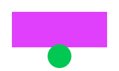

<div align="center">
  
  <h1>Centered heading</h1>
  <p><em>An italic tagline — centered under the heading.</em></p>
  <p>A multiplatform fork of <a href="https://example.com/tinta">Tinta</a>, moving the whole stack to Qt 6</p>
  <p>A longer centered paragraph with <strong>bold</strong>, <code>inline code</code> and a
  <a href="https://example.com/wrap">link that wraps</a> so that at narrow widths each wrapped
  line is centered by its own slack rather than the paragraph's widest line.</p>

  <a href="https://example.com/badge">
    
  </a>
  
  <p>Water is H<sub>2</sub>O, area is m<sup>2</sup>, <mark>marked</mark> and <del>deleted</del>.</p>
</div>

<p align="right">A right-aligned paragraph with a <a href="https://example.com">link</a>.</p>

<p>A left paragraph: text <b>bold</b> <i>italic</i> and <a href="https://example.com">a link</a> keep their spaces.</p>

<div align="center">

### Markdown heading in a centered div

A Markdown paragraph centered by the div around it, as GitHub renders a README.

</div>

## Markdown after the HTML block

Plain Markdown stays left aligned, with a [Markdown link](https://example.com) that has
no underline, **bold**, *emphasis* and `code`.

Inline HTML in Markdown: CO<sub>2</sub>, E = mc<sup>2</sup>, <mark>highlighted</mark>,
<del>struck</del>, <b>bold</b> and an <a href="https://example.com">HTML link</a>.

<sub>A small-print line written the way the README writes one.</sub>

> A quote with a [link](https://example.com).

| Column | Value |
| --- | --- |
| Link | [cell link](https://example.com) |

- A list item with a [link](https://example.com).
- A second item.

```text
A fenced block after the list.
```

All surrounding content renders after the aligned HTML.
